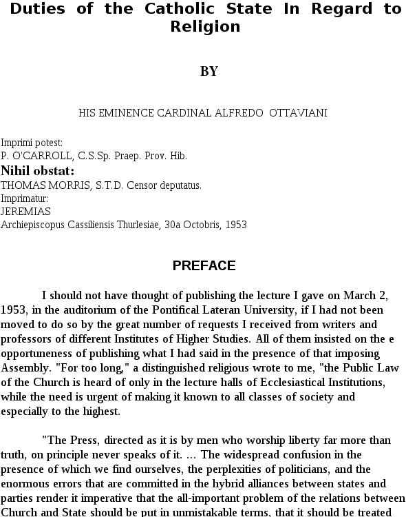

# Duties of the Catholic State in Regard to Religion

BY

HIS EMINENCE CARDINAL ALFREDO OTTAVIANI

[Imprimi potest:]{lang=la}\
P. O'CARROLL, C.S.Sp. [Praep. Prov. Hib.]{lang=la}

[**Nihil obstat:**]{lang=la}\
THOMAS MORRIS, S.T.D. [Censor deputatus.]{lang=la}

[Imprimatur:]{lang=la}\
[JEREMIAS]{lang=la}\
[Archiepiscopus Cassiliensis Thurlesiae, 30a Octobris, 1953]{lang=la}

## PREFACE

I should not have thought of publishing the lecture I gave on March 2, 1953, in the auditorium of the Pontifical Lateran University, if I had not been moved to do so by the great number of requests I received from writers and professors of different Institutes of Higher Studies. All of them insisted on the opportuneness of publishing what I had said in the presence of that imposing Assembly. "For too long," a distinguished religious wrote to me, "the Public Law of the Church is heard of only in the lecture halls of Ecclesiastical Institutions, while the need is urgent of making it known to all classes of society and especially to the highest.

"The Press, directed as it is by men who worship liberty far more than truth, on principle never speaks of it. ... The widespread confusion in the presence of which we find ourselves, the perplexities of politicians, and the enormous errors that are committed in the hybrid alliances between states and parties render it imperative that the all-important problem of the relations between Church and State should be put in unmistakable terms, that it should be treated fully, with the greatest clearness, and above all, fearlessly.

"Christian courage is a cardinal virtue which is called fortitude."

All these pressing importunities have convinced me that today, more than at any other time, it is necessary for every priest and every layman who collaborates in the apostolate of the clergy to imitate, as far as is possible for him, the example of the Divine Master who, speaking of Himself, said: "For this came I into the world: that I should give testimony to the truth" (St. John. 18:37).

Someone may be tempted to comment on the fact that I have not mentioned names of authors, even in the cases in which I have quoted extracts from their writings. I have not done so for two reasons: primarily, because it is of little importance to know that certain ideas have been defended by one or other writer, when they are so widely diffused that they can be no longer considered as the exclusive property of certain individuals; secondarily, because I have wanted to observe the rule laid down by St. Augustine who admonishes us to combat errors, not those who commit them. Thus also I have tried to follow the program and the example of the august Pontiff gloriously reigning, who has taken as the motto of his Pontificate: "Doing the truth in Charity."

Rome, March 25, 1953.

Alfredo Cardinal Ottaviani

## DUTIES OF THE CATHOLIC STATE IN REGARD TO RELIGION

It is not to be wondered at that the enemies of the Church have always striven to impede her mission, refusing to admit some, or even all, of her divine prerogatives and powers.

The fury of the attack, with its false pretenses, was already let loose against the Divine Founder of this two-thousand-year-old and yet ever youthful Institution. Against Him the cry was raised, the same that is raised today: "We will not have this man to reign over us."^[St. Luke 19: 14] And with the patience and the serenity that come to her from the secure foundation of her promised destiny and from the certainty of her divine mission, the Church sings throughout the centuries: "He who gives heavenly kingdoms does not take away earthly ones."

We are, however, astonished, and our astonishment grows into bewilderment and turns to sadness, when the attempt to deprive this beneficent mother, the Church, of the spiritual arms of justice and truth, is the work of the Church's own children. This is a particular cause of grief, when it is a question of her children dwelling in interconfessional States and thus in continual contact with non-Catholic brethren, since, more than any others, they should experience a debt of gratitude towards this mother, who has always made use of her rights, to defend, to protect and to safeguard her own faithful.

### CHARISMATIC CHURCH AND JURIDICAL CHURCH

Today some maintain that there is in the Church only a spiritual order, and from that they draw the conclusion that the nature of the Church's law is in contradiction with the nature of the Church herself. According to these people, the original sacramental element has grown continually weaker, giving way to the jurisdictional element, which is now the power of the Church. As the Protestant jurist Sohm holds, the idea has come to be accepted that the Church of God is constituted like the State.

But Canon 108, 3, which treats of the existence in the Church of the power of orders and of the power of jurisdiction, appeals to divine right. And that this appeal is justified, is proved by the texts of the Gospels, the affirmations of the Acts of the Apostles and the citations from their Epistles, all of which are frequently quoted by authors of treatises of Public Ecclesiastical Law in order to establish the divine origin of the above-mentioned powers and rights of the Church.

In the Encyclical Letter, [*Mystici Corporis*]{lang=la},^[Translation published by the Daughters of St. Paul. Available from Angelus Press.] the august Pontiff now gloriously reigning wrote about this point in the following terms: "We therefore deplore and condemn also the calamitous error which invents an imaginary Church, a society nurtured and shaped by charity, with which it disparagingly contrasts another society which it calls juridical. Those who make this totally erroneous distinction fail to understand that it was one and the same purpose - namely, that of perpetuating on this earth the salutary work of the Redemption - which caused the Divine Redeemer both to give the community of human beings founded by Him the constitution of a society perfect in its own order, provided with all its juridical and social elements, and also, with the same end in view, to have it enriched by the Holy Spirit with heavenly gifts and powers."

Accordingly, the Church does not desire to be a State, but her Divine founder has constituted the Church a perfect society, enriched with all the powers inherent in such a juridical condition, in order to accomplish its mission in every State, without conflicts between the two societies of which He is, though in different ways, the Author and the Support.

### ADHERENCE TO THE ORDINARY MAGISTERIUM

Here the problem presents itself of how the Church and the lay state are to live together. Some Catholics are propagating ideas with regard to this point which are not quite correct. Many of these Catholics undoubtedly love the Church and rightly intend to find a mode of possible adaptation to the circumstances of the times. But it is none the less true that their position reminds one of that of the faint-hearted soldier who wants to conquer without fighting, or of that of the simple, unsuspecting person who accepts a hand, treacherously held out to him, without taking account of the fact that this hand will subsequently pull him across the Rubicon towards error and injustice.

The first mistake of these people is precisely that of not accepting fully the "arms of truth" and the teaching which the Roman Pontiffs, in the course of this last century, and in particular the reigning Pontiff, Pius XII, by means of encyclicals, allocutions and instructions of all kinds, have given to Catholics on this subject.

To justify themselves, these people affirm that, in the body of teaching given in the Church, a distinction must be made between what is permanent and what is transitory, this latter being due to the influence of particular passing conditions. Unfortunately, however, they include in this second zone the principles laid down in the Pontifical documents, principles on which the teaching of the Church has remained constant, as they form part of the patrimony of Catholic doctrine.

[sec:pendulum]{.label} In this matter, the pendulum theory, elaborated by certain writers in an attempt to sift the teaching set forth in Encyclical Letters at different times, cannot be applied. "The Church," it has been written, "takes account of the rhythm of the world's history after the fashion of a swinging pendulum which, desirous of keeping the proper measure, maintains its movement by reversing it when it judges that it has gone as far as it should.... From this point of view a whole history of the Encyclicals could be written. Thus in the field of Biblical studies, the Encyclical, [*Divino Afflante Spiritu*]{lang=la}, comes after the Encyclicals [*Spiritus Paraclitus*]{lang=la} and [*Providentissimus*]{lang=la}. In the field of Theology or Politics, the Encyclicals, [*Summi Pontificatus*]{lang=la}, [*Non abbiamo bisogno*]{lang=it} and [*Ubi Arcano Deo*]{lang=la}, come after the Encyclical, [*Immortale Dei*]{lang=la}."^[Cf. [*Temoignage Chretien*]{lang=fr}, Sept 1, 1950 (Quoted in [*La Documentation Catholique*]{lang=fr}, October 8, 1950).]

Now if this were to be understood in the sense that the general and fundamental principles of public Ecclesiastical Law, solemnly affirmed in the Encyclical Letter, [*Immortale Dei*]{lang=la}, are merely the reflection of historic moments of the past, while the swing of the pendulum of the doctrinal Encyclicals of Pope Pius XI and Pope Pius XII has passed in the opposite direction to different positions, the statement would have to be qualified as completely erroneous, not only because it misrepresents the teaching of the Encyclicals themselves, but also because it is theoretically inadmissible. In the Encyclical Letter, [*Humani Generis*]{lang=la}, the reigning Pontiff teaches us that we must recognize in the Encyclicals the ordinary magisterium of the Church: "Nor must it be thought that what is expounded in Encyclical Letters does not of itself demand assent, in that, when writing such Letters, the Popes do not exercise the supreme power of their teaching authority. For these matters are taught with the ordinary teaching authority, of which it is true to say "He who heareth you heareth Me" (St. Luke 10:16); and generally what is expounded and inculcated in Encyclical Letters already belongs for other reasons to Catholic doctrine."^[[*Acta Apostolicae Sedis*]{lang=la}, Vol. XLIII, p. 568. The translation is that contained in Catholic Documents, Vol. III, published by the Pontifical Court Club, London.]

Because they are afraid of being accused of wanting to return to the Middle Ages, some of our writers no longer dare to maintain the doctrinal positions that are constantly affirmed in the Encyclicals as belonging to the life and legislation of the Church in all ages. For them is meant the warning of Pope Leo XIII who, recommending concord and unity in the combat against error, adds that "care must be taken never to connive, in anyway, at false opinions, never to withstand them less strenuously than truth allows."^[Encyclical Letter, [*Immortale Dei*]{lang=la}, *On the Christian Constitution of States*. (Translation as given in The Great Encyclical Letters of Pope Leo XIII, Benziger Brothers).]

### DUTIES OF THE CATHOLIC STATE

Having treated in succint fashion of the preliminary question of the assent that is due to the teachings of the Church, even in her ordinary magisterium, let us now pass on to a practical question, which in popular phraseology, we can call "burning," namely, that of a Catholic State and of the consequences that follow from it with regard to non-Catholic forms of worship.

It is known that in certain countries of which the absolute majority of the population is Catholic, the Catholic religion is proclaimed to be the religion of the State in their respective Constitutions. I shall mention as an example, the most typical case, namely, that of Spain. In Article 6 of the Spaniards' Charter, [*Fuero de los Espanoles*]{lang=es}, the fundamental Charter of the rights and duties of Spanish citizens, the following provisions are laid down:

[quote:fuero]{.label} "The profession and practice of the Catholic religion, which is the religion of the Spanish State, shall enjoy official protection. No one shall be molested for his religious beliefs nor for the private exercise of his cult. No ceremonies or external manifestations other than those of the State religion shall be permitted."

These provisions have provoked protests on the part of many non-Catholics and unbelievers; but what is more displeasing, they are considered as out-of-date by some Catholics. These people think that the Church can live peacefully and in the full possession of all the rights to which she is entitled in a lay-state, even when the State is composed of Catholics.

The controversy recently carried on between two authors of opposite views in a country beyond the Atlantic is widely known. One of the disputants has defended the thesis we have just mentioned and holds:

(1) The State, properly speaking, cannot accomplish an act of religion. (The State is a mere symbol or a collection of institutions).

(2) "An immediate illation from the order of ethical and theological truth to the order of constitutional law, is, in principle, dialectically inadmissible." That is to say, the State's obligation to worship God can never enter the Constitutional sphere.

(3) Finally, even for a State composed of Catholics, there is no obligation to profess the Catholic religion. With regard to the obligation to protect it, this does not become operative except in determined circumstances and precisely when the liberty of the Church cannot be guaranteed in any other way.

From such principles spring attacks directed against the teaching set forth in manuals of public ecclesiastical law, no account being taken of the fact that such teaching is based, for the most part, on the doctrine expounded in Pontifical Documents.

Now if, among the general principles of public ecclesiastical law, there is any certain and indisputable truth, it is that of the duty incumbent on the Rulers in a State composed almost entirely of Catholics, and which therefore ought to be governed by Catholics in a manner consistent with their religion, to mould the legislation of the State in a Catholic sense ...

[Three consequences follow immediately from this duty:]{.underline}

(1) [list:first]{.label} The social, and not merely the private, profession of the religion of the people;

(2) [list:second]{.label} Legislation inspired by the full concept of membership of Christ;

(3) [list:third]{.label} The defense of the religious patrimony of the people against every assault aimed at depriving them of the treasure of their faith and of religious peace.

I have said, first of all [list:first]{.ref}, that **[the State has the duty of professing its religion, even socially]{.underline}**.

Men living together in society are not less subject to God than they are as individuals, and civil society, no less than individual human beings, is in debt to God, "who gave it being and maintains it, and whose ever-bounteous goodness enriches it with countless blessings."^[[*Immortale Dei*]{lang=la}, [Acta Leonis XIII]{lang=la}, Vol. V, p. 122. (Translation as given in *The Great Encyclical Letters of Pope Leo XIII*, Benziger Brothers).]

Accordingly, as it is not lawful for any individual to neglect his duties to God and to the Religion according to which God wills to be honored, in the same way "states cannot without serious moral offense conduct themselves as if God were non-existent or cast off the care of religion as something foreign to themselves or of little moment."^[[*Immortale Dei, Acta Leonis XIII,*]{lang=la} Vol V, p. 123. (Translation as given in The American Ecclesiastical Review, May 1953).]

Pius XII reinforces this teaching, condemning "the error contained in conceptions such as do not hesitate to absolve civil authority from all dependence upon the Supreme Being, the First Cause and the Absolute Master both of man and of society, and from every bond of transcendent law which proceeds from God as from its Primary Source, and that concede to civil authority an unlimited power of action, a power left to the ever-changing wave of whims or to the sole restraints of contingent historical exigencies or of relative interests."^[[*Summi Pontificatus*]{lang=la} (Translation as given in The American Ecclesiastical Review, May 1953).]

And, continuing, the Supreme Pontiff shows clearly, also, what disastrous consequences for the liberty and rights of man follow such an error: "When the authority of God and the power of His law have been thus denied, the civil power, by a necessary consequence, tends to attribute to itself that absolute autonomy which belongs only to the Creator and to put itself in the place of the Omnipotent, raising the State or the collectivity to be the final end of life, the supreme criterion of the moral and juridical order."^[[*Summi Pontificatus.*]{lang=la}]

I have said, in the second place [list:second]{.ref}, that it is the duty of the Rulers to see to it that the **[moral principles of the True Religion inspire the social activity of the State as such and its legislation]{.underline}**.

This obligation on the part of the Rulers is a consequence of the duty of religion and of submission to God, not only on the part of individuals but also on the part of society, and its fulfillment will certainly contribute to the well-being of the people.

In opposition to the moral and religious agnosticism of the State and its laws, Pope Pius XII insisted upon the concept of the Christian State in his splendid Letter of October 19, 1945, for the Nineteenth Social Week of the Italian Catholics, in the course of which the problem of the new Constitution was to be studied.

"Reflecting seriously on the deleterious consequences which a Constitution, that abandons the 'corner stone' of the Christian concept of life and **attempts to base social life on moral and religious agnosticism,** would introduce into the bosom of society and into its ephemeral history, every Catholic will readily understand that the question which, before every other, ought at present to attract his attention and to spur him to action, is that of securing for this and future generations the benefit of a fundamental law of the State, which is not opposed to sound religious and moral principles, but which rather draws vigorous inspiration from them and proclaims and pursues their lofty aims."^[[*Acta Apostolicae Sedis*]{lang=la}, Vol. XXXVII, p. 274.]

In this connection, the Sovereign Pontiff has not failed to bestow "the praise due to the wisdom of those Rulers who have either always favored or have striven and known how to restore to honor, to the profit of their people, the value of Christian civilization, by establishing happy relations between Church and State, by safeguarding the sanctity of marriage, and by the religious education of youth."^[Christmas Radio Message, 1941. ([*Acta Apostolicae Sedis*]{lang=la}, Vol. XXXIV, p.13).]

In the third place [list:third]{.ref}, I have said that it is the duty of the Rulers of a Catholic State **[to ward off everything that would tend to divide or weaken the religious unity of a people that has the unanimous conviction of being in the secure possession of religious truth.]{.underline}** With regard to this point, there is an abundance of documents in which the Holy Father reaffirms the principles enunciated by his Predecessors, particularly by Leo XIII.

When condemning the religious indifferentism of the State in the Encyclical Letter, [*Immortale Dei*]{lang=la}, Pope Leo XIII appeals to the divine law, whereas in the Encyclical Letter [*Libertas*]{lang=la}, he appeals also to the principles of justice and to human reason. In the Letter, [*Immortale Dei*]{lang=la}, he makes it manifest that Rulers cannot "out of the many forms of religion adopt that one which pleases them,"^[Encyclical Letter, [*Immortale Dei*]{lang=la}.] because, as he explains, in the worship of God they are obliged to observe the laws and the forms of worship in accordance with which God Himself has commanded that He should be honored, "for we are bound absolutely to worship God in that way which He has shown to be His will."^[Encyclical Letter, [*Immortale Dei*]{lang=la}.] And in the Encyclical Letter, [*Libertas*]{lang=la}, he insists strongly on the same point, appealing to justice and to reason: "Justice forbids, and reason itself forbids, the State to be godless; or to adopt a line of action which would end in godlessness, namely to treat the various religions (as they call them) alike, and to bestow upon them promiscuously equal rights and privileges."^[Encyclical Letter, [*Libertas*]{lang=la} ([*Acta Leonis XIII*]{lang=la}, Vol. VII, p. 231. Translation as given in, *The Great Encyclical Letters of Pope Leo XIII*, Benziger Brothers. Available from Angelus Press.)]

The Pope appeals to justice and to reason, because it is not just to ascribe the same rights to good and to evil, to truth and to error. And reason revolts at the thought that, out of deference to the demands of a small minority, the rights, the faith, and the conscience of the quasi-totality of the people should be spurned, and that this people should be betrayed, by allowing the enemies of its faith to introduce division among its members with all the consequences of religious strife.

### FIRMNESS OF PRINCIPLES

These principles are firm and unchanging. They were valid in the days of Innocent III and Boniface VIII. They are valid in the days of Leo XIII and Pius XII, who has reaffirmed them in more than one of his documents. That is why, with unyielding firmness, he has also recalled Rulers to their duties, by appealing to the warning of the Holy Ghost, a warning which applies to all times. In the Encyclical Letter, [*Mystici Corporis*]{lang=la}, the Sovereign Pontiff, Pius XII, speaks as follows: "We must implore God that all those who rule over people may love wisdom,^[Cf. Wisdom 6:23.] so that upon them may never fall that fearful judgment of the Holy Spirit: 'The Most High will examine your works and search out your thoughts; because being ministers of his kingdom, you have not judged rightly nor kept the law of justice, nor walked according to the will of God. Horribly and speedily will he appear to you; for a most severe judgment shall be for them that bear rule. For to him that is little mercy is granted; but the mighty shall be mightily tormented. For God will not except any man's person, neither will he stand in awe of any man's greatness: for he made the little and the great, and he hath equally care of all.' "^[English C.T.S. Translation. The quotation from Scripture is from Wisdom 6:4-8.]

Referring back, then, to what I have said above [sec:pendulum]{.ref} concerning the agreement of the Encyclicals that have been called in question, I am certain that no one can prove that there has been any change whatever, in regard to these principles, between the Encyclical Letter, [*Summi Pontificatus*]{lang=la}, of Pius XII, and the Encyclicals of Pius XI, [*Divini Redemptoris*]{lang=la} against Communism, [*Mit brennender Sorge*]{lang=de} against Nazism, and [*Non abbiamo bisogno*]{lang=it} against the State-monopoly of Fascism, on the one hand; and the earlier Encyclicals of Leo XIII, [*Immortale Dei*]{lang=la}, [*Libertas*]{lang=la} and [*Sapientiae Christianae*]{lang=la}, on the other.

"The ultimate and supreme norms of society, those which are its foundation stone," declares the August Pontiff in his Radio-message of Christmas, 1942, "cannot be impaired or weakened by the intervention of human minds. They may be denied, ignored, despised, transgressed, but they can never be abrogated in a manner juridically efficacious."^[[*Acta Apostolicae Sedis*]{lang=la}, Vol.XXXV,pp. 13, 14.]

### THE RIGHTS OF TRUTH

Here it is necessary to answer another question, or rather, a difficulty, so specious that, at first sight, it may seem insoluble.

The objection is put to us: You maintain two different standards or norms of action according as it suits you. In a Catholic country, you uphold the doctrine of [the Confessional State]{.underline} with the duty of *exclusive* protection for the Catholic religion. On the other hand, where you form a minority, you claim *the right of toleration* or straightway the equality of forms of worship. Hence for you there are two weights and two measures. The result is a really embarrassing duplicity from which the Catholics who take account of the actual developments of civilization wish to be delivered.

Well, quite frankly, two weights and two measures *are* to be employed; one for truth, the other for error. Men who feel themselves in secure possession of truth and justice are not going to compromise. They demand full respect for their rights. How can those, however, who do not feel themselves secure in the possession of the truth, claim to hold the field alone, without sharing it with the man who claims respect for his own rights on the basis of other principles?

The concept of the equality of forms of worship and of tolerance has resulted from the doctrine of private judgment and from confessional multiplicity. It is a logical consequence of those opinions according to which, in the field of religion, there is no place for dogmas and that the individual conscience is the sole criterion and exclusive norm for the profession of faith and the exercise of worship. Accordingly, in the countries in which such theories flourish is it any wonder that the Catholic Church seeks to be in a position to develop her divine mission and to obtain recognition for those rights which she can claim, as a logical consequence of the principles accepted by the Legislatures of these countries?

The Church would prefer to speak and to put forward her claims in the name of God. But amongst these peoples the exclusive nature of her mission is not recognized. She is content, therefore, to plead her case in the name of that tolerance, of that equality, and of those common guarantees which inspire the laws and the lawgiving of these countries.

When, in 1949, there was held at Amsterdam a reunion of various heterodox bodies in view of furthering the ecumenical movement, there were represented in that assembly no fewer than 146 different Churches or Confessions. The delegates present belonged to about 50 nations. There were Calvinists, Lutherans, Copts, Old Catholics, Baptists, Waldenses, Methodists, Episcopalians, Presbyterians, Malabar Christians, Seventh-Day Adventists, etc.

The Catholic Church, knowing herself to be in firm possession of the truth and unity of Christ's Mystical Body, could not, logically, take part in such an assembly with a view to seeking there that union which the others have not got.

After lengthy discussions, the members of the assembly were not even in agreement for a final celebration in common of the Eucharistic Banquet, which was to be the symbol of their union, if not in faith, at least in charity. Such was the lack of unity that, in the plenary session of August 23, 1949, Dr. Kraemer, a Dutch Calvinist, who has since become the Director of the new ecumenical Institute of Celigny in Switzerland, remarked that it would have been preferable to omit the Eucharistic Banquet altogether rather than manifest so great a lack of unity by holding many separate celebrations.

In such conditions, I say, could one of these Confessions coexisting with the others, or even predominant, in one and the same State, adopt an intransigent attitude and claim for itself what the Catholic Church expects from a State in great majority Catholic?

It ought not, therefore, be a matter for wonder that the Church appeals to and demands recognition for the rights of man at least, when the rights of God are not acknowledged. This the Church did in the first centuries of Christianity when confronted with the Roman Empire and the pagan world; this she continues to do today, especially in those places where every religious right is denied, as in the countries under Soviet domination.

In the presence of the persecutions, to which all Christians are subjected, and Catholics first of all, how could the reigning Pontiff not appeal to the rights of man, to tolerance, to the freedom of consciences, precisely when such frightful havoc is being played with these rights?

He vindicated these rights of man in every sphere of individual and social life in his Christmas message of 1942, and, more recently, in the Christmas message of 1952, in connection with the sufferings of the "Church of silence."

It is clear, therefore, how wrong is the attempt being made to give the impression that the recognition of the rights of God and of the Church, which existed in the past, is irreconcilable with modern civilization, as if the fact of accepting what is just and true for all times constituted a retrogression.

For example, a well-known author alludes to the Middle Ages as follows: "The Catholic Church insists on this principle that truth should have precedence over error, and that, when the true religion is known, it should be aided in its spiritual mission in preference to religions of which the message is more or less halting and feeble and in which error is mingled with truth. That is simply a consequence, flowing from the duty of man to truth. It would, however, be very false to draw from it the conclusion that this principle can be applied only by demanding for the true religion the favors of an absolute power, or the assistance or dragonnades, or that the Catholic Church claims from modern societies the privileges she enjoyed in a civilization of the 'sacral' type, like that of the Middle Ages."

In order to do his duty, a Catholic Ruler of a Catholic State need not be an absolute monarch, nor a mere policeman, nor a sacristan, and need not return to the whole organization of the Middle Ages.

Another author objects: "Almost all those who, up to the present, have tried to reflect upon and to examine the problem of religious pluralism have come up against a dangerous axiom, namely, that truth alone has rights, while error has none. As a matter of fact, all see today that this axiom is fallacious, not indeed because we want to grant rights to error, but simply because we have become aware of the self-evident truth that neither error nor truth, which are abstractions, are the objects of rights, or are capable of having rights, that is, of begetting reciprocal duties between person and person."

It seems to me, on the contrary, that the self-evident truth consists rather in this, namely, that the rights in question are to be found perfectly, as in their subjects, in the individuals who are in the possession of the truth, and that other individuals cannot claim equal rights, by reason of their error.

Now, in the Encyclicals we have quoted, it is laid down that the first Subject of these rights is God Himself. From this it follows that only those who obey His commands and who possess His truth and His justice have true rights.

In conclusion, the synthesis of the doctrines of the Church on this subject has been set forth in the most unequivocal fashion, even in our day, in the Letter which the Sacred Congregation for Studies in Seminaries and Universities sent to the Bishops of Brazil on March 7, 1950. This Letter, which refers continually to the teachings of Pius XII, amongst other things, contains a warning against the errors of renascent Catholic Liberalism which "admits and encourages the separation of the two powers and denies that the Church has any kind of direct power over mixed matters. It affirms that the State ought to show itself indifferent in regard to religion, and recognize the same freedom to truth and error. The Church ought not to enjoy any privileges, favors or rights superior to those recognized to the other religious bodies in the other Catholic countries, and so on.

### CONTRASTING TYPES OF LEGISLATION

Having examined the question from the doctrinal and juridical points of view, I now beg to be permitted to make a brief excursion into the practical domain. I mean to speak of the difference and the disproportion between the outcry raised against the principles set forth above, when actually realized in the Spanish Constitution [quote:fuero]{.ref}, and the slight resentment which, on the other hand, the whole laicized world has shown against the Soviet legislative system that oppresses all religion. And yet, as a result of that system, innumerable are the martyrs that languish in the concentration camps, in the Steppes of Siberia, in the prisons, not to speak of the legions of those who, at the cost of their lives and of all their blood, have experienced the iniquity of Soviet legislation to the utmost.

Article 124 of Stalin's Constitution, promulgated in 1936, and closely connected with the laws on religious associations of the years 1929 and 1932, reads as follows:

[quote:art124]{.label} "In order to secure freedom of conscience for the citizens, the Church is separated from the State, and the school from the Church. Freedom of religious profession and freedom of anti-religious propaganda are recognized for all the citizens."

Leaving out of consideration the offense committed against God, against all religion, and against the consciences of believers, by the fact that the Constitution guarantees complete freedom for anti-religious propaganda, which is carried on in the most licentious manner, we must bring out clearly in what consists the famous liberty of faith guaranteed by the Bolshevik law.

The existing rules regulating the exercise of forms of worship are gathered together in the law of May 18, 1929, which gives the interpretation of the corresponding article of the 1918 Constitution and in the spirit of which article 124 of the present Constitution is drawn up. Every possibility of religious propaganda is excluded and only freedom for anti-religious propaganda is guaranteed. As regards worship, it is allowed only in the interior of Churches. Every possibility of religious formation is forbidden, whether by way of discourses, or through the press, or by means of journals, books, pamphlets, etc. Every form of social and charitable initiative is ruled out, and the organizations that are inspired by these ideals are deprived of every fundamental right to sacrifice themselves for the good of their neighbors.

In proof of all this, it is enough to read the summary of this state of things given by a Soviet Russian, Orleanskij, in his treatise entitled *Law Concerning Religious Associations in the Socialist, Federal, Soviet Russian Republic*.

"Liberty of religious profession signifies that the action of believers in the profession of their particular religious dogmas is limited to the believers' sphere itself and is considered as strictly bound up with the religious worship of one or other of the religions tolerated in our State. ... Consequently, any kind of propaganda and every form of recruiting activity on the part of Churchmen or of Religious - and [a fortiori]{lang=la} of missionaries - cannot be considered as an activity allowed them by the law concerning religious associations, but must be reckoned as going beyond the limits of religious freedom protected by the law. Accordingly, it becomes the object of the penal and civil laws insofar as it is opposed to them."^[This work was published in Moscow in 1930. The quotation is taken from page 234.]

The struggle waged against religion is, in addition, carried on also by the State in the domain of all the activities which the practice of the Gospel implies of itself, both in regard to morality and in the social relations between human beings. The Soviet leaders have a clear grasp of the fact that religion is intimately linked up with the life of the individual members of society and the life of society itself. Accordingly, in order to combat religion, they seek to crush every form of religious activity in the field of education, morality and social life. Here is the testimony of a Soviet writer^[Author of the article entitled *Stalin's Constitution and Freedom of Conscience* in [*Sputnik Antireligioznika*]{lang=ru-Latn}, Moscow, 1939, pp. 131-133.] concerning this point: "The anti-religious propagandist," he states, "must remember that, though Soviet legislation allows every citizen freedom to perform acts of worship, it at the same time restricts the activity of the religious organizations, which have not the right to interfere in the politico-social life of the U.S.S.R. Religious associations are allowed to occupy themselves uniquely and exclusively with matters concerning the exercise of their worship, and with nothing else. Priests are not allowed to publish obscurantist publications, or to carry on propaganda for their reactionary and anti-scientific ideas, in the factories or workshops, or in the [Kolchoz]{lang=ru-Latn}, the [Sovchoz]{lang=ru-Latn}, the clubs and the schools. In virtue of the law of April 8, 1929, religious associations are forbidden to found sick-funds, co-operative societies or societies for production, and in general are forbidden to make use of the goods at their disposal for purposes other than those comprised within the sphere of religious needs."

Accordingly, before attacking Catholic Rulers who accomplish their bounden duty towards the Religion of their fellow-citizens, the defenders of the "rights of man," should examine a situation so offensive to the dignity of man, no matter what his religion, especially when a third of the total population of the world is crushed beneath that yoke!

### TOLERATED FORMS OF WORSHIP

The Church also recognizes the necessity in the case of certain Rulers of Catholic countries to tolerate other forms of worship for very serious reasons. "The Church, indeed," Pope Leo XIII teaches, "deems it unlawful to place the various forms of divine worship on the same footing as the True Religion, but does not, on that account, condemn those rulers who, for the sake of securing some great good or of hindering some great evil, patiently allow custom or usage to be a kind of sanction for each kind of religion having its place in the State."^[Encyclical Letter [*Immortale Dei*]{lang=la}, [*Acta Leonis XIII*]{lang=la}, Vol. V. p. 241. Translation as given in, *The Great Encyclical Letters of Pope Leo, XIII*, Benziger Brothers.]

But tolerance does not mean freedom to carry on propaganda which foments religious discord and disturbs the tranquil and unanimous possession of the truth and perseverance in the practice of religion, in countries such as Italy, Spain and others.

Referring to the Italian laws on the "admitted forms of worship," Pius XI wrote: "Forms of worship 'tolerated, permitted, admitted'; We have no desire to raise difficulties about the terms employed. So far as that goes, the question can be elegantly solved by distinguishing between the Constitution of the State and State legislation. The former is of itself more theoretical and doctrinal, and the word 'tolerated' is there more suitable; the latter is intended to be applied to practical life, and one can employ the words 'permitted' or 'admitted' in such a context, on condition that they be understood unequivocally. For that, it must be and remain clearly and unequivocally understood that the Catholic Religion and the Catholic Religion alone, according to the Statute and the Treaties, is the Religion of the State, with the logical and juridical consequences of such a situation according to Constitutional law, particularly in regard to propaganda.

... It is not admissible that these words should be understood in the sense of absolute freedom of discussion, that is to say, a freedom comprising those forms of discussion that can easily deceive the good faith of poorly-instructed hearers and which quickly degenerate into camouflaged forms of propaganda, becoming just as readily injurious to the Religion of the State and, by that very fact, to the State itself, and precisely in regard to the point which the tradition of the Italian people holds most sacred and its unity most essential."^[Letter of May 30th, 1929, to Cardinal Gasparri on the Lateran Treaties.]

But the non-Catholics, who would like to come to evangelize the countries from which the light of the Gospel took its rise and was diffused even unto them, are not satisfied with what the law concedes to them. In opposition to the law and without even submitting to the formalities it lays down, they would like to have unrestricted license to break up the religious unity of Catholic peoples. And they complain if the Governments close chapels, opened without even the required authorization, or expel the so-called "missionaries" who came into the country for purposes other than those stated in the requests for permission to enter. It is worthy of note also that, in this campaign, the Communists are among their most vigorous allies and defenders. Thus, those who, in Russia, forbid all religious propaganda and incorporate that principle in the article in the Russian Constitution we have quoted [quote:art124]{.ref}, are, on the other hand, full of zeal in helping every form of Protestant propaganda in Catholic countries.

Unfortunately, in the United State of America, where many non-Catholic brethren are ignorant of certain circumstances both of fact and of law that concern our countries, there are to be found imitators of the Communists' zeal in protesting against our pretended intolerance in regard to the missionaries sent to "evangelize" us.

But, why, pray, should the Italian authorities be denied the right to do in their own country what the American authorities do in theirs, when they apply, with unyielding firmness, laws made expressly in order to prevent entrance into their territory, or even to expel from it, those who are reckoned as dangerous by reason of certain ideologies and who are considered capable of doing harm to the free traditions and institutions of the Fatherland?

On the other hand, if the believers beyond the Atlantic, who collect funds for their missionaries and for the neophytes won over by their preaching, were aware that the majority of those "converts" are authentic Communists, who do not care a lot about the things of religion except when it is a question of insulting Catholicism, while they are deeply interested in enjoying the largesses that arrive abundantly from beyond the ocean, I believe that they would think twice before sending sums that, in the last analysis, only serve to encourage Communism.

### WITHIN THE TEMPLE AND OUTSIDE THE TEMPLE

There is one last question which frequently forms the subject-matter of present-day discussions. It concerns the pretension of those who would like to determine of themselves, according to their own judgment and their own views, the Church's sphere of action and the limits of her competence, in order to be able to accuse her of "interfering in politics," in case she goes outside that sphere.

This is the pretension of all those who would like to shut up the Church within the four walls of the temple, by separating religion from life, the Church from the world.

Now, the Church must hearken to the commandments of God rather than to the pretensions of men. "Preach the Gospel to every creature."^[St. Mark 16:15.] And the Gospel comprises the whole of Revelation with all the consequences that it entails for the moral conduct of man, with regard to his individual life, in his family life, and from the point of view of the good of the community or city ([polis]{lang=grc-Latn}).

"Religion and morality," teaches the august Pontiff, "in their close union constitute an indivisible whole. The moral order, the commandments of God, are equally binding in every field of human activity without any exception. And as far as these reach out, thither extends also the mission of the Church and therefore also the word of the priest, his teaching, his admonitions, and his counsels to the faithful committed to his care.

"The Catholic Church will never allow herself to be shut up within the four walls of the temple. The separation between religion and life, between the Church and the world, is contrary to the Christian and Catholic idea."

In particular with apostolic firmness, the Holy Father continues:

"The exercise of the right to vote is an act of grave moral responsibility, at least where there is question of electing the men who are called upon to give the country its constitution and its laws, especially those laws that concern, for example, the sanctification of Holydays, marriage, the family, the school, and the regulation of manifold social conditions in accordance with equity. It pertains to the Church, therefore, to explain to the faithful the moral duties that spring from that right to vote."^[Lenten Discourse of 1946 to the Parish Priests and Lenten Preachers of Rome. [*Acta Apostolicae Sedis,*]{lang=la} XXXVIII, 187.]

And the Church carries on this struggle, not from the desire of earthly advantages, nor for the sake of depriving Civil Rulers of that power which the Church cannot and must not aspire to - "He who bestows heavenly kingdoms does not take away earthly ones"^[Hymn for the Feast of the Epiphany.] - but for the reign of Christ, in order that the "Peace of Christ in the Reign of Christ" may be realized. It is for this that the Church unceasingly preaches, teaches and combats unto victory.

It is for the same end that She suffers, weeps and sheds her blood. But the path of sacrifice is precisely that by which the Church is accustomed to attain her triumphs. Pius XII recalled this in his Radio-message of Christmas, 1941

"We behold today, beloved sons, the God-man, born in a cave in order that He might raise man to the greatness from which he had fallen by his own fault, and place him again on the throne of freedom, justice and honor, which the centuries of false gods had denied him. The foundation of that throne will be Calvary. Its ornament will not be gold or silver, but the Blood of Christ, Divine Blood, which for twenty centuries flows over the world and dyes purple the cheeks of His Spouse, the Church, and purifying, consecrating, sanctifying, glorifying the children of the Church, becomes celestial brightness. O Christian Rome, that Blood is thy Life."^[[*Acta Apostolicae Sedis*]{lang=la}, Vol. XXXIV, pp. 19, 20.]

<!--
Transcription notes
Source: "Duties of the Catholic State - Ottaviani, Card. Alfredo_4570.epub"
(dgoodmaniii/breviary_1948). The EPUB is a single XHTML text file (Word ->
HTML export, ~7,700 words); it contains no page scans, so there was no OCR
layer to bypass and no page numbers to preserve. The only image is the cover.

Silent mechanical fixes: soft hyphens (decoded as U+FFFD) removed; stray
entity/fragment residue removed ("fearlessly.y.", "Church.h.h.",
"injustice.e.e.e.e.e.", "permitted."t;", "State."t;t;t;", "insoluble.e.e.e.",
"in n n succint", ", , Mystici Corporis"); non-breaking-space indentation
and double spaces collapsed; two U+FFFD quotation marks restored as ' and ".

Text corrections (source reading -> transcribed):
  "the e opportuneness"   -> "the opportuneness"
  "at least in charily"   -> "at least in charity"
  "August 23,1949. Dr."   -> "August 23, 1949, Dr."
  "Mil brennender Sorge"  -> "Mit brennender Sorge"
  "Spiritus *Paraclitus*" -> "*Spiritus Paraclitus*" (italics span)
  fn 6 "Immortate Dei, Acta LeonisXIll" -> "Immortale Dei, Acta Leonis XIII"
  fn 19: title italics split so the journal name stands alone.

Left as in source: "succint", "in anyway", "Espanoles", "Temoignage Chretien",
"United State of America", "Leo, XIII" (fn 20), missing colon after
"Christmas, 1941", unclosed quotation in the Brazil letter paragraph.

Cross-references: no page references exist; prose back-references were
tagged with matching {.ref}/{.label} pairs (list:first/second/third,
sec:pendulum, quote:fuero, quote:art124). "the Encyclicals we have quoted"
(The Rights of Truth) is too general to point at one target and is untagged.
-->
