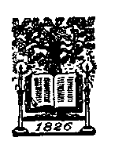

# Characters of the Inquisition

By William Thomas Walsh

Author of "Philip the Second," "Isabella of Spain"

P. J. Kenedy & Sons, Publishers, New York

## Foreword

[page:vii]{.label}

THE very word "Inquisition," which once enjoyed the connotation, as well as the meaning, of "inquiry," has become almost synonymous in the modern world with "bigotry," "intolerance," "cruelty." Men who are not quite sure what are the essentials of Christian belief are convinced that the burning of a human being for denying certain dogmas is not reconcilable with the teachings of Christ and the profession of a Christian. Men who cannot agree on a definition of the word "God," and are doubtful whether they believe in a God, will declare without hesitation that there is nothing godly about inflicting personal injury, or even deprivation of liberty, on those who do not agree with us. And since the Inquisitors were Catholics, it is clear that the Catholic Church in the modern world has suffered much in reputation on their account; the more so because the histories of the Inquisition have generally been written and disseminated by her adversaries.

A young Catholic sometimes is puzzled not only to answer the accusations of those not of his Faith but to satisfy the questionings of his own heart. He knows some priests, and whatever faults they have as human beings, they are not bloodthirsty men, quite the contrary as a rule; he knows Protestants and Jews, and sees nothing in them deserving of torment, much less hideous death. Some have left the Catholic fold, alleging this reason; others, attracted to her, have been kept outside by this one obstacle. No one sees Catholics today burning unbelievers, even in Ireland and Portugal, where the population is almost entirely Catholic; nor does any man of sense foresee the likelihood of a future persecution involving Catholics—except, perhaps, as victims. Yet vast numbers of persons continue to associate the word "Inquisition" with vague notions of Catholic dogma; as though the thing were essentially and peculiarly Catholic, and began and ended in the Catholic Church.

It must be obvious to anyone who thinks for a moment on the subject that intolerance, as such, was not the invention, much less the monopoly, of the Middle Ages. It was not the child of Christianity. Centuries before Christ came to the world, Plato set it down as a *duty* of government to show no tolerance toward those who denied the state religion. Even if dissenters were willing to live quietly without proselytizing, their example to others was so dangerous, he believed, that they ought to be incarcerated for five years in a "*[sophronisterion]{lang=grc-Latn}*," or place-for-growing-wise, and there be taught religion every day. Proselytizing dissenters were to be kept in dungeons for life and be denied burial after death. Centuries later we find Jews in Holland, whose ancestors had been victims of the Spanish Inquisition, establishing an Inquisition of their own. "The Amsterdam rabbis," says Graetz, "introduced the innovation of bringing religious opinions and convictions before their judgment seat, of constituting themselves a sort of inquisitorial tribunal, and instituting *[autos-de-fe]{lang=es}* which, even if bloodless, were not less painful to the sufferers."^[*History of the Jews,* Vol. IV, pp. 684–5.]

This Jewish Inquisition was on a different plane from Plato's, and a higher one. He was a totalitarian who conceded to the State the right to say what religion must be held. The rabbis were men who felt a *certainty* of a higher revelation, more precious to them than any other consideration; and the force they applied was to those who already belonged to the group that had received the revelation—in this instance, the *[Torah]{lang=he-Latn}*. It was not an intolerance in the name of an all-powerful state, representing the mere *opinion* of a group of human beings.

Now, when we examine the Inquisition of the Middle Ages and the Spanish Inquisition more closely, we find certain peculiarities which bring them closer to the Amsterdam rabbis than to Plato. The impulse here is different from that swift blind anger and bloodlust of the mob from which defenseless Jews, women and children included, have suffered in pogroms in all parts of the world. It is not like the shootings of children and nuns by Cromwell's Puritans in Ireland; or the lynchings of negroes; or the butchery of civilians, with or without a pretence of legal form, in the French Revolution, in Soviet Russia, and in Red Spain. Here, on the contrary, was a cold, deliberate attempt to set up a judicial instrument of conformity which would eliminate the caprice, the anger and the misinformation of the mob; which would inquire carefully, make distinctions, separate wheat from chaff, proceed not against particular men or members of particular races as such, but against members of the persecuting body—all this in the name of Almighty God, and apparently with a sense not only of representing the highest convictions of the community in general, but of being absolutely right about the whole matter, beyond any argument or need of apology.

There has been too much partisanship in most of the discussions of this subject; too much intolerance in the study of intolerance. The more popular expositions have been in the vein of Prescott's famous comparison of the Inquisitors (unfavorably, of course) to the Aztecs sacrificing human blood to their idol Quetzalcohuatl; or some of Dr. Graetz's angry generalizations, in which the Dominicans of the Holy Office appear as "Calibans" and "foul fiends in monkish cowls," while the heretics punished by them are "victims to the Christian Moloch." Later investigators have been more temperate in their epithets and more cautious in their methods of approach; but too many of them have leaned, with naïve credulity, upon the work of Llorente, a discredited official of the Holy Office, who proved his own bias by admitting that he had burned documents which did not serve his purpose. Lea has depended somewhat upon Llorente, but has also done some good source work, though prejudice has betrayed him into taking some unscholarly liberties with his material. G. G. Coulton has flayed the Inquisition with gusto, but when we look for his authority, we find it is principally Dr. Lea. The same is true of most of the work of Professor Merriman of Harvard on this subject. One great "authority" leans on another great "authority," and so on back to the end of a chain, where often the searcher finds no fact at all, or the very opposite to what has been alleged to generation after generation of trusting readers and students. These modern "authorities," writing with a greater air of scientific detachment, have probably been more effective, on the whole, than Prescott or Graetz.

It is rather startling, on turning from these types of criticism to the literature of Spain and Portugal, to find that men revealing intelligence, compassion, and other normal human traits in most matters, have been capable of writing about the institution, without a word of apology, yes, with unmistakable pride, as of something good, beneficent, holy. It is a bit of a jolt for one in youth illuminated by Dr. Lea and his disciples, to encounter, in the works of one of the most brilliant poets and historians of the Golden Age of Spain, the casual observation that the Inquisition was "the den of the lions of Daniel, which does no harm to the just, though it destroys the obstinate impenitent sinners; heavenly remedy, guardian of the Gates of Paradise."^[Cabrera, *[Felipe el segundo]{lang=es}*, t. I, p. 276.] A man as gentle and holy as Fray Luis de Granada could call it "wall of the Church, pillar of truth, guardian of faith, treasure of religion, arm against heretics, light against the deceits of the enemy."

Paramo goes even further, and tells us that the Great Inquisitor was Our Lord and Saviour Jesus Christ; indeed, this author carries his investigation further back, and discovers that the first Inquisitor was our father Adam!

Now, there is no sense in reviving so painful and controversial a subject as the Inquisition, a thing which persecutes nobody today and has not the slightest chance of doing so, if the motive is merely to add fuel to ancient hatreds which still divide man from man, and men from God. To make Catholics, Protestants, or Jews odious one to another, or to the rest of mankind, would surely be a useless, indeed, a wicked performance; and it is one I wish to have nothing to do with. But there is always something to be gained in the search of truth for the sake of truth itself, beautiful truth, luminous and eternal, the Thing that is, and not what hatred or envy, or greed or fear or revenge would like to imagine. There is something, surely, to be gained in saying, "Let us look at the past, not merely to justify ourselves, for we frail mortals have all made mistakes, we have all been guilty one time or another of injustice toward others. Well, then, let us see, if possible, what the truth was, and what can be learned from it—if only to avoid the same mistakes in future."

It would be fatuous to imagine that anything like the complete and absolute truth about so vast and so complicated a subject could be encompassed within the scope of the present study, even if the author were much more capable than he is. A life-time of useful labor is still waiting for some man with the patience and industry of Lea, a far better historical imagination, and considerably less prejudice. All I attempt here is to discuss a few characters through whom the Inquisition is revealed at various critical stages, and to suggest some important considerations that have been generally overlooked.

While I was wondering where this inquisitorial spirit, as distinguished from ordinary forms of intolerance, first made its appearance in the chronicle of man, I happened to notice in the *Book of Deuteronomy* a passage suggesting that what I sought had not originated in Fifteenth Century Spain or in Thirteenth Century France; that Paramo was right, after all, in a certain sense—in the sense in which Christianity is older than the Incarnation, existing as it did in the minds of the Hebrew prophets centuries before the birth of Our Lord. The Catholic Church has always insisted, even in our times and in the face of all opposition, that (in the phrase of Pope Pius XI) "spiritually we are all Semites." And in no flippant, analogical or allegorical sense, but in sober earnest, I came to the conclusion that the first real Inquisitor, as a Torquemada would have understood the word, was Moses. He was quite certain that he had compulsive truth from a higher than human source; he was resolved to keep it and sustain it at all costs; and the means he adopted were essentially those of the Medieval Inquisition, even more irritating if possible to some persons, and not always understood in their own background by later ages. Moses put to death, in the name of religion, a far greater number of human beings than Torquemada did. Yet his name has been venerated by orthodox Jews and Roman Catholics alike, and always will be, while that of the Dominican monk has become a stench in the nostrils of the modern world, and a symbol of something indefensible. All this will bear examination.

## Contents

| | | Page |
|---|---|---:|
| | Foreword | [page:vii]{.ref} |
| I | Moses | [page:1]{.ref} |
| II | Pope Gregory IX | [page:21]{.ref} |
| III | Bernard Gui | [page:50]{.ref} |
| IV | Nicholas Eymeric | [page:89]{.ref} |
| V | Torquemada | [page:131]{.ref} |
| VI | Cardinal Ximenes | [page:181]{.ref} |
| VII | Some Sixteenth Century Victims | [page:214]{.ref} |
| VIII | Llorente | [page:266]{.ref} |

## I. Moses

[page:1]{.label}

MOSES appeared among the children of Israel (as Christ would appear) in one of the darkest hours of their history.

Jacob had been gathered to his fathers, leaving behind him a prophecy, that was to be quoted for and against the Jews many centuries later, even in medieval Spain:

> "The sceptre shall not be taken away from Juda, nor a ruler from his thigh, till he come that is to be sent, and he shall be the expectation of nations, tying his foal to the vineyard, and his ass, o my son, to the vine. He shall wash his robe in wine, and his garment in the blood of the grapes. His eyes are more beautiful than wine, and his teeth whiter than milk."^[*Genesis,* XLIX: 10–12. This and all other biblical quotations in this work are from the Douay Version.]

The children of Israel remained in the land of Egypt, multiplied and prospered. Their numbers aroused the fear, as their prosperity incited the envy, of the dwellers of the Nile, who "made their life bitter with hard works in clay, and brick, and with all manner of service, wherewith they were overcharged in the works of the earth," until at last King Pharao, having failed to impose a sort of birth control on the Hebrews by corrupting their widwives, condemned all their male babies to be cast into the Nile—even as Herod, in his fear and jealousy of Christ, would deal with the male infants of Bethlehem.

It was at this moment of danger that Moses, precursor and prophet of the Messias, was born of a Levitical family, in which there were already two children, a son, Aaron, and a daughter, Miriam (Mary). The mother was a resourceful woman. She hid her baby in a basket of bulrushes, calked and camouflaged with pitch and mud, and laid him in shallow water, among the sedges by the river's brink. The girl Miriam, watching from a distance, saw the daughter of Pharao go down with her maidens to bathe, open the basket, discover the crying infant, and take compassion on him, saying, "This is one of the babes of the Hebrews!"

Miriam stepped forward and said, "Shall I go and call to thee a Hebrew woman, to nurse the babe?"

"Go," said the Princess.

Miriam of course fetched her own mother, who took him and nursed him, as another Hebrew woman, a greater Miriam, centuries later would nurse the Holy Child in Egypt. Pharao's daughter called him Moses, "because," she said, "I took him out of the water;" and when he grew up, she adopted him.^[*Exodus,* II: 10.] He became a powerful lad, strikingly handsome, with a majestic presence, a quick temper, and a great deal of natural wisdom, with a certain diffidence and humility—Moses never could speak, for example, with the burning eloquence of his older brother; he may even have stammered a little. But he had a more profound intelligence than Aaron, and according to Rabbinical tradition, he was well taught in the lore of the Egyptians, the Assyrians, the Chaldaeans and the Greeks. The sufferings and sorrows of his people afflicted him, and he must have brooded long and often on how they could be redeemed from their servitude to a people spiritually inferior, who worshipped false gods made with human hands and had many base customs. One day he saw an Egyptian brutally striking a Hebrew workman. "And when he had looked about, this way and that way, and saw no one coming, he slew the Egyptian and hid him in the sand."

Moses supposed that he was unseen, but the next day, stopping a quarrel between two of his own race, he found that one of them knew what he had done, and in resentment threatened to report the matter, as in fact he did: and Moses, condemned to death, fled to the land of Madian.

There, tired and dusty, he sat down by a well, as a far greater Man would sit by the well of Jacob in Samaria: and there came seven maidens, all daughters of the priest of Madian, to draw water for their sheep. Some shepherds arrived, and either out of deviltry, or because water was scarce, began to drive the girls away. To their great surprise, a powerful youth in Egyptian raiment rose up from beside the well, and gave them a thrashing; and after they had fled, Moses gallantly watered the flock for the young women.^[*Ibid.,* II: 15–17.]

The upshot of all this was that he married one of the girls, Sephora, had two children by her, and remained for some years in the land of Madian, until Pharao died, "and the children of Israel groaning, cried out because of the works: and their cry went up unto God from the works. And he heard their groaning, and remembered the covenant which He made with Abraham, Isaac and Jacob.^[*Ibid.,* II: 23–24.]

"Now Moses fed the sheep of Jethro his father-in-law, the priest of Madian: and he drove the flock to the inner parts of the desert, and came to the mountain of God, Horeb. And the Lord appeared to him in a flame of fire out of the midst of a bush: and he saw that the bush was on fire and was not burnt. And Moses said, I will go and see this great sight, why the bush is not burnt. And when the Lord saw that he went forward to see, he called to him out of the midst of the bush, and said, 'Moses, Moses.'

"And he answered, 'Here I am.'

"And he said, 'Come not nigh hither, put off the shoes from thy feet: for the place whereon thou standest is holy ground.'

"And he said, 'I am the God of thy father, the God of Abraham, the God of Isaac, and the God of Jacob.'

"Moses hid his face: for he durst not look at God.

"And the Lord said to him, 'I have seen the affliction of my people in Egypt, and I have heard their cry because of the rigour of them that are over the works: and knowing their sorrow, I am come down to deliver them out of the hands of the Egyptians, and to bring them out of that land into a land that floweth with milk and honey, to the places of the Chanaanite, and Hethite, and Amorrhite, and Pherezite, and Hevite, and Jebusite. . . . But come, and I will send thee to Pharao, that thou mayst bring forth my people, the children of Israel out of Egypt.'"

Moses was terrified in such a Presence.

"Who am I," he said, "that I should go to Pharao, and should bring the children of Israel out of Egypt?"

The Lord replied, "I will be with thee: and this shalt thou have for a sign that I have sent thee: When thou shalt have brought my people out of Egypt, thou shalt offer sacrifice to God upon this mountain."

Moses was a practical person, accustomed to looking ahead. What would the children of Israel say when he told them, "The God of your fathers hath sent me to you?" Would they not say, "What is his name?" What then?

The voice of the Almighty answered,

"I AM WHO AM. Thus shalt thou say to the children of Israel: He WHO IS hath sent me to you."

Moses still hesitated, even after God performed two miracles to convince him—the turning of the rod into the serpent, and the momentary leprosy that whitened his hand and disappeared as it came.

"I beseech thee, Lord, I am not eloquent from yesterday and the day before: and since thou hast spoken to thy servant, I have more impediment and slowness of tongue."

"Who made man's mouth? or who made the dumb and the deaf, the seeing and the blind? Did not I? Go therefore, and I will be in thy mouth: and I will teach thee what thou shalt speak."

"I beseech thee, Lord, send whom thou wilt send."

The Lord now was angry, but He gave Moses one more chance. He suggested Aaron as spokesman for his slow-tongued brother: "He shall speak in thy stead to the people, and shall be thy mouth: but thou shalt be to him in those things that pertain to God."

The last objection having been removed, Moses obeyed. Setting his wife and sons upon an ass, he started on the long journey to Egypt, assembled there the ancients of the people, the earliest known Sanhedrin, and spoke as he had been instructed. "And the people believed . . . and falling down, they adored."

How Moses and Aaron went to Pharao (Moses was then eighty years old, his brother three years older), and how the King refused to let the children of the promise go into the wilderness: how he caused them to make bricks without straw, and had them scourged until they cried out against Moses and Aaron, saying "The Lord see and judge, because you have made our savour to stink before Pharao and his servants, and you have given him a sword to kill us;" how the God of Abraham, Isaac and Jacob smote the Egyptians with seven plagues—the rivers of blood, the festering frogs, the sciniphs that came out of the dust, the grievous swarm of flies, the vexatious murrain on all the beasts of the Egyptians, the scattered ashes, the devastating and thunderous hail; the insatiable locusts on the burning wind, blackening out the sun; the three days' darkness so thick it could be felt, and finally the slaying of all the first children of Egypt by the angel of the Lord, while the Hebrews celebrated their first Passover feast with unleavened bread, yearling lamb and wild lettuce behind blood-spattered doors, until "Pharao arose in the night, and all his servants and all Egypt, and there arose a great cry in Egypt, for there was not a house wherein there lay not one dead;" and how the Egyptians begged the children of Israel to go, lest all die; how the children of Israel, after 430 years of bondage, trooped forth, taking with them the sacred bones of Joseph, into the desert where the Lord went before as a pillar of cloud by day and a pillar of fire by night: how Pharao and his army pursued, and how the waters of the Red Sea closed over him and all his men and horses and chariots, while the Hebrews passed to safety between the walls of water, and went singing a mighty chorus, while Mary the prophetess and all the other women danced to the beat of their timbrels; and how the Lord showed them the tree that would sweeten the bitter waters of Mara, and fed them for forty years on the manna that fell from Heaven, a *[gomor]{lang=la}* of which He ordered kept in the Tabernacle, as it were a prefiguring of the Blessed Sacrament, until at last they came to the foot of the holy Mount of Sinai, where they held their breaths with fear while the Lord God gave to Moses the Ten Commandments which have been the moral law of the world from that day to this,—all this is so familiar to us that we are in danger of forgetting what a sublime epic it is, and how living and untarnished and valid it is, after thousands of years, in contrast to all the merely human epics of the gentile world, which have no such claim upon our reverence. For the Law of Moses in its essentials is still the basic moral law of the Catholic Church, through which it has influenced, directly or indirectly, the conscience of the whole world; and must be so, in the nature of things, to the end of time. Often forgotten or overlooked nowadays is the oneness and continuity of the revelation on Mt. Sinai with the revelation of Christ: this oversight explains some of the starkest tragedies and blunders of history, and explains, surely, some of the mysteries which set the Hebrews apart from other peoples in ancient times, and set apart down to our own time the comparatively small group of them who are known to us as Jews.

The children of Israel were chosen very explicitly by the Creator of mankind for the loftiest of destinies, of which obviously there were two parts:

(1) To keep the knowledge and worship of one true God alive among all the savage superstitions and vile debaucheries of less favored nations.

(2) To receive, in good time, the Holy One of God, who should come to the earth to save not only the Hebrews but all men; and to give Him to mankind.

This privilege was conferred conditionally:

> "Thus shalt thou say to the house of Jacob, and tell the children of Israel: You have seen what I have done to the Egyptians, how I have carried you upon the wings of eagles, and have taken you to myself. If therefore you will hear my voice, and keep my covenant, you shall be my peculiar possession above all people: for all the earth is mine. And you shall be to me a priestly kingdom, and a holy nation."^[*Exodus,* XIX: 3–6.]

In this promise lies an explanation of a great deal of the strange history of the Chosen People, with its alternating triumphs and defeats, glories and humiliations, virtues and sins, even to our own day. It was not merely that their great law-giver gave them principles by which all the affairs of life were regulated more intelligently, in a human sense, than those of any other ancient people; that he anticipated modern theories of hygiene, and even the distinction our law books make about burglary, as a crime committed "in the night season"—and with this, the right of a man to kill a burglar, but not a daytime thief.^[*Ibid.,* XXII: 2, 3.] It was not that the Jews had a harsh law of justice alone, contrasting with a Christian law of charity alone—this is a vulgar error, pregnant with conclusions unfair both to Jews and to Christians. The same Moses who, in those rude and dangerous times, told them to exact "eye for eye, tooth for tooth, hand for hand, foot for foot, burning for burning, wound for wound, stripe for stripe,"^[*Ibid.,* XXI: 24, 25.] also transmitted these commands:

> "Thou shalt not hate thy brother in thy heart, but reprove him openly, lest thou incur sin through him. Seek not revenge, nor be mindful of the injury of thy citizens. Thou shalt love thy friend as thyself. I am the Lord . . .^[*Leviticus,* XIX: 17, 18.]
>
> "Neither shalt thou gather the bunches of grapes that fall down in thy vineyard, but shalt leave them to the poor and the strangers to take . . .^[*Ibid.,* XIX: 10.]
>
> "Thou shalt not calumniate thy neighbor, nor oppress him by violence. The wages of him that hath been hired by thee shall not abide with thee until the morning . . .^[*Ibid.,* XIX: 13.]
>
> "If a stranger dwell in your land, and abide among you, do not upbraid him: but let him be among you as one of the same country: and you shall love him as yourselves: for you were strangers in the land of Egypt. I am the Lord your God . . .^[*Ibid.,* XIX: 33, 34.]
>
> "You shall not hurt a widow or an orphan. If you hurt them they will cry out to me, and I will hear their cry: and my rage shall be enkindled, and I will strike you with the sword, and your wives shall be widows, and your children fatherless.
>
> "If you lend money to any of my people that is poor, that dwelleth with thee, thou shalt not be hard upon them as an extortioner, nor oppress them with usuries."^[*Exodus,* XXII: 22, 25.]

The Hebrews, too, then, were told to love their neighbors. But they were not encouraged to confuse charity for fellow men with a sentimental and suicidal toleration for false ideas. Custodians of the holy truth which alone could lead man back to the primal felicity of daily communion with God, which he had lost through the sin of disobedience, they held this higher than any human consideration, holier even than human life itself. Moses, acting under divine inspiration, never hesitated to shed blood rather than let his Chosen People become like the Egyptians, with their corrupting Astarte, or those Phoenicians who sacrificed innocent babies to their idol Moloch. Crimes against God were, in the mind of Moses (by God illuminated), crimes against Being Itself. Hence, when he returned from the holy mount to find that his people had made to themselves (with his own brother's connivance) a molten calf of gold, to which they bowed in adoration, and to which they sacrificed victims, he was so angry that he cast the tables of the Law from his hand, and shattered them, he burnt the calf and beat it into powder, he made the Hebrews drink water containing the dust of it, and assembling all the sons of Levi, men marked for the holy priesthood, "he said to them, 'Thus saith the Lord God of Israel: Put every man his sword upon his thigh: Go, and return from gate to gate through the midst of the camp, and let every man kill his brother, and friend, and neighbor.' And the sons of Levi did according to the words of Moses, and there were slain that day about three-and-twenty thousand men."^[*Ibid.,* XXXII: 27, 28.]

Stern justice? It was necessary if the revelation of the Creator of mankind was to be kept alive in the world; if all the human race was not to sink into a state of degradation below that of beasts. It was necessary, this slaughter of 23,000, to prevent the loss of far more, in peace and in war, who would perish if the Chosen People scorned the spiritual and abased themselves before the material. No merely human cause, no liberal reform, no promise for the proletariat, no misty vision of progress in the future, could have justified it. Such punishment could be meted out justly only by the outraged majesty of a patient God, whose only alternative would have been to forsake or destroy a hopelessly corrupted world.

Thus Moses dealt with all offenses against the Almighty: with unnatural vice, which would have made the children of Israel as soft, as foul and as forsaken as the pagans around them; with adultery, which struck at the heart of the family and therefore the foundation of society; above all, with offenses against the revealed Truth itself. Of magicians and soothsayers, of spiritualists, of a man or woman in whom there dwelt a pythonical or divining spirit, he said, "Dying let them die: they shall stone them: their blood be upon them."^[*Leviticus,* XX: 27.] and if a daughter of a priest was "taken in whoredom," she was to be burned to death.^[*Ibid.,* XXI: 9.] (This form of capital punishment was not invented in the Middle Ages.)

Schism was punished with equal severity, for it challenged a leadership which was divine as well as political. When Core and his friends rose up against Moses, the great prophet called down upon them the anger of God, "and immediately, as he had done speaking, the earth broke asunder under their feet: and opening her mouth, devoured them with their tents and all their substance. And they went down alive into hell, the ground closing upon them, and they perished from among the people."^[*Numbers,* XVI: 31–33.] Others were destroyed by plague, 14,700 dying in all.

Moses had toleration for what might be called the *human* weaknesses of human nature, but he had none at all for those which cut the holy cord that bound souls to their Maker. For idolatry, the sin against the first commandment, "I am the Lord thy God . . . Thou shalt not have strange gods before me," he had but one answer. The only good idolaters were dead idolaters. Their portion was the sword, and their lands were confiscated by the Children of Israel. He never forgot the terrible lesson of the Golden Calf. He remembered, too, the feeble excuse Aaron had offered for his share in that abomination, "Let not my lord be offended: for thou knowest this people, that they are prone to evil;"^[*Exodus,* XXXII: 22.] and he was constantly on the alert for some repetition of the offense. Moses was aware, doubtless, that those who had received great spiritual gifts would be most tempted by the devil, and if once they fell, would sink lower than less favored sinners.

> For sweetest things turn sourest by their deeds;\
> Lilies that fester smell far worse than weeds.^[*Sonnet 94.*]

Idolatry, worst of sins, never failed to beget a spawn of other sins, especially those most degrading to human nature. The people of Madian had taken this fatal path, and had become worse than beasts. They adored an idol called Beelphegor, in whose honor they offered up sacrifices, and indulged, like other idolators, in promiscuous orgies. Evidently, too, they had a sort of secret society into which the worshippers of Beelphegor had to be initiated; an old custom among people who have some guilty secret to conceal. They also had an obscene idol named Phogor.

"And Israel at that time abode in Settim, and the people committed fornication with the daughters of Moab, who called them to their sacrifices. And they ate of them, and adored their gods. And Israel was initiated to Beelphegor: upon which the Lord being angry, said to Moses, 'Take all the princes of the people, and hang them up on gibbets against the sun' . . . and Moses said to the judges of Israel, 'Let every man kill his neighbors, that have been initiated to Beelphegor'."

The Hebrews who had not been corrupted took arms, and slew 24,000 of the wretches who had worshipped the false god. Phineas the son of Eleazar, seeing Zambri, of the tribe of Simeon, enter a brothel with a harlot of Madian named Cozbi, went in after them with a dagger, "and thrust both of them through together, to wit, the man and the woman in the genital parts."^[*Numbers,* XXV.] Nor did the retribution stop then. The Madianites had become so dehumanized that their complete extinction was commanded by God. Moses sent twelve thousand well-armed men against them. "And when they had fought against the Madianites and had overcome them, they slew all the men. And their kings Evi, and Recem, and Sur, and Hur, and Rebe, five princes of the nation. Baldam also the son of Beor they killed with the sword. And they took their women and their children captives, and all their cattle, and all their goods. And all their possessions they plundered: and all their cities, and their villages, and castles, they burned. And they carried away the booty, and all that they had taken both of men and of beasts. And they brought them to Moses, and Eleazar the priest, and to all the multitude of the children of Israel."^[*Ibid.,* XXXI: 7–12.]

"Why have you saved the women?" demanded Moses in anger. "Are not these they that deceived the children of Israel by the counsel of Baalam, and made you transgress against the Lord by the sin of Phogor, for which also the people was punished? Therefore kill all that are of the male sex, even of the children: and put to death the women that have carnally known men."^[*Ibid.*]

Moses was growing old, and he himself, because of his sin at the Waters of Contradiction, could never see the Land of Promise; but in a magnificent discourse, after giving the tables of the Law again to Israel, he described it as "a land which floweth with milk and honey. For the land, which thou goest to possess, is not like the land of Egypt, from whence thou camest out, where, when the seed is sown, waters are brought in to water it after the manner of gardens. But it is a land of hills and plains, expecting rain from heaven. And the Lord thy God doth always visit it, and his eyes are upon it from the beginning of the year unto the end thereof. If then you obey my commandments, which I command you this day, that you love the Lord your God, and serve him with all your heart, and with all your soul, He will give to your land the early rain and the latter rain, that you may gather in your corn, and your wine, and your oil, and your hay out of the fields to feed your cattle, and that you may eat and be filled. Beware lest perhaps your heart be deceived, and you depart from the Lord, and serve strange gods, and adore them: and the Lord being angry shut up heaven, that the rain come not down, nor the earth yield her fruit, and you perish quickly from the excellent land which the Lord will give you."^[*Deuteronomy,* XI: 9–17.]

False gods—this danger was constantly in the venerable old man's mind. He never tired of repeating his warning against the one danger which could be fatal to his people. He gave them all sorts of additional admonitions—a remission of debts every seven years, by what we now call the statute of limitations; care of the poor, and of the widow and the orphan; all manner of laws whereby this Chosen People might keep their personal, family and communal life clean and undefiled, and enjoy the blessing of God's friendship. But always he came back to idolatry. Even if a man's brother or son or wife proposed secretly to him the service of false gods, he must denounce the offender, and be the first to cast the stone of death upon him. Finally, in his anxiety to provide for the spiritual and therefore social health of his people, after he should die, Moses hit upon an idea which in all its essentials suggests a parallel, or rather prototype, of the Medieval Inquisition, in spirit, aim and method.

"When there shall be found among you within any of thy gates, which the Lord thy God shall give thee, man or woman that do evil in the sight of the Lord thy God, and transgress his covenant, so as to go and serve strange gods, and adore them, the sun and the moon, and all the host of heaven, which I have not commanded: and this is told thee, and hearing it thou hast inquired diligently, and found it to be true, and that the abomination is committed in Israel: thou shalt bring forth the man or the woman, who have committed that most wicked thing, to the gates of thy city, and they shall be stoned. By the mouth of two or three witnesses shall he die that is to be slain. Let no man be put to death, when only one beareth witness against him. The hands of the witnesses shall be first upon him to kill him, and afterwards the hands of the rest of the people: that thou mayst take away the evil out of the midst of thee." In any hard or doubtful matter, or if the judges should disagree, the people must appeal to the priests of the Levitical race, and follow their sentence. And "he that will be proud, and refuse to obey the commandment of the priest, who ministereth at that time to the Lord thy God, and the decree of the judge, that man shall die, and thou shalt take away the evil from Israel: and all the people hearing it shall fear, that no one afterwards swell with pride . . .^[*Deuteronomy,* XVII: 2–13.]

"Neither let there be found among you any one that shall expiate his son or daughter, making them to pass through the fire: or that consulteth soothsayers, or observeth dreams and omens, neither let there be any wizard, nor charmer, nor any one that consulteth pythonic spirits, or fortune tellers, or that seeketh the truth from the dead. For the Lord abhorreth all these things, and for these abominations he will destroy them at thy coming. Thou shalt be perfect, and without spot before the Lord thy God."^[*Ibid.,* XVIII: 10–13.]

Here, as we shall see, are all the essentials (plus considerably more rigor, to be sure) of the Thirteenth Century Inquisition. If any are suspected of offenses against the revealed truth of God, an Inquiry (Inquisition) is to be set in motion; witchcraft, spiritualism, and superstition in general are to be included: a conviction may be reached if the testimony of two witnesses is accepted: and the death penalty may be inflicted, and in the case of the Hebrews, is mandatory. The Children of Israel, of course, had a theocratic form of government; Church and State were one, and the same authority punished religious and political offenses. This was not the case in the Middle Ages; hence there we find the State, not the Church, imposing the death penalty. But the object was the same, and the results were, as we shall notice later, somewhat similar.

Immediately after this legislation, Moses, at the age of 120, with death approaching in the very sight of the Promised Land, made the tremendous prophecy which alone gives universal significance to all his previous utterances. With the greatest solemnity the splendid old man told the Hebrews what would be the crown and reward of all their fidelity to the revelation he had brought to them.

"The Lord thy God will raise up to thee a Prophet of thy nation and of thy brethren like unto me: *him thou shalt hear:* as thou desiredst of the Lord thy God in Horeb, when the assembly was gathered together, and saidst, 'Let me not hear any more the voice of the Lord my God, neither let me see any more this exceeding great fire, lest I die.' And the Lord said to me, 'They have spoken all things well. I will raise them up a prophet out of the midst of their brethren like to thee: and I will put my words in his mouth, and he shall speak to them all that I command him. *And he that will not hear his words, which he shall speak in my name, I will be the revenger.*' The Hebrews would be able to distinguish the great Prophet from false ones by the realization of his prophecies, and the failure of theirs."^[*Deuteronomy,* XVIII: 15, 22.]

Shortly after this Moses died, his eyes still keen, his teeth intact. "And there arose no more a prophet in Israel like unto Moses, whom the Lord knew face to face . . ."^[*Ibid.,* XXXIV: 10.]

Centuries passed, and the dying prophecy of Moses was repeated and strengthened by King David, Isaias, Aggeus, Malachias, Daniel and other men of God; and in the ripeness of time a star stood over Bethlehem, and the mighty Word leapt down in the silence of night. Another slaughter of innocents, another journey into Egypt, and presently the Prophet predicted by Moses was performing such miracles as no one had ever performed before, and speaking as none had spoken; and the world was shaken to its foundations, and changed forever.

Yet if He was a sign for the rise and fall of many, he was certainly no "revolutionary" in the sense implied by some superficial exegetes of modern liberalism. As He explained, He had not come to destroy the Law of Moses, but to fulfill it. In His preaching He frequently mentioned, and always with approval, the great lawgiver. Upbraiding the Pharisees for evading the commands of Moses regarding the honor due to parents, He referred to those commands as the Word of God.^[*St. Mark,* VII: 9, 13.] When He healed some lepers, He told them to show themselves to the High Priest and offer "the things that Moses commanded."^[*Ibid.,* I: 44.] "The Scribes and Pharisees," He declared on another occasion, "have sitten on the chair of Moses. All things therefore whatsoever they shall say to you, observe and do: but according to their works do ye not; for they say, and do not."^[*St. Matthew,* XXIII: 3.] He cited Moses against the Sadducees who, in their ignorance or neglect of their own scriptures, denied the resurrection of the dead.^[*St. Mark,* XII: 26; see also *St. Luke,* XX: 37.] A man's attitude toward Moses was likely to determine his attitude toward the Just One, when He came, "If they hear not Moses and the Prophets, neither will they believe, if one rise again from the dead."^[*St. Luke,* XVI: 31.] Again, "Did not Moses give you the law, and yet none of you keepeth the law? Why seek you to kill me?"^[*St. John,* VII: 19.] "As Moses lifted up the serpent in the desert, so must the Son of Man be lifted up, that whosoever believeth in him may not perish, but may have life everlasting."^[*St. John,* III: 14.] Decidedly, He was not like one coming to destroy a house. Rather, as Son of the Owner, He came to perfect and ratify the work which Moses, a good servant, had begun.

His tone was altogether different, too, from that of Moses. He "spoke like one having authority" in His own right. Quite explicitly, on one occasion when the Jews sought to kill Him (not only because he healed on the Sabbath but because He said God was His father, thus "making Himself equal to God") He referred to the prophecy that Moses had uttered concerning Him; and bluntly gave the reason why His hearers had failed to understand that prophecy, "But I know you, that you have not the love of God in you. . . . There is one that accuseth you, Moses, in whom you trust. *For if you did believe Moses, you would perhaps believe in Me also: for he wrote of me.* But if you do not believe his writings, how will you believe my words?"^[*St. John,* V: 42, 47.] The same prophecy occurred at once to Philip when he first met the Christ. "We have found him," he cried to Nathaniel, "of whom Moses in the law, and the prophets wrote . . ."^[*St. John,* I: 43.]. Of the distinction between Moses and Himself, Our Lord left no doubt: "Moses gave you not bread from Heaven, but my Father giveth you the true bread from Heaven . . . I am the bread of life: he that cometh to me shall never thirst."^[*St. John,* VI: 32, 35.]—a prediction most literally fulfilled in those mystics, like St. Catherine of Siena, who have subsisted, sometimes for years, on the Blessed Sacrament alone.

During His Transfiguration, the three apostles saw Moses and Elias conversing with Him; and St. Peter, characteristically impulsive, proposed building three tabernacles, one to his Lord, one to Moses and one to Elias, only to have his sense of values corrected by a voice from Heaven saying, "This is my beloved Son, in whom I am well pleased: hear ye him."^[*St. Matthew,* XVII: 4, 5. *St. Luke,* IX: 33, 34.]

By some mystery of human perversity, the authority of Moses, which should have disposed his followers to recognize and to adore the Christ, was the very pretext used to reject Him; indeed, it was the inquisitorial command of Moses, referred to above, that he was accused, by legal chicanery, of violating. Undoubtedly a great measure of the blame for this belonged to the High Priests and the Pharisees. In older times the people had strayed from the truth, and their priests had been faithful: now it was the other way about: and the ruling class of Jerusalem, the officialdom and the *[intelligentsia]{lang=ru-Latn}*, had yielded, partly under foreign influence, to an empty and insincere formalism on the one hand, and to an even more deadly skepticism on the other. It was this class, chiefly, that Our Lord accused of hypocrisy, of preaching but not practicing the Law of Moses. And it was by this class that the ordinary Jew was betrayed and kept blind, all in the name of Moses. "Of the people many believed in Him, and said, 'When the Christ cometh, shall he do more miracles than those which this man doth?'"^[*St. John,* VII: 31.] The Pharisees, getting wind of this murmur, sent ministers to apprehend Jesus. The agents returned, saying, "Never did man speak like this man."^[*Ibid.,* VII: 46.]

In desperation the corrupted leadership turned to the mighty name of Moses. To a man whose sight Our Lord restored, they said scornfully: "Be thou his disciple; but we are disciples of Moses. We know that God spoke to Moses; but as to this man, we know not from whence he is." The man answered, "Why, here is a wonderful thing, that you know not whence he is, and he hath opened my eyes. . . . Unless this man were of God, he could not do anything"—an argument for which the Pharisees could think of nothing but force, "and they cast him out."^[*St. John,* IX: 28–33.]

Moses was invoked likewise against the first disciple who shed his blood for Christ. Unable to refute Stephen, the High Priests induced false witnesses to say, "We have heard him say, that this Jesus of Nazareth shall destroy this place, and shall change the traditions which Moses delivered to us." In answer to this, Stephen, in his last speech, told the whole story of Moses, and his prophecy of Christ, and ended with these indignant words, "You stiff-necked and uncircumcised in heart and ears, you always resist the Holy Ghost: as your fathers did, so do you also. Which of the prophets have not your fathers persecuted? And they have slain them who foretold of the coming of the Just One, of whom you have been the betrayers and murderers."^[*Acts,* VI: 14; VII: 51.] Hearing this, cut to the heart, they gnashed their teeth at him, and stoned him to death.

Saint Paul likewise had Moses quoted against him, wherever he preached. "Even until this day," he wrote, "when Moses is read, the veil is upon their heart. But when they shall be converted to the Lord, the veil is taken away."^[2 *Cor.,* III: 15.] Yet he insisted, of course, that the Law of Christ and the Law of Moses were essentially one: and it is interesting to find him quoting the inquisitorial injunction of Moses, and turning it against the Jews who had rejected Our Lord. "A man making void the Law of Moses," he said, "dieth without any mercy under two or three witnesses: how much more do you think he deserveth worse punishment, who hath trodden under foot the Son of God, and hath esteemed the blood of the testament unclean, by which he was sanctified, and hath offered an affront to the Spirit of grace?"^[*Hebrews,* X: 28, 29.]

Saint Paul on another occasion was so exasperated at the opposition of his unbelieving compatriots that he referred to them as "the Jews, who both killed the Lord Jesus and the prophets, and have persecuted us, and please not God, and are adversaries of all men; prohibiting us to speak to the Gentiles, that they may be saved, to fill up their sin always: for the wrath of God is come upon them to the end."^[*Thessalonians,* II: 15, 16.]

Yet Saint Paul knew what has often been forgotten: that the whole Jewish nation did not reject Christ, by any means. He himself converted 3,000 Jews on one day, and 5,000 on another. The primitive Christian Church, in fact, was almost entirely Jewish by race. The first glorious Popes and martyrs were generally sons of Abraham and Juda. And the Apostle to the Gentiles refused to believe that God, who had so often forgiven His people when they had erred, would not take them back if they turned to Him in penitence.

"I say then," he went on: "Hath God cast away his people? God forbid. For I also am an Israelite of the seed of Abraham, of the tribe of Benjamin. God hath not cast away his people, which he foreknew. . . . Even so then at this present time also, there is a remnant saved according to the election of grace." He warned the Gentile Christians not to gloat over the spiritual misfortune of the Jews, who were like branches cut off from the tree. "For if God hath not spared the natural branches, fear lest perhaps he also spare not thee. See then the goodness and the severity of God: toward them indeed that are fallen the severity; but towards thee, the goodness of God, if thou abide in goodness, otherwise thou also shalt be cut off. And they also, if they abide not still in unbelief, shall be grafted in: for God is able to graft them in again. For if thou were cut out of the wild olive tree, which is natural to thee, and contrary to nature, were grafted into the good olive tree, how much more shall they that are the natural branches, be grafted into their own olive tree? For I would not have you ignorant, brethren, of this mystery (lest you should be wise in your own conceits) that blindness in part has happened in Israel, until the fulness of the Gentiles should come in. And so all Israel should be saved, as it is written, 'There shall come out of Sion he that shall deliver, and shall turn away ungodliness from Jacob. And this is to them my covenant: when I shall take away their sins'. . . . As you also in times past did not believe in God, but now have obtained mercy, through their unbelief; so these also now have not believed, for your mercy, that they also may obtain mercy. For God had concluded all in unbelief, that he may have mercy on all. O, the depth of the riches of the wisdom and of the knowledge of God! How incomprehensible are his judgments, and how unsearchable his ways!"^[*Romans,* XI: 21–33.]

The division of the Jews continued, and because they were divided, the world was spiritually divided, and remains so to this day. While the divine plan works toward its appointed end, the wheat and tares grow up together, the net of Peter the Jewish Fisherman drags through the unquiet waters of the world for souls, and Israel remains apart. Meanwhile the spirit of Moses, in its fullest and truest expression, has lived on in the Catholic Church. Yet in this twentieth century of the New Dispensation, a Jewish Rabbi, in the very act of writing, probably with good intentions, the sad blasphemy that "the true Messias is the Jewish people," cannot help slipping into Christian terminology; he must refer to the long "crucifixion" of his people, and their coming "resurrection."^[Kohler: *Jewish Theology.*] In this there is much to grieve at; but is there not also a hope? Not the false Talmudic hopes raised in the hearts of the poor harried Jews after the literal fulfilment of Our Lord's prophecies of the destruction of their Temple and their city, and the passing of the Kingdom from their hands to those of the Gentiles, but the hopes of St. Paul for their final conversion, and a happy, if belated recognition that a prophecy by the great Jew Isaias was realized nearly twenty centuries ago:

> "Arise, be enlightened, O Jerusalem: for thy light is come, and the glory of the Lord is risen upon thee. For behold darkness shall cover the earth and a mist the people: but the Lord shall arise upon thee, and His glory shall be seen upon thee. And the Gentiles shall walk in thy light, and kings in the brightness of thy rising. Lift up thy eyes round about and see: all these are gathered together: they are come to thee: thy sons shall come from afar, and thy daughters shall rise up at thy side. Then shalt thou see and abound, and thy heart shall wonder and be enlarged when the multitude of the sea shall be converted to thee. The multitudes of camels shall cover thee, the dromedaries of Madian and Epha: all they from Saba shall come, bringing gold and frankincense and showing forth praise to the Lord."^[*Isaias,* LX: 1–6.]

The same Isaias wrote, "Hear ye therefore, O house of David: Is it a small thing for you to be grievous to men, that you are grievous to my God also? Therefore the Lord himself shall give you a sign. *Behold a virgin shall conceive, and bear a son. . . .*"^[*Isaias,* VII: 14.]

And this: "Despised, and the most abject of men, a man of sorrows, and acquainted with infirmity: and his look was as it were hidden and despised, whereupon we esteemed him not. Surely he hath borne our infirmities and carried our sorrows . . . he was wounded for our iniquities, he was bruised for our sins. . . . All we like sheep have gone astray. . . ."^[*Ibid.,* LIII: 3, 6.]

Much blood was to be shed in future ages over the denial and the acceptance of those prophecies. "I came not to send peace, but the sword."^[*St. Matthew,* X: 34.] . . . And Jerusalem shall be trodden down by the Gentiles, till the time of the nations be fulfilled."^[*St. Luke,* XXI: 24.]

## II. Pope Gregory IX

[page:21]{.label}

TWENTY-FIVE centuries passed over the secret grave of Moses, and the prophecies of Christ, for whom he had prepared the way by teaching, and if necessary *[in extremis]{lang=la}* by the sword, had been fulfilled literally and circumstantially. Jerusalem had been destroyed, with the great Temple of Solomon, and the survivors of the Roman terror were scattered as exiles through the world, and presumably would so continue until, in the words of Moses, "they confess their iniquities and the iniquities of their ancestors. . . ."^[*Leviticus,* XXVI: 40.] Meanwhile the authority to teach and interpret the divine revelation had passed from the High Priests, who had blinded the children of Israel, to Saint Peter and his successors: and for nearly thirteen centuries the mustard seed had been growing, under their inspired and infallible teaching (though not always impeccable conduct), into the mighty tree of its Founder's prophecy. The Christian Church, incredibly hated by the world, had gone forth to teach all nations; had taken over the civilizing mission and transmitted to the barbarians the culture of Rome: had tamed the Vikings and the Magyars, had given harmony and order to the whole Western world, and was ready to penetrate the East. Conserving the accumulated good of human experience, suppressing gradually and patiently the evil (slavery, for example; divorce, usury, abortion, suicide), the Mystical Body of Christ had woven its gospel into the very fabric of European laws and customs; not by violence, but with the gentle irresistible power of truth, good example, and, from time to time, martyrdom. Now at last the mustard tree was about to burgeon into the magnificent century of Dante and Giotto, of Gothic cathedrals and teeming universities; of Saint Thomas Aquinas, Saint Francis, Saint Dominic, Saint Louis and Saint Ferdinand, Saint Elizabeth of Hungary and Saint Clare; the century in which European laws matured and European men became politically free. In every field of human endeavor, Christ, directly or indirectly, had overcome the world.

The achievement was all the more remarkable considering the obstacles. Of these the most constant, perhaps, was the downward pull of human nature itself, even in the Church: a tendency to laxity and corruption, from which the divine organization had to be purged from time to time, sometimes by the providential elevation of some extraordinary Pope; sometimes by the providential appearance of a new religious order. Again, the very presence of unbelieving Jews in various parts of Christendom made certain a dissenting minority, intelligent and irreconcilable, and, as certain Jewish modern writers have noticed,^[[page:22-n2]{.label}For example, Abrahams, *Jewish Life in the Middle Ages;* Rabbi Newman, *Jewish Influence on Christian Reform Movements;* Browne, *Stranger than Fiction,* p. 222; Graetz, *History of the Jews,* III, ch. 15 and elsewhere.] a constant nucleus around which dissident elements in the Christian ranks could be assembled. This was often an additional reason why the Church found so troublesome those internal conspiracies, for such they usually were, to propagate heresies. There was always a considerable intercommunication and cooperation among the various enemies of the Church, even though they might differ radically among themselves on details of their unorthodoxy.

Of the external foes of the Church, Mohammedanism was one of the most dangerous and long enduring. Ideologically it was not external, but one of the great heresies, containing as it did many Christian elements, mingled with some borrowed from Judaism, and much gross and carnal materialism foreign to both; Mohammed taught, for example, the Virgin birth and Resurrection of Christ, yet denied His divinity; treated Him as a great prophet, yet demanded the conversion of His followers by the sword. But the organization of Islam was outside the Christian fold, and its pressure was from without. In its very first century of existence, this sect conquered not only large tracts of Asia, but all northern Africa as far as the Atlantic, engulfed Spain, and invaded France, leaving there, as on the crest of a highest wave, marks of its own culture which persisted even to modern times. Nor did the danger of a Mohammedan conquest of all Europe end with the battle of Tours in 732. The peril endured for nearly a thousand years, now menacing France, now Italy, now striking through the Balkans, now through northeastern Europe: now on land, now on sea. In the tenth century the Moslems held Sicily, whence they raided the mainland of Italy, laid waste the country about Rome, profaned the apostolic tombs, and collected tribute from the Popes. They had been a threat to the peace and independence of European Christians for nearly four centuries when Pope Urban II preached the First Crusade against them in 1096.

More insidious was the danger to the safety and order of Christian life from those who bored from within as heretics. These were generally people with some perverse or distorted view, which they held to be the original and unadulterated gospel of Christ, and tried to propagate under the appearance and guise of Catholics. Some of these sectaries were pathetic, others were violent, and, like the Donatists of St. Augustine's time, went about burning Catholic Churches and persecuting Catholics. The Gnostics and the Aryans alike made life miserable, when they could, for the orthodox. Usually such groups of dissenters were organized as secret societies, with passwords, rituals and sometimes even a hierarchy of their own. There was always some truth in their teaching, otherwise they could not have made any successful appeal to human nature; yet the attendant falsehood always had the effect of dissolving true Christianity, to which it opposed itself as more plausible and more comfortable.

Now, it is a curious fact that the Church which treasured and taught the Law of Moses in the New Dispensation of Christ, never emulated his severity towards the heterodox within the gates for a good thousand years after the Incarnation. The example of a God who chose to let Himself be spat upon, mocked and crucified, rather than invoke legions of angels to destroy His persecutors, a God who could say in His death-agony, "Father, forgive them, for they know not what they do!" cried out still from every crucifix that men saw on their churches and altars. Christian leaders felt, as a rule, that the Church should take no action against her hypocritical members, who mocked her doctrines while pretending to believe them, except to excommunicate them. Some of the later Roman Emperors exiled heretics and confiscated their estates, on Plato's principle that those who opposed the ruler's religion was an enemy of the state; but in general they inflicted capital punishment only on those guilty of acts of violence against Christians. Saint Leo, Saint Martin and others had proclaimed that nothing could justify the Church in shedding blood, and Saint John Chrysostom probably expressed the mind of Christendom when he said, "To put a heretic to death is an unpardonable crime." It is obvious then that there was nothing in the teachings of the Catholic Church to encourage the coercion of dissenters by Catholics; quite the contrary. The rigor of Moses and his successors was felt to have been justified by the stern and peculiar necessities of his time, since God permitted it, but to be unjustified in the community of souls among whom dwelt the suffering God, whose children had sacraments to lead them back when they strayed.

Religion is likely to grow more intolerant when its interests become identical with those of the state, or most nearly so. In the theocracy of the Hebrews, of course, they were fused into one; hence, an offense against God was an offense against society, and vice versa. This tendency of human nature doubtless had its effects upon the minds of Christians as the Church approached the time of her completest triumph, and her doctrines, now unconsciously a part of the very texture of European law, custom and mode of life, were taken for granted by the secular as well as the religious power. There was a real separation of the Church and State in the Middle Ages, but it was a separation of function, not of principles. The average European in any country thought of himself first of all, not as a resident of this or of that country, but as a Christian. His faith was a gift of God, his race or nationality a mere accident. And yet, for the first thousand years, your Catholic man looked upon an occasional heretic as a freak or an oddity; usually an untaught, unintelligent fellow who perhaps was a little mad, but would do nobody much harm, if left to himself.

To understand how this attitude changed about the year 1000, a modern parallel may be of some service. In the United States, during the nineteenth century and the first years of the twentieth, kidnapping, a crime comparatively rare and motivated by greed rather than violence, was punishable by a term in prison, whose length gradually increased, as the offense became more frequent, until it averaged from 10 to 25 years. If any one had suggested the death penalty, say in 1900, the conscience of the average citizen would have rejected the idea as unjustly severe. Then there occurred some kidnappings ending, by design or accident, in murder; and when the body of the Lindbergh baby, stolen from his crib, was found, public opinion almost universally accepted the view that the menace to childhood, to the home, to society was so grave as to justify the death penalty for such an offense. In several states, laws were passed inflicting capital punishment for kidnapping alone, even if no death resulted. Against this new rigor of the law there has been no protest of importance from public opinion anywhere in the States.

Something very similar happened when the Manichees began migrating to various parts of Europe, taking with them, not an intellectual protest against the tenets of the Church, not a mere refusal to believe or to practise (there were always unbelievers in Europe, and people who did not go to Mass, yet no coercion was applied to them), but something quite positive and quite sinister, which was felt to be a virus injected into the blood stream of human society. As most of them came from Bulgaria, they were called Bulgars, Bougres, and finally Buggers.

The Manichees, originally followers of Mani, were oriental dualists who believed virtually in two gods, one good, the other evil. The Father, or *[Spiritus Vivens]{lang=la}*, had created the universe, but when he summoned three spirits to carry on the work of creation, one of them, the Great Architect, apparently designed the future paradise, without any thought of man's attaining it. Adam and Eve, on the contrary, were the result of intercourse of the Devil, the creator and master of the world: and though Adam had light in him, Eve was all darkness—a notion which perhaps helped to color the Mohammedan concept of the essential inferiority of women. All life on this planet, being the work of the Devil, was evil. Marriage, since it propagated the curse of life, was evil. Suicide, since it ended the crime of living, was good and desirable. There was a horrible logic in all this, granting the initial premise that all matter was evil *[per se]{lang=la}*. There was even a germ of truth likely to appeal to a simple-minded person who had noticed that the world was full of miseries and disillusionments, and was either ignorant of or indifferent to the Church's explanation: that man, having sinned, was under the shadow of evil unless he accepted the redemption of Christ: but that all life, all creation, all *being* is good in itself, as the work of an all-beneficent God.

Toward the end of the twelfth century, many thousands of Manichees had settled in the cities of Lombardy and Languedoc. In the latter, especially, they were numerous, and, in spite of their professed aversion to the marriage relation, were increasing in numbers. Perhaps the south of France offered them a more congenial environment than they could have found anywhere else in Europe. It was not only fertile and sunny, but it had long been a refuge for unbelievers. There the Saracens had settled after their invasion of Spain and their defeat at Tours. There, as usual, large Jewish communities had assembled, finding the atmosphere of Islam more congenial, in general, than that of Christendom. There, in the course of centuries, had developed a semi-oriental civilization, easy-going, prosperous, sensual and colorful, with a veneer of Christianity which at times wore very thin. In such surroundings the Manichees probably found more encouragement than in most other lands of the West. "If the truth were known," says Lewis Browne, "probably it would be found that the learned Jews in Provence were in large part responsible for this free-thinking sect. The doctrines which the Jews had been spreading throughout the land for years could not but have helped to undermine the Church's power;"^[*[Loc. cit.]{lang=la}*] and another modern Jewish writer goes even further, and considers it "indubitable" that the heretical doctrines of Southern France "were largely the result of friendly intercourse between Christians and Jews."^[Abraham, *[Op. cit.]{lang=la}*]

Once the dissident movement was under way, however, the Jews quickly dissociated themselves from it. They were too intelligent to give up the sublime tradition of Moses, and their sane and well ordered family life, for any such grotesque nonsense as the various sects of Manichees preached. For grotesque nonsense it was, and vicious nonsense, too, that the Albigenses (the name usually given to the French Manichees, from their populous town of Albi) believed and practised. Nothing could be further from the truth than the theory of certain liberal historians that the "noble Albigenses" were a harmless and highly cultured people, persecuted by the Catholic Church out of sheer bigotry and intolerance.

Although these noble heretics lived in the land of troubadours, they themselves achieved nothing intellectually or artistically noteworthy. They called themselves the Cathari, or the Pure (Puritans). They were a secret society with an inner circle of initiates known as the Perfected. To join their True Church, as they called it, one must promise (1) to renounce the Catholic Faith (for they held that the Mass was idolatry, the Eucharist a fraud and an abomination, since bread and wine were creations of the evil spirit, the Church of Rome the whore of Babylon, and the Pope Antichrist) and (2) to receive, before death, their only sacrament, the *[consolamentum]{lang=la}*. After a year's probation, a member became one of the Perfected by a curious ceremony. He promised, among other things, never to touch a woman, never to kill an animal, never to eat meat, eggs, milk or any other food that came from animals (to which the souls of human beings might have transmigrated—besides, animals were the result of sexual intercourse), never to take an oath, never to travel or pass the night without a *[socius]{lang=la}*, never to take off his clothes upon retiring. When he had bound himself to all this and more, he was kissed twice on the mouth by each of the Perfected who were present, and he in turn kissed the next man, who passed the salutation along. If the candidate were a woman, she was not kissed, but merely touched with a book of the Gospels. Indeed, the aversion to women seemed to be the chief and common characteristic of those sects, and the one, naturally, which sane and healthy men were likely to look upon with ribald scorn. The *[Cathari]{lang=la}* called marriage prostitution, and held that carnal intercourse between the sexes was the original sin of Adam and Eve, and the greatest of all sins, since it begot children. Even perversion, therefore, was preferable, in their eyes, to marriage. Perhaps the prevalence of abnormal vice among them was exaggerated by their neighbors; yet, human nature being what it is, their tenets could hardly fail to lead in that direction.

It was easier to get evidence (and there is a great deal of it) that their fanatical logic translated the dogma that life was evil into the most shocking kind of action, a veritable ritual of suicide and murder. They would ask a sick man, or any other candidate for death, whether he wished to be a "martyr" or a "confessor." If a martyr, he was smothered with a pillow. If a confessor, he was starved to death. Even babies were thus barbarously murdered. Such was the result of a doctrine which regarded a pregnant woman as possessed by a devil, and, if she died in childbirth, certain to go to Hell. The *[endura]{lang=oc}*, in fact, cost more lives than the Inquisition ever did.

The State as well as the Church was repudiated by these anarchists. Holding that it was evil to take life under any circumstances, they considered a soldier who defended his country a murderer, and denied the right of any one to inflict capital punishment, or indeed to administer justice in any way. Their refusal to take oaths struck at the very foundation, of course, of a feudal society. It is not surprising that the various sects of Manichees began to be victims of mob violence, which in itself constituted an additional problem for the officials of both Church and State. Even Lea, who was no friend of the Catholic Church, admitted that "the cause of orthodoxy was in this case the cause of civilization and progress. Had Catharism become dominant or even had it been allowed to exist on equal terms, its influence could not have failed to prove disastrous. . . . It was not only a revolt against the Church, but a renunciation of man's dominance over nature."^[*A History of the Inquisition in the Middle Ages,* I, p. 106.]

All the ordinary machinery of order and of justice seemed futile against a secret society whose members, if arrested, would resort to every subterfuge and hypocrisy to conceal their true beliefs. Count Raymond V of Toulouse wrote in 1177 that the heresy had penetrated everywhere, dividing husband from wife, son from father, corrupting even many of the priests, and causing the churches to be abandoned. Wherever it worked, men degenerated into a fantastic state of savagery. Thoughtful persons wondered what could be done.

Even the great, energetic and resourceful Pope Innocent III was unable to put an end to the evil. Fearless champion of the idea that Saint Augustine expressed, that unless men followed the guidance of Christ's Church, the City of God, they could not escape the dominance of the Prince of this world and all the spites and discords of Hell, he persuaded England and France to make peace in 1198 by threatening them with an interdict if they refused; he forced Philip Augustus of France to put aside his concubine and ultimately to take back his lawful wife; he compelled King John of England to accept Langton, the choice of the monks of Canterbury, as Archbishop; and when the King defied him, even after the country was placed under an interdict, he brought him to reason by excommunicating him and releasing his subjects from their allegiance; he likewise excommunicated King Alfonso IX of Leon for marrying a near relative; and he saved Spain from falling anew under the Moslem yoke by proclaiming the Crusade that triumphed in the decisive battle of *[Las Navas de Tolosa]{lang=es}* in 1212. All this power to move the world, notice, came from the spiritual prestige of the Vicar of Christ: Innocent had no physical force which could have accomplished such results. Yet a great influence he was, not only for order and peace, but for progress. He was a patron of universities. He built the hospital which became the foundation and pattern of the medieval hospital system, on which our modern institutions are modelled.

One of the great trials of his pontificate was the rapid spread of the Cathari. He faced the menace with his usual energy. First he attempted to win back the Manichees to Christianity by reason. He sent some Cistercian legates, chief among them De Castelnau, to debate with the heretics and to impress upon the nobles the importance of stamping out the disease. Unfortunately the legates lived so luxuriously that the Puritan austerity of the Perfected seemed Christian by comparison, and few converts were made. Count Raymond of Toulouse meanwhile was playing a double game, and at last one of his retainers assassinated De Castelnau. Innocent took advantage of the public indignation to proclaim a crusade, which crushed the military power of the Albigenses in a campaign ending with the remarkable victory of Simon de Montfort at Muret in 1213, while Saint Dominic knelt in a church nearby and prayed for the Christian host.

The war then degenerated into a struggle for political power, ending in the domination of the French crown over Languedoc; and it did not solve the question which had set it in motion. The heresy, driven out of high places, flourished all the more in secret. When Innocent died at Perugia in 1217—his body looted by night and left almost naked in death—he had failed to destroy the antisocial thing either by persuasion or by the sword. It is inaccurate to say, as some historians have said, that he was the founder of the Inquisition. Like his predecessors, he set in motion investigations by bishops and legates; but not in the distinctive form that characterized the Holy Office of later times. That task was reserved for Innocent's grand-nephew, Ugolino, who, as Pope Gregory IX, is now generally considered the real father of the medieval institution.

* * *

Ugolino (Little Hugh) was born under a friendly star at Anagni, about 1170. His father, Matthew, Count of Segni, had ample means to give him a good start in that teeming and colorful world where men lived, fought, loved, hated, worked, studied and prayed with a gusto peculiarly Italian and medieval. All the influence of the Conti family was at his disposal, and like his great-uncle, he was sent to study at the University of Paris. Nature, too, had been generous with him. He was distinguished in form and feature, of excellent mind, unusually good memory, and an eloquence that his contemporaries described as Ciceronian. He understood and loved music. Profoundly Christian, he not only knew the Bible and delighted in explaining it, but he put its teachings into practice, living a chaste life in an age of much laxity, and ministering to the poor.

When his uncle Lothario was made Pope, in 1198, Ugolino, then twenty-eight, became his chaplain, and Cardinal-deacon of St. Eustachius. He was one of many examples of the good side of nepotism. If a Sixtus IV and a Paul IV lived to lament the promotion of their nephews to high office, other Popes found in relatives the loyalty and intelligence they failed to discover in strangers. So, at least, it was with Innocent III, himself the nephew of a Pope. In 1205 or 1206 he made young Ugolino Cardinal-Bishop of Ostia, and almost immediately sent him on a delicate mission to Germany, to make peace between Otto of Brunswick and Philip of Suabia. During the next few years, as he journeyed back and forth from Rome to Germany, Cardinal Ugolino showed himself a man of great skill, tact and prudence; one who never went to extremes; and a born peace-maker.

He was forty-six when Innocent died in 1216. He was immediately taken into the confidence of the next Pope, Honorius III, who sent him to Lombardy in 1217, to preach the Crusade, and, as a step toward that consummation, to make peace between the warring cities of the North. To the people of Pisa the Holy Father described his legate as "the angel of the Lord of Hosts, whose lips guard wisdom and from whose mouth the law may indeed be sought."

Ugolino was eminently successful in this mission. One of the reasons, both in Lombardy and elsewhere, was his gift for friendship. As Cardinal, he won the warm regard of men at such opposite poles of the spiritual, political and economic worlds as the Emperor Frederic II and Saint Francis of Assisi. As for the Hohenstaufen who had been the ward of Innocent III, had inherited Sicily from his mother and the Holy Roman Empire from his father, and lived more like an oriental caliph than a Christian prince, keeping two harems (he made no secret of his preference for Mohammedanism, though it was said he had no belief in anything)—a papal legate could hardly afford to offend a monarch whom a tradition as old as Constantine regarded as the protector and secular arm of the Church. But there was no political reason for cultivating the favor of a poor preaching friar, whom many of the great regarded with suspicion as an enemy of private property. The Cardinal in his scarlet robes and the *[Poverello]{lang=it}* in his threadbare serge had something in common. Ugolino, too, must have been humble, and poor in spirit.

He so admired the poverty and simplicity of Francis that he put off his own costly garments, according to Thomas of Celano, and went barefoot, in a coarse habit like that of the Friars Minor, to "entreat for the things that made for peace." Francis was not even a priest, yet the Cardinal bowed before him, and kissed his hands. Once he noticed the contrast his own glittering military escort made with the ragged friars in brown, who had assembled in the huts around the Portiuncula, and cried, "How will it fare with us, who live so luxuriously, in superfluous delights?"

The Saint predicted that Ugolino would be Pope, for he far surpassed all the other Cardinals in virtue and holiness. He used to call him "the right reverend lord Hugo, bishop of the whole world."

The friendship of Cardinal Ugolino probably contributed in no small degree to the final success of his mission. His preaching in Italy had been a triumph. The little group that had assembled around him in 1208 had grown so numerous, and so beloved by the poor and the sick to whom they ministered, that he began to think of other countries: and at the first general chapter of his order in 1217, he divided the whole world into Franciscan provinces. Various lieutenants were assigned to teach here and there. He himself resolved to go to France.

Ugolino persuaded him to give up this idea, and to journey instead to Rome. It would be better to make his position at the Vatican more secure before attempting a great expansion.

"Brother," said the practical Cardinal, "there are many prelates who would gladly hinder the good of your Order in the Roman Court. But I and the other Cardinals who love this Order of yours could more readily help and protect it, if you remain within the province."

It was sound advice, as Francis was warned in that famous vision he had of the little black hen trying to gather under her wings an infinite brood of chicks. "I am this hen," he concluded, "small in stature and black by nature. . . . The chicks are the brethren multiplied in number and in graces, whom Francis' strength suffices not to defend. I will therefore go to Rome, that by the rod of her power the ill-disposed may be smitten and the children of God may enjoy full freedom."

Ugolino was in the city when Francis arrived. On the day when the humble Saint spoke before the Pope and the Curia, his friend the Cardinal was "in an agony of suspense, praying to God with all his might that the simplicity of the blessed man might not be despised." It was a decisive moment for the Franciscan order, but Francis was equal to it. He spoke so fervently and so joyfully of his work and his hopes that he began to move his feet as if dancing, "not as in wantonness, but as flowing with the fire of divine love." No one thought of laughing. On the contrary, some of their Eminences were moved to tears "as they wondered at God's grace and the steadfastness of the man." What a scene!

It was Cardinal Ugolino who brought together, in a memorable meeting, Saint Francis and Saint Dominic. The Spanish priest, also father of a new order, was preaching Lenten sermons in Rome that year. Like Francis, he was a flame of love, and sought nothing but the extension of God's kingdom on earth. But as no one man is great enough to express all the approaches to Divinity which are included in the Catholic Church, each saint emphasizes, as a rule, some one or two of the many facets of the truth she presents: and it might be said that Francis sought God primarily through His charity, Dominic through His justice. The Italian's first appeal was to the heart, the Spaniard's to the head. Francis reawoke the love for God and one's fellow man which is the essence of Christianity. Dominic, profound scholar and theologian, was about to provide the Church with defenses against those who sought to destroy her in the realm of ideas. (This is not to deny that the Franciscans had great scholars, and the Dominicans a generous share of what have been called the Franciscan virtues!) From both stemmed movements which, commencing with individual Christian lives, overflowed into society and renewed arts, sciences, civilization itself: from Francis an awakening in poetry (he was a precursor of Dante), of painting, drama and architecture; from Dominic, the mighty teaching of Albertus Magnus and the angelic philosophy of Saint Thomas, of which the world is still unworthy.

Ugolino helped both saints. He was now father protector of the Franciscans, and, as such, he induced Francis to modify his original rule. In fact, he wrote out the new rule himself, adding not a few things which gave acute pain to the *[Poverello]{lang=it}*. Ugolino has been much blamed for this. Some have said that he debased the Franciscan ideal, and made possible the division and relaxation that occurred after the Founder's death, indeed started during his lifetime with the election of the low politician Brother Elias. On Ugolino's side it is urged that without his practical sense the work of Francis would have died with him; that the first rule was excellent when monks were few, and under the direct influence of a man whose sanctity and genius no one could resist, but would be quite different when he was dead, and his followers numbered many thousands.

Ugolino was popular with the friars. When he visited them every year during their Whitsuntide Chapter, clad always in one of their brown habits, they would come forth in procession to meet him, and he, dismounting from his horse, would walk back with them to the Church of Saint Mary of the Angels, where he would sing Mass and preach to them, while Brother Francis (who was not a priest) would chant the gospel.

Ugolino was fifty-seven (not eighty, as one tradition has it) when he was elected Pope. He had no desire for the elevation; in fact, he tried to escape when the Cardinals threw the Papal mantle over him, and in seizing him they tore his clothes. He consented, however; and at last, one fine April morning he rode, vested in gold, with the double diadem on his head, through streets carpeted with tapestries from the looms of Egypt and draped with silks from India and the East. Rare incense burned about him. Trumpet answered trumpet from all the walls of Rome. Prelates and nobles made a glitter of many colors, children sang, Greeks and Jews offered homage in their own tongues. Yet the new Gregory IX would rather have been breaking coarse bread, perhaps, with the men in brown who came back singing from sweeping foul hovels in the slums of antique cities, or from putting alms into the bony hands of those lepers who howled in the lazar-houses outside the walls, or pawed over heaps of garbage for some edible morsel. God had set the feet of Ugolino on a different road, in its own way a harder test of his poverty of spirit, and he did not flinch from it again.

It was soon evident, indeed, that he was a strong Pope. He was one of the great lawgivers of the Middle Ages. He set his Dominican chaplain, Saint Raymond of Penyafort, to work compiling and arranging all the Decretals of his predecessors and his own—a monumental collection which became the universal law of Christendom. He remained the staunch friend of the new orders. He was a father to Saint Clare (though he could never persuade her to accept property, even as a gift). Contemporary of many saints, including King Louis IX of France and King Fernando III of Castile, he had the joy of canonizing, among others, his dear friends Francis, Dominic, and Elizabeth of Hungary.

In addition to all the ordinary burdens of the Pope's office, Gregory had to face the three great major problems that haunted so many of the medieval pontiffs: (1) the conflict, by arms and propaganda, between Christendom and Islam; (2) the conflict of Church and State within the confines of Christendom; (3) the conflict of the Christian Faith against the most destructive of all the heresies.

The first two seemed one problem in the beginning. For the State with which Gregory had chiefly to deal was the vast one ruled by the Emperor Frederic II, and the essential need of the Crusade at the moment was to get that monarch to undertake it. Frederic was as indifferent to the menace of Islam as he was to the lofty concept of his guardian, Pope Innocent III, that the Vicar of Christ was arbiter over all the kings of the earth. It was not many months after the accession of Gregory IX that the friendship between them began to cool; and the break came over the new Pope's call to a Crusade. Frederic, at his coronation, had taken the cross from Ugolino, then Bishop of Ostia, and had solemnly vowed to go to the Holy Land. Now, as Pope, Gregory called upon him to keep his vow, and "to fight the battles of the Lord." In a second appeal he begged the Emperor, in virtue of the long-standing affection he had for him, to begin to develop that part of his nature which he had in common with angelic natures, and to repress that which he had in common with the beasts of the field.

Frederic, as it later appeared, was more beast than angel; and he had no intention of rendering any such service to Christendom as the Pope suggested. Not that he was averse to fighting: he was ready enough for that, and could do it as ruthlessly as any Turk, when it came to putting down the democratic aspirations of the cities of Lombardy, for example, or warring against the Pope, or against his son. He had no intention, however, of taking the sword for anything but his own grandeur. This strange man, with the courteous and winning manners of a troubadour, and the dark, crafty, cruel and effeminate heart of an oriental despot, this patron of education who wrote Italian poems, and pried into the secrets of medicine, philosophy, mathematics and nature herself with insatiable curiosity, who loved art and literature (thanks to the training Pope Innocent III had given him), was not exactly the hard-headed rationalist and agnostic that he has been made to appear by some anti-Catholic historians. It would be nearer to truth to call him a mixture of rationalism and superstition. He was dominated by astrologers, and followed their advice as Gregory would have followed the intuitions of prayer. He had a pseudo-mystical concept of his own position, quite different from that of Constantine, or that of Charlemagne. The reverence he often denied to the office of the Pope, he consistently bestowed upon his own: looking on himself as a sort of lay super-Pope, an imperial caliph of Christ on earth, an emanation of the Deity, to be adored as Nero was adored; yet immune from the law of Christ, whom he scorned, as he scorned Moses. Though surrounding himself with Jews, he despised the ancient revelation of the Jews. It was not without reason that some of his contemporaries said that he aspired to be nothing less than *Lord of the World,* a title with which his ruthless grandfather Frederic Barbarossa had been flattered.

Well aware that he was blamed for the ruin of the Fifth Crusade in 1217 (though in truth it must be said that he had the fever prevalent among his troops, and probably was unable to sail), he now went through the motions of answering the call of Gregory, and appeared with an army of Brindisi about three months after a mighty host, including from 40,000 to 60,000 Englishmen (according to various estimates) had assembled there, waiting for him, and dying by thousands from the burning heat and disease. Frederic set sail in September, with Ludwig, husband of Saint Elizabeth, but presently turned back, put in at Otranto, announced the death of Ludwig from fever (though some said it was poison), and went to Puteoli to enjoy the baths. So another Crusade was ruined, and thousands of brave men had died to no purpose. Public opinion ran high against the Emperor, and against Gregory IX also, for it was said he had not prepared sufficiently for the expedition.

Frederic offered neither explanation nor apology. The Pope thereupon publicly excommunicated him for his repeated failure to keep his solemn vow.

The following year Frederic sailed for the Holy Land, to the astonishment of Christendom, with only a few ships and a handful of knights. At Acre the clergy and knights of the crusading orders avoided him, as an excommunicate. It was obvious that he must have had an understanding with Malek, to go with so insignificant a force, and he had hardly landed when the Caliph sent him presents of gold, camels, and elephants. Early the next year the two signed a peace which was to last ten years. Frederic was acknowledged as king of Jerusalem, and there, in the Church of the Holy Sepulchre, he set the crown on his own head, for there was no one else to do it, nor would any priest give him a blessing. Malek el Kemel sent him a harem, however, and Frederic disported himself in oriental fashion until it was time to set sail for home, despised and laughed at by Christians and Moslems alike. The Mohammedans at least could afford to laugh. They took Jerusalem back the following year.

Before sailing for Palestine, Frederic had bought up certain nobles in Rome, who became leaders of his party there, and on orders from him stirred up riots against the Pope, who thus found himself publicly insulted, and in consequence left the city, and went to Perugia. Gregory had been there two years when the Great Flood of February, 1230, overwhelmed Rome to the roofs of the houses in the lower sections, and washed the steps of Saint Peter's. Seven thousand were drowned. The receding waters left everywhere carcasses of dead fish and animals, and even "a great mess of serpents," which rotted and stank. The plague then stole into the stricken city. The people, convinced that they had been punished for permitting Christ's Vicar to be ill-used, begged Gregory to come back, and when he did so, received him with delirious joy.

Meanwhile Frederic, alarmed by the disloyalty and rebellion of his son Henry, who made common cause with his enemies in Germany, concluded a peace with the Pope in the summer of 1230 at San Germano, promising to be obedient to the Church in the things wherein the Church had rights, and was absolved by Gregory, who dined with him afterwards. But when Henry was beaten and safely stowed in an Apulian prison, Frederic decided to crush the Lombard League, knowing, of course, that Gregory, like his predecessors, would be the champion of the free cities against the despotic claims of the Empire; not only because the cities were right, but because the independence of the whole Church would be endangered if the same potentate ruled Italy as well as Germany. When Gregory protested against the barbarity of Frederic's Saracen soldiers in Sicily, who carried off stones from the churches to build their barracks, the Emperor replied loftily that he had not the eyes of a lynx that he could see from Germany what his officials were doing in Sicily, nor had he a voice of thunder, to make his wishes heard there, and he really did not know what they might be doing in his absence. In turn he accused Gregory of instigating the renewal of the Lombard League.

In 1236 Frederic invaded Italy, sacked Vicenza, and the following year defeated the League at Cortenuova. Thus began a war of fourteen years, which put a stop to the Crusade, ruined the trade of Lombardy, and imposed on the Church heavy expenses which Gregory had to meet by unpopular taxation. Meanwhile Enzio, a bastard son of Frederic, gave an historic example of ruthlessness in Sardinia.

Gregory retaliated by excommunicating Frederic a second time on Palm Sunday, 1239, stating seventeen reasons; and he absolved all of the Emperor's vassals from their oaths of allegiance to him.

Frederic was furious. Denying that he was excommunicated, he denounced Gregory as "the so-called vicar of Christ, the preacher of peace, but in reality the author of schism," and urged the Cardinals to call a General Council against him.

Gregory, writing to all the Princes of Europe, compared Frederic to the Beast of the Apocalypse, "coming up out of the sea, having seven heads and ten horns, and upon his horns ten diadems, and upon his heads names of blasphemy;" and answering the Emperor point by point, he gave the lie to "this hammer of the world, eager to crush kingdoms and to make the world a desert."

Frederic retorted by an appeal to the Cardinals. God, he said, had appointed the Papacy and the Empire to rule the world, but Gregory was no other than the Anti-Christ, who had perverted the established order, and had defamed him by quoting him as saying that the world had been deceived by three great seducers, Moses, Christ, and Mohammed. What he really believed, said Frederic, was that Our Lord was coequal with the Father and the Holy Ghost, that Mohammed was in Hell, and that Moses was the friend of God. In opposing Gregory he was not opposing the Church, which he loved and honored, but only a corrupt individual.

In spite of his disclaimer of the cynical epigram about Moses, Christ and Mohammed, men continued, then, and for centuries to believe that Frederic had said it. It sounded more like him than the pious sentiments with which he was trying to separate the Cardinals from the Pope.

While all this was going on, both Gregory and Frederic had learned with deep concern of the rapid spread of many of the Manichean sects; and it is a curious fact that although modern "history" to a great extent has attributed the resulting severity to the Pope and his successors, it was actually the infidel Emperor, surrounded by his Jews and Mohammedans, who first undertook to defend society against them by force.

What Frederic thought of these heretics is set forth in no ambiguous terms in one of his edicts. Here they are "rapacious wolves" who have made their way among the sheep; "*[angeli pessimi]{lang=la}*" . . . "sons of the father of depravities and author of vileness and fraud, lying in wait for simple minds; these snakes who ensnare the female doves; these serpents, that are seen to crawl secretly, bearing in their tails a virus to spew forth under the sweetness of honey, and while they pretend to administer the food of life, they mix a potion of death, like some most fatal poison."^[Bernard Gui, *[Practica]{lang=la}*, Douais ed. 1886, p. 307; also in Eymeric, appendix, p. 28.]

The Manichees had already split into many secret societies, differing on details, but agreeing in general that life was the work of the devil, and that the Catholic Church was not the door of Salvation. Frederic in another edict denounced the following varieties: "[Catharos, Patharenos, Speronistas, Leonistas, Arnaldistas, Circuncisos, Passaginos, Josefinos, Garatenses, Albanenses, Franciscos, Bagnarolos, Commixtos, Waldenses, Roncarolos, Communellos, Varinos and Ortholenos]{lang=la}, with those of Aquanigra, and all heretics of both sexes."^[Gui, *[loc. cit.]{lang=la}*; Eymeric, *[loc. cit.]{lang=la}*, p. 29.]

The Byzantine Princess Anna Comnena left an interesting description of the Bogomils, or God's Friends, who went about with hair unkempt, heads down, and gloomy faces muffled up to the nose, muttering as they walked. They despised learning, all formal religion, and all prayer except the Lord's Prayer. Contemporary observers (not of their sect) agree that they were full of pride, ignorance and hypocrisy, and although their consciences would not allow them to attend Mass, to marry, or to take oaths, they would resort to every trickery, and all manner of equivocation to escape detection. Nearly all of these sects rejected the authority of the Old Testament, along with a great deal of the New; the Cathari and the Bogomils, for example, asserted that the Old Testament was the work of the Devil. It was the Catholic Church that consistently defended the Law of Moses against them, as in the course of time she would be found defending it against twentieth-century advocates of the racist heresy.

Following the spirit of the Roman Law, of which there was a great revival at that time, Frederic, as early as March, 1224, ordered that any heretic convicted in Lombardy be burned alive (the ancient penalty for high treason). In 1231 he applied the same law to Sicily, and in 1233 to the whole Empire, begging the Pope, "to whom it belonged to remove any evil that threatened the Christian religion," to cooperate with him, so that the madness of the heretics might be struck down with the two swords which were in their hands.

Gregory made a very cool reply to this overture. He knew how much real love Frederic had for the Christian religion; but he answered diplomatically that he was very glad indeed to hear that the Emperor was zealous for the Faith, and would certainly give all support in his power to help him "destroy the contagion of so baleful a pest." He hoped, however, that His Imperial Majesty would take care in future not to commit to the flames men who were not heretics, but merely his own personal enemies—as, added Gregory, had already happened, to his great grief and that of others, "and to the scandal of all Christendom and the dishonor of God."

Gregory had already decreed, in 1231, that it was just for the Church to support the State's right to inflict capital punishment for so grave a threat to its own existence; and he had decreed, that year, that Cathari, Patarenes, Poor Men of Lyons, and others might be handed over, after conviction of heresy by the Church, to the secular courts. Some Patarenes in fact were burned in Rome. Catholics were ordered, under pain of excommunication, to denounce heretics, or their secret meetings, and even to point out those who differed from their neighbors in the ordinary habits of life. Gregory commanded the hierarchy to publish his decrees concerning heretics, and to try to induce the local civil authorities to carry out the Imperial decrees.

The stiffening of Gregory's attitude was influenced a great deal by reports from Germany concerning the activities of a sect known as the Luciferians. They were a secret society who had already developed a fixed ritual. During their ceremony of initiation, the novice kissed a sort of toad, allowing its tongue and saliva to enter his mouth. Then he was confronted by "a man of ghastly pallor, all skin and bones," with black piercing eyes, and when he had kissed this apparition, which was icy cold, "all memory of the Catholic faith left him." A banquet followed. Then the ceremony was renewed, with the appearance of a black cat, to which obscene reverence was paid. The following conversation ensued:

Presiding *[Magister]{lang=la}*: "Spare us!"

Another Brother: "Who has commanded this?"

"The Chief Master."

A fourth: "And we must obey."

The lights were put out, and "unspeakable orgies" were said to have followed. When they were finished, there came forward the figure of a man "all fiery from his loins upward, and thence downward all hairy like a cat." ("So they say," added Pope Gregory.) The Magister offered part of the novice's clothing to this apparition, saying, "Master, what has been given to me, I give to thee."

The Apparition: "Well have you often served me. . . . To your charge I do entrust what you have given me."

In Gregory's account of all this, he adds that the Luciferians often profaned the consecrated Host, doubtless stolen from the altars, or obtained in other ways. Satanists of all periods have manifested hatred, as one might expect, for the Body of Christ.

Incredible? Not to those who have read, in the revelations of certain European converts from Freemasonry, descriptions of the fantastic rituals of some of the continental Grand Orient lodges in the enlightened Nineteenth Century. In some of the advanced degrees of the secret societies that prepared the seeds of the Spanish War of 1936, as they had nourished those of the French Revolution and other modern upheavals, one reads of a hymn to Satan, of a crucifix spat on and trod upon, of a dog presented to the novice for an unseemly kiss; and one wonders whether this is not somehow a survival of one of the grotesque aberrations of the Middle Ages, reported by Gregory IX. At any rate, many of his contemporaries who, as Dr. Mann observes, were neither fools nor knaves, believed all this of the Luciferians of Germany; and it is not surprising that the Pope shared the general indignation, and took steps to cause the deluded wretches or scoundrels who perpetrated such madness to be discovered and brought to justice.

Gregory was motivated by considerations of charity as well as justice. Something had to be done to put a stop to mob violence which often fell most cruelly on the innocent. He had learned a bitter lesson from his mistake in reposing confidence in the confessor of Saint Elizabeth of Hungary, Conrad of Marburg, who had been recommended as a "virtuous and zealous" priest. To this cold and merciless man—zealous to the point of fanaticism, as events proved, and more virtuous in chastity than in charity—the Pope had given a commission to investigate heresy, and to denounce to the secular courts those found guilty of such practices as were reported of the Luciferians. Gregory's instructions were:

"When you arrive in a city, summon the bishops, clergy and people, and preach a solemn sermon on faith. Then select certain men of good repute to help you in trying the heretics and suspects brought before your tribunal. All who, on examination, are found guilty or suspected of heresy must promise complete obedience to the commands of the Church. If they refuse, you must prosecute them according to the statutes that we have already promulgated."

Conrad did not follow these instructions. Instead of working only with "men of good repute," he allowed himself, in his hatred of the vile anti-social thing he was prosecuting, to cooperate with, and to be used by, two rabble-rousers who had no sort of mandate from the Holy See, but took it upon themselves to lead mobs of vigilantes against those suspected of intimacy with the unholy toad. One was Conrad Dorso, or Torso, a Dominican, but not a priest; the other a layman named John, described by a chronicler of the time (not inaccurately, it would seem) as "a one-eyed deformed scoundrel." These two worthies were careful at first to pick out victims who were poor and without influence. Finding themselves well supported by popular indignation—for what sane man would not detest the Luciferian nonsense?—they became bolder before undiscriminating judges who, sensitive to the danger and to the pressure of public opinion, were often willing to condemn a man on their mere assertion; and they managed to suggest to King Henry and many of the nobility the advantages to be gained from denouncing rich heretics and confiscating their goods. This was such a crude and obvious piece of brigandage that they needed some spiritual reputation behind which to hide it. It was a rare stroke for them when they enlisted the help of Conrad of Marburg, who, for all his severity, was known to be incorruptible.

All went well until they accused one Henry, Count of Sein, a man once rich, but now in straitened circumstances. It happened that he was a good Catholic, with all the courage that a clear conscience can give, and that his relatives still had influence enough, if he had not, to get his case tried by the Council of Mainz, and by them referred to Rome. Thus the proceedings came under the eyes of Pope Gregory, who immediately ordered the prisoner set free, and wrote him, "We are astonished that you have borne this injustice so long without reporting it to us. We would not have this state of things go on any longer, and we annul all that has been done."

Before the Pope could punish Conrad, the relatives of some of the other victims took the law into their own hands, and murdered the holy man and his fellow judges. There was no great sorrow in Germany on this account; nor perhaps in Rome. Yet Gregory was not the man to endure the assassination of his own commissioner when he himself had been on the point of taking action against him.

"The Germans have always been wild men (*[furiosi]{lang=la}*)," he cried, "and now they have got crazy judges!" He ordered the bishops to excommunicate the murderers of Conrad. He decreed also that in all future trials for heresy, the proper forms of law must be carefully observed, and that a cleric who gave any form of consent to, or was even present at, a trial unlawfully conducted, would incur the grave censure of "irregularity."

Yet it was clear that something more had to be done, if the evil of the secret societies was to be suppressed without encouraging some equally grave, or graver abuse, such as mob violence, the reign of cupidity, or imperial political vengeance. The great Pope must have pondered long and diligently over this problem. As Father of Christendom, he did not desire the death of his misguided children, but their amendment. How could he avert the poisoning of all society without permitting injustice to the innocent, or to the heretic himself? How could he steer a safe course between the exasperating indifference of many bishops, or their susceptibility to local pressure, and, on the other hand, the cruelty of the mob or of the Imperial officers?

In his perplexity, Gregory had what seemed a happy inspiration. Why not use the new mendicant orders? Even Lea has acknowledged their usefulness. "The establishment of these orders seemed a providential interposition to supply the Church of Christ with what it most sorely needed. As the necessity grew apparent of special and permanent tribunals, there was every reason why they should be wholly free from the local jealousies and enmities which might tend to the prejudice of the innocent, or the local favoritism which might connive at the escape of the guilty. If, in addition to this freedom from local impartialities, the examiners and judges were men specially trained to the detection and conversion of heretics; if they had also by irrevocable vows renounced the world; if they could require no wealth and were dead to the enticement of pleasure, every guarantee seemed to be afforded that their momentous duties would be fulfilled with the strictest justice—that while the purity of the Faith would be protected, there would be no unnecessary oppression or cruelty or persecution, dictated by private interest or personal revenge."

Gregory, as Lea conjectures, probably had no intention of establishing a permanent tribunal. He was legislating for an emergency; and the Dominicans, with their thorough training in theology, seemed admirably fitted to act as auxiliaries to the bishops. Some of the hierarchy, of course, would not like this: prelates had been known to be a little touchy about outside interference, even from Rome. So Gregory wrote a tactful letter to the bishops of southern France, explaining the situation:

"Seeing you wrapped in the whirlwind of cares, and scarce able to breathe under the pressure of overwhelming anxieties, we think it well to divide your burdens, that they may be more easily borne. We have therefore determined to send preaching friars against the heretics of France and the adjoining provinces; and we beg, warn and exhort you . . . to receive them kindly, and to treat them well, giving them . . . favor, counsel and aid, that they may fulfil their office."

Thus the Dominicans, and to a lesser extent the Franciscans, were sent to the places where heresy most abounded. Some went to Germany, but no formal and permanent Tribunal was established there until 1367. Alberic, a Dominican, was sent to Lombardy, with the title, "*[Inquisitor hereticae pravitatis]{lang=la}*." One of his successors was killed by a mob; another, Saint Peter of Verona, Dominican son of Manichee parents and founder of the Inquisition at Florence about 1245, was assassinated by heretics on the road from Como to Milan in 1252. It was dangerous business, being an Inquisitor, for the heretics were often rich and influential, with the courage of fanaticism and despair. Hunting them out was not a task that any young Dominican aspired to for its own sake. This was particularly true in southern France, where the Cathari, having survived the Crusade, put up a long and stubborn fight against the new monastic courts. A Dominican convent was sacked by some heretics in 1234. Eight years later the Inquisitor Arnaud and several other Dominicans were assassinated. The Dominicans then asked the Pope (Innocent IV) to relieve them of the mission. This he refused to do. In 1244 an armed force of Catholics broke the resistance of the Cathari by storming Montsegur, whence the murderers of the Dominicans had ridden forth, and burned 200 heretics without trial, even as the Levites of Moses had slain the idolators. After that the Inquisition was accepted by the secular officials. Gregory IX sent Inquisitors to Spain in 1238. One of them was poisoned by heretics.

In his instructions to his emissaries, the Pope created the form which distinguished the Medieval Inquisition from the bishops' investigations and all other previous Christian attempts to deal with the problem of heresy. Into a town, reported to be infected with heresy, the friars were to go and publicly proclaim that all guilty of offenses against the Faith must appear and abjure their errors. Those who did so were to be forgiven. To detect those who did not, the friars were to set in motion an *Inquiry;* and if two witnesses testified that such and such a man was a heretic, they must place him on trial, acting at all times, of course, in cooperation with, and only with the consent of, the Bishop. There was no provision for torture; it was not used for about twenty years.

Gregory apparently had no intention of founding a new institution. He was making use of the new religious orders to help the Bishops in a duty that had always been theirs. Bishop Douais, a profound student of source documents of the early Inquisition, believed he was also trying to forestall encroachments by Frederic II, who had already begun to burn political enemies on the pretext that he was defending the Faith. Gregory proposed to decide by theological experts, not by politicians or soldiers, who was a true Catholic and who was not. Once that question was answered, the Church was free to reconcile or excommunicate the guilty, and the State, if it considered him dangerous enough, could inflict on him the usual penalty for high treason.

Like Moses of old, Gregory desired to protect the children of God from error. Like Moses, he commanded an Inquiry, or Inquisition, to be made with all diligence; and he demanded the evidence of at least two witnesses. Like Moses, he insisted that crimes against God should not go unpunished. So far the parallel is exact, but no further. Moses, under the old dispensation and in a more primitive age, drew no fine distinctions between the penitent and the obstinate, the deceiver and the deceived: let the guilty be stoned to death. Gregory's principal desire was to draw the misguided heretic back into the grace of God; only if he insisted on being God's enemy (and the enemy of society as well) was he to be cut off from the Church, and abandoned to the scantier mercy of the State.

It took some time and effort to get the new arrangement working so that it would accomplish what the Pope desired, and avoid the evils he was trying to eliminate. Most of the judges, it is now generally admitted, were much superior to their contemporaries of the secular courts. Yet now and then, in spite of the watchfulness of Rome, a Conrad of Marburg was bound to appear in the personnel, to cause trouble and injustice. There was, for example, Robert the Bugger, so called because he had been a Manichee, before becoming a Catholic and a Dominican. This heartless scoundrel, as he proved to be, was one of the first Inquisitors. Gregory IX, ignorant of his true character, sent him in 1233 to northern France, where he conducted investigations at Péronne, Elincourt, Cambrai, Douai and Lille. Then, making no secret of his ambition not to convert the heretics but to burn them, he went, flushed with success, to Champagne, and to his gratification found at Montwimer a large group of Manichees under a Manichee bishop, Moranis. Within a week he had condemned more than 180, all of whom he had burned on May 29, 1239, in the presence of the King of Navarre and other dignitaries.

When complaints of this reached Rome, it was too late to save the victims, but Gregory suspended Robert *[le Bougre]{lang=fr}* at once, and ordered him imprisoned for life.

The Pope was in the last months of his life, wearied with many cares, and engaged in a final struggle with Frederic II for the independence of Italy. The German Emperor, still smarting under the second sentence of excommunication, had decided to show his enemy, once and for all, who was Lord of the World; and at the beginning of 1240 he entered Tuscany with a great army, and made towards Rome. It was not the first time, nor would it be the last, that a Vicar of Christ would stand firm against some tyrant from the north, and Gregory calmly awaited the blow. Meanwhile he had summoned a general council of all Christendom, princes as well as prelates, to hear the matters at issue between him and the Emperor. This was precisely what Frederic had often demanded when he thought it would be embarrassing. Now he fairly raged at the idea, and sent troops to seize bishops and other delegates on their way to Rome from all parts of Christendom. Many of the Lombard and Genoese delegates died in Frederic's dungeons, and the French bishops might have shared the same fate, but for Saint Louis' demand for their release. Thus the Council was made impossible. Although the people of Rome took arms to defend their city and their Pope, it was obvious that they could do little against the overwhelming force that was approaching, with Frederic at its head. On the way the Emperor seized a castle, and finding it full of the Pope's relatives, had them all hanged.

The summer heat of 1241 was terrible. Thus far Gregory, though more than sixty, had astonished every one by his youthful appearance and serene courage. Now, when the news of the murder of his relatives arrived, he seemed suddenly to wither up into a feeble old man. Presently he became a sick old man as well, and a few days later received the Last Sacraments.

As the Hohenstaufen conqueror approached the capital of Christendom, to attack it as he had never attacked any Moslem stronghold, the Teutonic Knights far to the north were being shattered by the sons of Genghiz Khan; and Tartar hosts were again murdering Christians and burning Christian shrines that the man who called himself the right arm of God should have been protecting. But Frederic at last was marching into Rome.

Gregory was beyond his vengeance. This did not keep the Emperor from gloating in the most disgusting fashion over his remains, before he went back to his hawks and his harem. Thanks to his interference with the Council and the bishops, no Pope could be elected for two years. When at last Innocent IV mounted the chair of the Fisherman, he could reckon on the opposition of the Emperor until the day, fortunate for Christendom, when the gifted and perverse man left a world that had been his plaything. One version was that he dropped dead without the sacraments; but the truth seems to be that he died more slowly of dysentery; and according to his son Manfred, who was present, he acknowledged the Holy Catholic Church as his mother, drew a will in which he made such reparation as he could, and with a contrite and humble heart received absolution from the Archbishop of Palermo. His power was already slipping; only seventeen years later the Hohenstaufen empire came to an end with the battle of Tagliacozza, and the murder of his grandson Conradin. It it not permitted to us to know how God judged Frederic, or how clearly the greatest of all poets read the Infinite Mind when he presumed, without hesitation, to place him in the Sixth Circle of Hell, among the heresiarchs:

> *"[Qua dentro è lo secondo Federico,]{lang=it}\
> [E il Cardinale, e degli altri mi taccio.]{lang=it}"*^[*[Inferno]{lang=it}*, canto X, lines 119–120.]

## III. Bernard Gui

[page:50]{.label}

ONE of the most successful of the Inquisitors who carried on the fight begun by Gregory IX—and a long uphill fight it proved to be—was a Frenchman named Bernard Guidonis, or more commonly, Bernard Gui.

All that is known of his early life is that he was born at Royeres, near La Roche-L'Abeille, in Limousin, about the year 1261, or some twenty years after the death of the ninth Gregory, and entered the Dominican Order at the Convent of Limoges in 1279, when he would have been eighteen years of age. Was his family rich or poor, noble or proletarian? These were matters of no importance in the very real community of talents that always flourished within the hierarchical organization of the Roman Catholic Church. All we hear of Bernard is that after he completed the usual course of studies, in what were doubtless the best schools in Europe, he received his tonsure from the hands of Father Pierre d'Astier, later bishop of Perigueux, and became one of that quiet, well-disciplined and intelligent army of men in robes of black and white, who had set in motion, in a few decades, one of those powerful reform movements by which the Church periodically renews and cleanses the humanity of which her children are necessarily composed.

It is hardly likely that young Brother Bernard had any ambition to achieve the dangerous eminence of an Inquisitor of Heretical Depravity, much less see any of his fellow mortals burned to death. He was first of all a priest imbued, like most of the sons of Saint Dominic, with a great and sincere love for Christ, and a desire to see the Kingdom of Heaven prevail through the entire world. Secondly, he was a born student, whose lucid and concise Latin paragraphs indicate that he was endowed with some literary ability, and probably could preach better than average sermons. Not brilliant, but a good hard-working prudent methodical man, he spent about fifteen years toiling as an obscure teacher and student in various schools of his order, before he began to emerge from the crowd. In 1284 he taught logic at Brives. The next year he studied theology at Narbonne, and during the next two or three years, at Limoges and Montpellier. He worked under several masters of renown—Friar Hughes de Creyssel, Friar Bernard Lamothe, Friar Itier de Compuhac and Friar Guillaume de Quinsac; and at last, in 1291, he himself became a master, and went back to teach theology at the convent of Limoges as *[sous-lecteur]{lang=fr}*.

The following year he received an assignment that was bound to have a momentous effect upon the course of his life. He was sent to be *[lecteur]{lang=fr}* in theology at the Dominican convent at Albi, the stronghold of the *[Cathari]{lang=la}* or *[Albigenses]{lang=la}*, and there he was to remain for the next thirty-one years in the very heart of the Manichee country. He taught also at Castres (near that grotto in which Saint Dominic, according to tradition, used to pray), and at lofty Carcassonne. In 1294 he went back to Albi, to serve as Prior for three years. He was prior at Carcassonne (1297–1301), Castres (1302–1305), and Limoges (1306).

He began to play a more important part in the annual chapters of the order. He was *[socius]{lang=la}* of the prior provincial in 1306, *[definiteur]{lang=fr}* at the chapters of 1307 and 1308; and at the one in 1311 was elected Master General of the order. As Vicar of the province of Toulouse he presided at the provincial chapter of 1314. He was *[procureur]{lang=fr}* of his order at Rome for a considerable time, and so won the confidence of Pope John XXII that he was entrusted with several delicate and difficult embassies in France and Italy. A discreet, tactful, adroit, peace-loving man he must surely have been; an able administrator, who could be energetic and courageous when energy and courage were required.

When there was need of a new Inquisitor at Toulouse in 1306, Brother Bernard was probably the best qualified man who could be found for the position. He had ridden countless miles over those white dusty roads that wind between the mountains and the bluest of oceans, where Saracen pirates of the early Middle Ages used to ravage the Mediterranean coasts of Italy and Spain in slim boats with lateen sails, like shark's fins, such as may yet be seen. In that almost preternaturally clear and limpid air and dazzling sunlight, where everything is as sharply outlined as in a dream, Friar Bernard learned to know the contours of lovely hills and valleys checkered with vineyards, olive groves, and (toward Toulouse) with fields of yellow grain, all cultivated to the last handful of a soil that had been ploughed and harrowed for thousands of years. He learned to know the thrifty stone or brick houses with red tile roofs gleaming in the sun, and who lived in them. He knew the ways of a half-oriental, perhaps never more than half-Christianized civilization, that had been old when Caesar camped his legions on the banks of the Garonne, a civilization that had assimilated the culture of Rome, and afterwards the culture of Islam and the culture of Jewry, but never that of the northern barbarians. It was a warm, passionate, pleasure-loving civilization in which, beneath the Cross that everywhere rose above old hill-crowning churches, men paid lip service to Moses or to Christ, while they secretly gave their hearts to the dark perversities of the Talmud or of life-hating Manes, or the plausible sensualities of Mohammedanism. There the troubadours who (with the bards of Ireland) fathered the lyric poetry of Europe, gave to lovely woman, long after she had gained respect through the cult of the Virgin, a sentimental adoration just as poisonous, in its way, as the more brutal possessiveness of pagan Rome. In a district where marriage was despised, lust was honored all the more.

Concerning those dark vivacious people with their quick laughter and quick anger, with the blood of many races in their veins, and the broad vowels of the *[langue d'oc]{lang=fr}* on their tongues, Friar Bernard had the inside sort of knowledge that priests have of human nature; and it is evident from his writings that while he hated any inhuman idea that tended to dissolve the faith of Christ, he looked upon most of his fellow mortals with a charitable eye, and was not lacking in a sense of humor. He must have known well enough, too, that the aberrations of many of these people were not wholly their own fault. They had not all been well instructed in the doctrines of Christianity. And one reason for this was the failure of priests to teach them. When Saint Dominic went to Languedoc, he found a pretty widespread contempt for the clergy; and if some of this was due to the incessant propaganda of Jews, Saracens and heretics, it must be admitted that much of it was well earned by the luxurious and easy living of some of the priests themselves, and sometimes by notorious scandals among them. Part of the blame belonged, too, to rich political bishops who had no real interest in their flocks; it was not for nothing that one of the Thirteenth Century councils sternly reproved such prelates for failing to have the truth taught by their priests. The Dominicans and Franciscans were now supplying this need, and waking up the secular clergy to the urgency of their duties. Much more needed to be done; and Brother Bernard, who was an historian of note (he had written, among other works, a complete history of the Christian Era from the Incarnation to the Thirteenth Century) undoubtedly realized that the Church was in the midst of one of her great periodic trials, and that here, in this little earthly paradise of some fifteen thousand square miles between the Pyrenees and the Mediterranean, a profound issue must soon be settled: whether the enemies of Christ would succeed in shattering the unity of Christendom by driving a wedge of heresy between Rome and the West and North, or whether the Church would be free to continue her mission of carrying to all mankind the teachings and commands of the crucified God, who, alone of men since the beginning of time, could repeat, and continue to convey through His Church, the awful words that Moses had heard on Sinai: I AM.

When Friar Bernard rode into Toulouse one day in 1306, he was probably as well prepared for the terrific responsibility that had been placed upon him as a man could be; and from what is known of his later life, it is fair to assume that he quietly and efficiently assumed, as a sacred duty, functions that no normal man could desire for their own sake. He was probably met by an imposing array of clergy, nobles and townspeople, and conducted by them, in a colorful procession, with music, to the edifice around which the town was built, the Cathedral Church of Saint Stephen—a heterogeneous piece of architecture, with romanesque nave and Gothic choir, housing the bodies of Saint Edmund of England, of Saint Barnabas, and (in part) of Saint George; the head of Saint Bartholomew, a portion of the true Cross, and a thorn from the crown of Christ that Baldwin II, Emperor of Constantinople, had given to Saint Louis the King. There, hushed in the presence of such sacred memorials, were gathered most of the people of Toulouse, ready to listen as the new Inquisitor mounted the ancient pulpit from which Saint Bernard and Saint Dominic had preached. It was the will of Christ, he said, that all Christians be as one, under His appointed Vicar, the successor of Saint Peter; and he offered the usual period of grace to any who had been foolish or wicked enough to listen to the wolves in sheep's clothing who sought to divide the flock that they might destroy it. This term of grace extended, according to circumstances, from two weeks to thirty or even forty days, during which time any Catholic who had adopted heretical beliefs, or had conspired with heretics, or had aided and abetted or defended or concealed them in any way, must appear before the Inquisitor and confess. Such a person was regarded not as a criminal but as a sinner, and it is obvious from such records as remain that the object of the Holy Office was not to punish him but to reconcile him with the Church. On confessing and abjuring his sin, he naturally received a penance, as he would in the confessional for any ordinary sin. This penance varied with the gravity of his offense. For holding heretical opinions in secret, he would be told to say certain prayers, or to perform other religious acts, in private. If he had given scandal by openly defying the authority of the Church or leading others to do so, he would be made to fast on specified days, even to undertake a pilgrimage; and for certain crimes which, like heresy, involved some affront to the Divine Majesty (bigamy, blasphemy, sodomy and other offenses thus fell under the jurisdiction of the Holy Office), he might get a term in prison. But the whole emphasis at that stage of the procedure was on the side of mercy.

To prove his sincerity, the heretic who confessed was required to give the name of other persons he knew, who were guilty of similar offenses, and any further information he might have.

Bernard Gui had his headquarters in a house that Peter Cella had given to Saint Dominic, near the Chateau Narbonnais. There had previously been two Inquisitors for Languedoc, but the Dominicans had encountered such powerful opposition from the Manichees, and had sustained so many casualties in the conflict, that they had made Toulouse the inquisitorial capital of the entire province, from whose far corners, therefore, suspects were brought, if they did not come to confess of their own accord. There, for seventeen years, Friar Bernard directed the hunt for heretics, and their reconciliation or punishment. During the whole period he tried 930 cases, an average of about 54 a year, or slightly more than one a week. This conveys an impression of ceaseless activity that is perhaps far from accurate. He presided at only 18 *[sermones generales]{lang=la}* during the whole period. This suggests that he dealt with his heretics in batches, about once a year on the average. Certain historians have given him the unsavory credit of burning hundreds. The misunderstanding upon which this estimate was based is made clear by the following account of his sentences, found among the records at Toulouse:^[Douais, *[Documents]{lang=fr}*, I., p. 205.]

| Sentence | Number |
|---|---:|
| Released from obligation to wear crosses | 132 |
| Sentenced to pilgrimages, without wearing crosses | 9 |
| Released from prison | 139 |
| Sentenced to wear crosses | 143 |
| Imprisoned | 307 |
| Dead persons, who would have been imprisoned | 17 |
| Abandoned to the secular arm and burned | 42 |
| Dead persons, who would have been abandoned | 3 |
| Bones exhumed and burned | 69 |
| Fugitives, declared excommunicate | 40 |
| Sentenced to be exposed in the stocks or pillory | 2 |
| Priests sentenced to be degraded | 2 |
| Exiled | 1 |
| Houses ordered demolished | 22 |
| Copies of the Talmud condemned and burned (two cartloads) | 1 |
| Interdict removed | 1 |
| **Total** | **930** |

If we assume that the 307 imprisoned include the 139 released from prison, and if we deduct the condemned dead persons, the houses and the Talmuds, and if, finally, we assume that those 132 released from wearing crosses were included in the 143 sentenced to wear them, we find Bernard passing sentence, at the lowest possible computation, on 527 living persons. If those released from wearing crosses were sentenced by some previous Inquisitor, the number will be 659. To avoid any temptation to "whitewash" Bernard's Inquisition, let us take the lower total, 527. Of this number he reconciled the vast majority; he sentenced 307 to prison, but released 139 of them before the expiration of their terms, and he sentenced 143 to wear crosses, the equivalent of the yellow garments later called *[sanbenitos]{lang=es}*. The 42 whom he found to be obstinate and incurable heretics, with no hope of reformation, he turned over to the secular officials for the usual penalty. These constitute about eight percent, by the highest possible reckoning, of the total number of the condemned. They would be a much smaller percentage of the total number who were accused or denounced. Of those not arrested for lack of evidence, or released without a trial, we have no accounting, but there were many. Of the forty-two burned at the stake, seventeen were condemned at one *[sermon generalis]{lang=la}* on April 5, 1310; this suggests that the Inquisition had discovered some unusually large and dangerous conspiracy, and had dealt rigorously with it. During his whole term of office, Bernard failed in eight of every hundred cases that he prosecuted—for the Inquisitor deemed it a failure when he could not win a man back to a sane Christian life, and had to turn him over to the State. The general average for the Medieval Inquisition may have been higher. It has been estimated that ten out of every hundred convictions ended at the stake.

Toward the end of his term, when he had learned nearly all that was to be learned about the ways of heretics and how to deal with them—especially, as he always emphasized, how to make them confess and return to the true Church—Bernard compiled, for the benefit of the Inquisitors under him, a *[Practica]{lang=la}*. Here, in one large tome, he included all the advice that occurred to his experienced mind, all possible forms that might be needed for investigation, trial and sentence, using letters and documents that he himself had written, with names of culprits or suspects omitted. In this volume, as in a mirror, we behold the famous judge and a great deal of his early fourteenth century stage; and because the portrait is unintentional, it is all the more valuable. Out of the polished but concise and sometimes legalistic Latin periods arise the lineaments of long forgotten priests and archbishops, Jews and Saracens, sorcerers, witches and diviners, heretics of many fantastic varieties, the very form and pressure of that chaotic time.

Bernard arranged his book in five parts. The first contained the formulae for the arrest of suspects, for acts of grace, in general for the merciful part of the procedure. The second dealt with formulae for condemnation of sundry offenses in public *[sermones]{lang=la}*, and so on. The third contains 47 formulae, chiefly for sentences, the very ones used by Bernard himself. The fourth is a lengthy treatise on the powers of the Holy Office, with many citations of apostolic letters of the Popes defining its functions, limitations, responsibilities and privileges. The fifth contains the texts of Papal bulls dealing with the Inquisition, and of Imperial decrees by Frederic II and his successors; but it deals even more particularly with the characteristics of various sorts of heretics, and how to recognize and detect them.

This last section, of course, is the richest in human interest. It begins with a caution by the author that not every disease can be treated with the same medicine. Therefore the Inquisitor, "*[ut prudens medicus animarum]{lang=la}*," must consider each case in its own peculiar circumstances and characteristics, "and circumvent the crafty evasions of the heretical with the bridle of discretion, so that with God's help the winding serpent may be drawn from the cesspool and abyss of errors by an obstetrical hand."^["*[Ut, favente Domino, de sentina et abysso errorum obstetricante manu educatur coluber tortuosus.]{lang=la}*"—*[Practica Iquisitionis Heretice Pravitatis]{lang=la}*, ed. Douais, Paris, 1886, *[quinta pars]{lang=la}*, pp. 236–7.] After this somewhat complicated metaphor, he passes on to "the errors of the Manichees of modern times." Brother Bernard, as a modern man, found it intolerable that in the year of grace 1307 there should persist in the Christian world believers in an old pagan superstition that paid worship to two gods, one good and one evil, and went about the business of propagating their dualism with such crafty hypocrisy that the unskilled layman was likely to be taken in by them. Besides their two gods they had two meanings for all their theological terms: one for themselves, the other for outsiders. They believed in two distinct creations. Everything invisible and incorporeal (and of course their own sect, as a notable exception) belonged to the good creation. Everything visible and tangible—including the Roman Catholic Church, its priests and its sacraments, belonged to the bad creation, the world of matter, the devil's universe. Hence they found it logical to identify the visible Church that Christ had established with the scarlet woman of the Apocalypse. Their own shadowy church of the world beyond was the true church of Christ, who, in their terminology, became equally shadowy almost to the point of non-existence; He never had a human body, they said, and therefore never could have died on the cross or risen from the dead. They called His Church the mother of fornications, the great Babylon, the *[meretricem et basilicam diaboli]{lang=la}*, the synagogue of Satan. With singular astuteness, they said that their own sect was the true Virgin Mary, begetting spiritual sons and daughters for God; and penance and chastity alike consisted in joining them, to become first Pure and then Perfect. Asked whether he believed in Christ and the Blessed Virgin, a Manichee would answer, "Oh, yes, of course," attaching his own private and particular meanings to the terms; hence the difficulty of pinning him down, and making him admit just what he did believe. Even learned men, if inexpert, were often deceived by this hypocritical patter which paralleled and travestied the whole range of Christian teaching. Hence great care must be exercised, wrote Brother Bernard, to pin them down and make them explain themselves. "And from then on the task is to exhort them to conversion, and to show them where they were wrong by every manner of means, through men highly expert and industrious."^[*Ibid.,* p. 239.] Such heretics had better be detained a good while, and questioned repeatedly, "first, that they may often be invited to conversion, for the conversion of such is the most useful of all, because the conversion of the Manichean heretics is commonly sincere and rarely pretended; and when they are converted, they disclose everything and lay open the truth, and reveal all their accomplices, whence follows great fruit." However, if they refused after being given chance upon chance to confess, they were to be sentenced in due course, and turned over to the secular arm.

People were to be suspected of Manichean tendencies who kept three Lents per year, who refused to eat meat or eggs or anything else that came by way of generation or coïtus in animals. A man who would not touch a woman was likewise to be looked upon with suspicion. There were many other signs—such as saying the *[Pater Noster]{lang=la}* in a certain manner while breaking bread; or bowing to the earth, joining hands, and saying some such formula as "*[Benedicite!]{lang=la}* Good Christians . . . pray God that he save us from an evil death (by which Bernard said they meant a death with the sacraments of the Catholic Church) and bring us to a good end, or to the hands of faithful Christians"^[*Ibid.,* p. 240.] (meaning the *[endura]{lang=oc}* or murder ceremony of the Cathari). Such were the signs by which one might recognize one of the apostles of suicide, the merchants of death who smothered little children to save them from the curse of living.

In preaching, the Manichees of the early fourteenth century would make a clever beginning by declaring that they were good Christians, who would not swear or kill either man or animals; that they held the faith of Jesus Christ and his Gospel, and were the successors of His apostles. They then went on to explain that this was why they were persecuted by the prelates, priests and monks of the Catholic Church, and especially by the Inquisitors, just as Christ and His Apostles had been persecuted by the Pharisees. They went on to inveigh against the alleged evil lives of the Catholic clergy, their pride and greed, and any other faults that occurred to them to mention. They then passed on to the Sacraments of the Church, which they ridiculed and vituperated—especially, says Bernard, the Holy Eucharist, which they declared could not be the body of Christ, "because even if it were as big as one very large mountain, the Christians would already have eaten it all up." The Host was made of the chaff of wheat, which passed through the tails of horses and mares, as when grain is purged *[per sedacium]{lang=la}*. It went into the *[latrinam]{lang=la}* of the bowels, and passed out *[per turpissimum locum]{lang=la}*, "which it could not do, so they say, if God were there."^[*Ibid.,* p. 242.] A very literal minded and unimaginative folk, the Manichees, and in their own simple way much more materialistic than the Catholics whom they derided.

The Waldenses or Poor Men of Lyons, wrote Bernard, first appeared about the year 1170, making a claim similar to that of the Manichees, that they were the true Christians and successors of Christ's apostles. They believed in Heaven and Hell, but denied that there was a Purgatory. They would take no oaths, and would obey no authority but that of God, which they claimed to receive directly, as holy and perfected men; by the same token denying the authority of the Church, the validity of her sacraments, and the priestly functions of her ministers. Every holy person, they said (including women), was a priest, and their sect alone was holy; hence they absolved one another of sin. Yet in spite of their aversion to ecclesiastical organization and obedience, they imposed both organization and obedience on all who joined their society, "which they call a fraternity," added Brother Bernard. The members had to promise strict obedience to their superiors. (Some of these dissenters had a hierarchy, even a sort of Pope, of their own.) They promised to live in evangelical poverty, with no private property, and in chastity. Theoretically, at least, they owned all things in common, and lived on the alms given to them; "and he who is greater among them distributes and dispenses to any one according to his need." They were Communists of a sort, these Waldenses, and like many radicals, held somewhat unconventional views of sexual morality. "The Waldenses praise continency to their believers," said Bernard, "yet they grant that one ought to satisfy a burning lust by any manner of shamefulness whatsoever, their apostles explaining this by saying it is better to marry than to burn (*[Melius est nubere quam uri]{lang=la}*), for it is better, they say, to satisfy lust by any act of shame whatsoever than to be tempted in the heart within; this, however, they keep very secret indeed."^[*Ibid.,* p. 249.]

Twice a year the members of this sect would quietly assemble to hold a general chapter or convention in some town where they were met by some believer, and led, as if they were merchants, to the house of a member, where they would elect officers and carry on other business. They made a great point of visiting churches and hearing sermons, and always maintained a very devout exterior. "Commonly they call themselves brothers, and say they are the Paupers of Christ or the Poor Men of Lyons." Those who had achieved perfection never worked with their hands. Married men, on joining the sect, gave up their wives when initiated.^[*Ibid.,* p. 251.]

Considering the ease with which these self-canonized saints could pervert the hell fire with which Saint Paul threatened fornicators into the flame of lust, Bernard felt it necessary to warn his readers that the Waldenses were the hardest of all heretics to trap and expose. He furnished the Inquisitors with an account of a typical cross-examination, based upon his own experience:

"When one of them is arrested and brought forward for questioning, he comes as if fearless, and conscious of no evil in himself, and secure. Asked if he knows why he is arrested, he answers very calmly, with a smile, 'Sir, I will gladly tell you the reason.'"^["*[Domine, Liberenter discerem a vobis causam.]{lang=la}*"—]

He is never at a loss. When the Inquisitor asks what his faith is, he answers,

"I believe all that a good Christian ought to believe."

"And what do you consider a good Christian?"

"He who believes as the Holy Church teaches to believe and hold."

"What do you call the Holy Church?"

"Lord, what you say and believe to be the Holy Church."

"I believe the Holy Church to be the Roman Church, over which the Pope presides as lord, and other prelates under him."

"And I believe it," answers the suspect promptly (meaning, "*I* believe that *you* believe it," explains Bernard).

Asked about particular articles of faith, such as the incarnation of Christ, His resurrection and ascension, he replies,

"Firmly I believe it."

Does he believe that the bread and wine are changed in the Mass, at the words of the priest, into the body and blood of Our Lord?

"Ought I not indeed to believe that?" he demands, innocently.

"I do not ask whether you *ought* to believe it, but *do* you believe it?"

"I believe whatever you and other good doctors order me to believe."

The Inquisitor asks if the "other good doctors" are not the masters of the man's sect, and the real dictators of his opinions.

"I believe you also, willingly," replies the prisoner, "if you teach me anything that may be good for me."

Inquisitor: "You judge a thing to be good for you, if I teach you what those other masters teach you. But answer simply, if you believe the body of the Lord Jesus Christ to be on the altar."

Heretic: "I believe." (He means, says Bernard, that "there is a body, and all bodies are of the Lord Jesus Christ.")

Inquisitor: "Do you believe that there is that body of the Lord which was born of the Virgin and hung on the cross, and arose from the dead and ascended into Heaven?"

Heretic: "And you, Lord, don't you believe it?"

Inquisitor: "I believe it absolutely."

Heretic: "And I believe it in the same way (meaning, "I want you to believe that I so believe it.")

Urged again to answer explicitly and directly, he tries another tack. "If you wish to interpret everything I say as otherwise than plainly and simply, then I don't know what I ought to answer to you. I am a simple man, and uneducated. Please don't try to trip me up in my words."

Inquisitor: "If you are a simple man, reply and act simply, without any cloak of words."

Heretic: "Willingly."

Inquisitor: "Then you are willing to *swear* that you have never taught anything against faith . . . ?"

Heretic (trembling a little): "If I ought to swear, I will swear willingly."

Inquisitor: "You are not asked whether you *ought,* but whether you are *willing* to swear."

Heretic: "If you order me to swear, I will swear."

Inquisitor: "I don't compel you to swear, because since you believe an oath to be unlawful, you will try to shift the blame to me for compelling you; but if you swear, I will hear."

Heretic: "What then shall I swear, if you don't order me?"

Inquisitor: "In such a way as to dispel the suspicion that is against you, because you will be counted as a Waldensian heretic, believing and holding that every oath is unlawful and sinful."

Heretic: "How ought I to speak when I swear?"

Inquisitor: "Swear as you know."

Heretic: "Lord, I don't know unless you teach me!"

"Then I say to him," wrote Bernard, forgetting for the moment to be impersonal, "If I had to swear, then, I would raise my hand and touch the holy gospel of God, and say, 'I swear by this holy Gospel of God that I have never taught and believed anything that might be against the true faith that the holy Roman Church believes and holds.'"

The heretic, "shuddering, and almost like a man who does not know how to form even the words," mumbles something rather verbose which he intends to have sound like an oath, but not to have the form of an oath; or something in the way of prayer meant to simulate an oath, such as, "If God will aid me, and this holy Gospel, (to show) that I am not a heretic, or have not been one, or have not said this or that."

Inquisitor: "Well, will you swear?"

Heretic: "Didn't you hear me swear?"

Finally, when the heretic is straitened by questions, and at the end of his resources of evasion, he pretends to weep, or flatters the Inquisitor, saying that he will perform any penance to free himself from the infamous charge of which he, a simple man, is wholly innocent.

Sometimes, however, he will say he is ready to swear a simple and straightforward oath. At this point the Inquisitor must answer, no doubt with a show of sternness, "If you now swear so that you may go free, take notice that one oath will not be enough for me, nor two, nor ten, nor a hundred, but I shall ask for *[tociens quociens]{lang=la}*, for I know that among you you dispense from and allow for a certain number of oaths, when necessity compels, to set yourselves or others free. But I will require oaths without number, and especially if I have witnesses against you, your oaths will not be of any good to you, and then you will stain your conscience swearing against him, and on that account you shall not escape."

Bernard adds, "In the anxiety of such a moment I have seen some of them confess their errors, that they might go free."^[*Ibid., [loc. cit.]{lang=la}*]

This page from the great Inquisitor's notebook reads like a scene from a comedy; yet often a man's life, yes, and the fate of his soul, hung upon the outcome of the conversation.

Sometimes the Waldenses pretended to be simple-minded or insane, *[sicut David coram Achis]{lang=la}*, and they had a thousand other ways of prolonging their examinations, in the hope that the Inquisitor might weary of the seemingly endless task and let them go, or that they might discredit him among the Catholic laity, "because he seemed to trouble simple men without cause, and to seek a pretext for destroying them in a too cautious examination."^[*Ibid.,* p. 256.]

One of the most troublesome of the sects with which Bernard Gui had to deal was that of the Pseudo-Apostles. Their doctrine was first formulated, about 1260, by Gerard Segarelli of Parma, who, after a vain attempt to join the Franciscan Order, and a formal abjuration of his errors in 1294, relapsed, and was burned at Parma in July, 1300. His successor as "Pope" of this curious order of anarchists, for such they were, was Dulcinus Novariensis, the bastard son of a priest, says Bernard, who had a woman named Margarita as "his consort in crime and heresy." Clement V preached a crusade against them, and they were both burned, but the sect continued to grow, and spread from Lombardy into southern France. Later the anarchists fled to Spain in 1315, and the following year we find Brother Bernard writing from Toulouse to Archbishop Roderic of Compostela, giving an account of their grotesque beliefs, and how they could be recognized and brought to justice.^[*Ibid.,* pp. 350–353.]

The fundamental dogma of the *[Pseudo-Apostoli]{lang=la}* was one that would have made them a menace to any society, ancient, medieval or modern: they owed obedience, they said, to no mortal man. Being in a state of evangelical and apostolic poverty and perfection, they were subject only to God. They claimed, in fact, that the authority which Christ gave to Saint Peter and the other apostles had passed, not to the Roman Catholic Church (which they called "a reprobate church without fruit," the "great whore of Babylon") but through their founder, Gerard Segarelli, to them. They were the only true Christians, and led the perfect life. They had the power, denied even to Catholic priests, of dissolving marriages. A man could divorce his wife, without her consent, or a woman divorce her husband without his consent, to enter their order. Outside their ranks there was no possible salvation. Certainly there was none, according to them, in the Roman Catholic Church; but unlike other heretics, they made some curious exceptions. The primitive purity of the Church had continued in the Catholic Church, they admitted, up to the time of Saint Sylvester. After him all the Popes were "prevaricators and seducers," with the single exception of "*[Frater]{lang=la}* Pietro de Martone, who was called Pope Celestinus."

Must we infer, from this manner of speaking of Pope Celestino V, that Bernard was one of those numerous clergymen who shared the error that led Dante to place this unique Pontiff in Hell among the pusillanimous? It was in 1294, the very year when Bernard went to Albi to be prior for the first time, that one of the strangest events in the history of Christendom occurred. An emaciated Benedictine hermit, eighty-nine years old, who lived on Monte Morone in the Abruzzi, with an iron chain around his body, emulating Saint John the Baptist, had had a revelation that if the Cardinals, at deadlock for more than two years after the death of Nicholas IV, did not elect a new Pope within four months, God would visit great calamities upon His Church. A sudden desire swept through the Sacred College to make the hermit Pope; and the poor prophet was startled one day in July by the approach to his solitude of three eminent prelates, followed by a huge crowd of monks and laymen, who had come to tell him of his election. He yielded, after many tears, to the will of God, entered Rome clad in sackcloth, on an ass, led by two kings, and was Pope for six months, during which he set a beautiful example of evangelical poverty by sleeping in a little hut on the floor of the Vatican, and on the other hand proved himself a complete failure as an administrator, for he could not say "no," and sometimes gave the same benefice to four or five different applicants. At the end of the year, he resigned and fled to the mountains. His successor confined him to prison, where he died. Dante put him in Hell, but God put him in Heaven. For in 1313, the very time when Bernard Gui was hunting down heretics who considered Celestino the one true Pope of "modern" times, that penniless successor of Saint Peter was being canonized, oddly enough by the rich Pope Clement V; and he is now venerated by all faithful Christians each May 19. All this indicates not only the invigorating scope of the Catholic Church, but the difficulty of an Inquisitor's position, and how important it was to make careful distinctions in an age when saints and heretics both wore sackcloth robes, and had certain superficial appearances in common. San Celestino, like the Waldenses, kept three Lents a year. The essential difference between them was that he was humble, sincere, and always obedient to the will of God, as revealed in His Church.

The False Apostles were often very successful in passing themselves off on simple people as saints. Imitating Saint Francis and his friars, they used to go singing along the roads or through towns. They used to recite in a loud voice the *[Pater Noster]{lang=la}*, the *[Ave Maria]{lang=la}* and the *[Credo]{lang=la}*. They were always saying *[Vigilate et orate]{lang=la}*, or *[Penitentiam agite, appropinquabit enim regnum caelorum]{lang=la}*. They even had the effrontery to sing the *[Salve Regina]{lang=la}*. But their conception of chastity was very different from that for which true Franciscans implored the help of the Queen of Heaven. Dulcinus, second leader of the "Congregation," whom Pope Clement V denounced as "a son of Belial" and an "enemy of the human race,"^[*Ibid.,* pp. 340–1.] used to call his companion Margarita his "sister in Christ." When she was captured, this "sister" was found to be with child; and she and Dulcinus asserted to their followers that she had conceived by the Holy Ghost. Likewise, according to Bernard's *[Practica]{lang=la}*, the fellow-apostles of Dulcinus used to take about with them women whom they called "*[sorores in Christo]{lang=la}*," and "used to lie in beds with them, asserting mendaciously and falsely that they were troubled by no temptations of the flesh,"^[*Ibid.,* p. 339.] being of course Perfect. Is it not possible that many of the tales circulated centuries later by other sects, to the injury of true priests and nuns, had their origin in the blasphemous hypocrisies of these false priests and false nuns of the thirteenth and fourteenth centuries?

Of all the fanatics or fakirs who made capital out of the tremendous popularity of Saint Francis and his friars, Bernard had most trouble with those who called themselves Poor Brothers of Penance of the Third Order of Saint Francis, and were commonly known in Italy as the *[Fraticelli]{lang=it}*, and in southern France as *[Beguins]{lang=fr}* or *[Bequins]{lang=fr}*. Some had actually been members of the Franciscan Order, others not. There has been much confusion about these sects and their names. Usually they went about, both men and women, in brown sackcloth habits, sometimes with hoods, sometimes without. In the district of Toulouse they became numerous enough to attract the attention of our Inquisitor about 1317. Like the Pseudo-Apostles, they had an elaborate and fantastic eschatology, which promised the early destruction of the Roman Catholic Church by King Frederic of Sicily. Like most Manichees, they distinguished between two churches, the material Church of Rome and the spiritual congregation, which of course was their own assembly of saints. (Why they considered themselves more *immaterial* than Catholics does not seem clear—a later inquisitorial document describes them as generally sleek and well-fed!) With the want of consistency common to most heretics, they paid the highest honor to Saint Francis, without noticing, apparently, the love and obedience he always gave to the Catholic Church and all her ministers. Indeed, they said that the rule of Saint Francis and the Gospel of Christ were one and the same thing, and that no Pope or prelate had power to change an iota of the constitution of the Franciscan Order. They were much interested in the Antichrist, whose appearance some of them promised in 1325, others in 1330 or 1335. All would be destroyed, except the members of their sect, and those they would convert from the twelve tribes of Israel. So Bernard described them.

The *[Fraticelli]{lang=it}* had the sorry distinction of being the first professing Christians in the West to challenge the infallibility of the Pope, and the first to proclaim the modern heresy of the Totalitarian State—though this, actually, was but a reappearance of the worship demanded by the pagan emperors of Rome. After the death of Saint Francis, his followers had divided, on the issue of absolute poverty, into two principal factions, the *[Zelanti]{lang=it}*, or Spirituals, and the *[Relaxati]{lang=la}*, later called the Conventuals. A group of the former had been allowed by Celestino V in his short reign to settle in Italy as hermits, in absolute poverty; but the next Pope, Boniface VIII, had revoked the permission. A long and bitter conflict ensued between the leaders of this party and Avignon. Angelo da Clareno, excommunicated by Pope John XXII, defied the Pope's decree, and in 1318, set himself up as general of the congregation of spirituals who had been dissolved by the Pope. He appointed provincials and other officials, established new monasteries, and, in short, founded an independent Francisan Order, known as the *[Fraticelli]{lang=it}*. He and his followers declared that John XXII, then residing at Avignon, was not truly Pope, since he had abrogated the Rule of Saint Francis, which they considered the same as the Gospel. All his decrees were invalid, they said. All other religions and prelates were damned. By committing mortal sin, a priest lost his sacerdotal powers. Fra Angelo eluded the Pope and the Inquisitors until his death in 1337. His followers split into various groups, each changing the doctrine to suit its leaders. Some still considered themselves Catholics, others separated completely from the Church. Some have been confused, erroneously, with the Beghards.

Finally the Franciscan Order itself became involved in an unfortunate controversy with Pope John XXII, when Michael of Cesena, General of the Conventuals, convoked a chapter which declared, in 1322, that Christ and the Apostles possessed no property, either separately or collectively, and therefore no Christian should own any. This obvious error, arising from an attempt to make a counsel of perfection into a compulsory rule for all men, was declared heretical by the Pope. Michael of Cesena and his friends then turned a doctrinal dispute into a political quarrel of the utmost danger. Finding a champion in the ambitious Ludwig the Bavarian, they appealed to him to go to Italy and "purge" the Church. Some of them—Ubertino of Casale, John of Jandun and Marsilius of Padua—wrote a manifesto called *[Defensor Pacis]{lang=la}*, which put forth a democratic-totalitarian program, in which the clergy and people would choose a General Council, which in turn would choose a Pope. The Pope derived his authority, not from Christ, but from the General Council *and from the Emperor.* This, in effect, was a proclamation of the spiritual power of the Emperor, who could of course, through such sycophants as some of the *[Fraticelli]{lang=it}* were, control the General Council they envisaged. The result of all this was that Ludwig crossed the Alps and had himself crowned Emperor at Rome; whereupon he nominated an Anti-Pope, Nicholas V. Pope John XXII removed Michael of Cesena from office, and the Franciscans themselves repudiated him, returning, under his successor, to complete obedience to the rightful Vicar of Christ. Nicholas V, too, finally cast himself at the feet of John XXII at Avignon, and begged forgiveness. Gradually the quarrel subsided, but not until it had done untold harm both to the Franciscan Order and to the Church. It added infinitely to the difficulties of the Inquisitors; for some of the *[Fraticelli]{lang=it}* were good and devout men, who had been deceived by fanatical or ambitious leaders, while others were impostors, who used the robes of Saint Francis to gain an easy living, and to cloak the vilest sins. Against these latter, the tone of Brother Bernard was always sharp and contemptuous.

There were two other types of heresy against which he warned his fellow inquisitors. One of these he called "the perfidy of the Jews." Now, in fairness to the Holy Office, it must be noticed that never, in its entire history, did it proceed against the Jews, either on racial grounds as Jews, or on religious grounds as members of the synagogue. Far from attacking the Law of Moses, it defended that revelation against certain sects of heretics, as an essential part of Catholic truth. Over the Jew as Jew it claimed no jurisdiction. It was a Christian tribunal, which concerned itself with Jews only when they were Christians, or when they went out of their way to commit offenses against Christians, either by deriding Christian beliefs or ceremonies, or by persuading Christians to give up the Faith.

That the Jews, scattered throughout Christendom, carried on a continuous and effective propaganda which, while it persisted, was bound to make impossible the complete Christianizing of society, is freely admitted by Jewish scholars, as I have taken note elsewhere. "As a whole," says I. Abrahams, "heresy was a reversion to Old Testament and even Jewish ideals. It is indubitable that the heretical doctrines of the southern French Albigenses in the beginning of the Thirteenth Century, as of the Hussites in the Fifteenth, were largely the result of friendly intercourse between Christians and Jews."^[*[Op. cit.]{lang=la}* See also similar references above, p. [page:22-n2]{.ref}, n. 2. It is difficult to understand why Jewish and Christian accounts are usually kept in separate compartments, so to speak, when truth is served by putting them together.] Without pausing here to inquire why there should be a distinction between Old Testament "and even Jewish" ideals, unless the latter refers rather to the Talmud and the Kabbala than to the Law of Moses, it may be admitted that the very presence of the Jews in every large community was in itself a challenge to the claims of the Church. This condition the Church was willing to accept; for grace was a gift, and if a man did not have it, he could not be coerced.

If the Jews had confined their activities to the synagogue and their allegiance to the Law of Moses, a great deal of conflict and even bloodshed might have been avoided. Unfortunately, during their dispersion, under all the incredible sufferings and affronts they endured in country after country, they supplemented the revealed teachings of the Torah with others which, judging by their fruits, had a source quite other than the tables of Mount Sinai.

The Talmud was originally a series of oral instructions by which the rabbis interpreted the Law of Moses, and applied it to changing conditions. Early in the Christian era it was committed to writing, and expanded. Most of it has to do with the very exact rules, covering all contingencies, with which orthodox Jewish life was always carefully regulated. With this, of course, Christians had no right to interfere. But by the Thirteenth Century the opinion was almost universal in Christendom that in addition to all necessary laws and precepts, the Jews included in the Talmud and Talmudic books many obscene and blasphemous anecdotes concerning Christ and His Church, together with curses and imprecations against Christians, and bits of practical advice for outwitting and exploiting them. This the Jews usually denied. Saint Louis, King of France, was so disturbed, however, by stories of the harm the Talmud was doing among them, and the impassable barrier it was setting up against their conversion to the Faith of Christ, that he summoned several distinguished rabbis to defend the Talmudic writings in a celebrated conference; the result of which was that the rabbis themselves admitted that certain passages insulting to Christians were in the Talmud; and Saint Louis had copies of the work seized wherever they could be found and publicly burned. Modern Jews have made similar denials and similar admissions. The Jewish Encyclopedia, for example, discussing the obligation of Celsus to Judaism, remarks that "he asserts that Jesus was the illegitimate son of a certain Panthera, and again that he had been a servant in Egypt, not when a child as according to the New Testament, but when he was grown, and that there he learned the secret art. *These statements are frequently identical with those of the Talmud.*"^[Vol. III, p. 637. *My italics.*]

When Bernard Gui was Inquisitor at Toulouse, he had two cartloads of copies of the Talmud gathered up, and publicly burned. He himself indicated the motives for this act in the fifth part of his *[Practica]{lang=la}*. There he accused the Jews of reciting, in Hebrew, certain prayers and curses against Christians, and especially against Catholic priests and the Church. They named Christians, he added, only by circumlocution, but the reference was plain, and three times a day, he insisted, the Jews asked God to destroy all the followers of Christ. On their feast of propitiation in September, he went on to say, they recited a special malediction called the *cematha,* in which (again by circumlocution) "they call Christ the illegitimate son of a whore, and the Blessed Virgin Mary, an abominable thing to say or even to think, a woman of heat or lust, and they curse both, and the Roman faith, and all its members and believers." In a book "whose author is called Salomon" there were many statements from the Talmud, he went on, including the assertion that Christ was not God, nor the promised Messias; and in this work all those who professed Christ were called heretics and infidels. Another book called *The Gloss of Moses of Egypt,* said "that Jesus erred worse than Mohammed did, and had deceived the greater part of the world, destroying the law God had given."

Another offense with which he charged the Jews was that of proselytizing among Christians, particularly among Christians of Jewish descent. A certain number of the Jews in every age had become Catholic, some of them, in fact, saintly Catholics of the sort that the author of the Apocalypse, himself a Jew, had considered *true* Jews, as distinguished from those "who say they are Jews, and are not." The Catholic Jew, in short, has accepted his full spiritual destiny, and has regained the stature of a Chosen People, which his ancestors of the synagogue lost through their rejection of the Christ. There was another class of Catholic Jew, however, and probably the more numerous, to whose difficulties many men who dominated affairs in the Middle Ages seem to have been singularly blind. This was the sort of Jew who was compelled, at the sword's point, or under the sickening fear of social and economic ostracization, to accept baptism. Granted, the Church forbade this, and various Popes sternly reminded Christian folk that baptism must never be imposed upon anybody. But human nature being what it is, there were always fanatics who were "more Catholic than the Pope," and who could be counted upon, in any grave crisis, to make a scapegoat of the Jew, and to insist upon his immediate baptism or death.

One of these periodic crises arose when Pope Urban II preached the First Crusade at the close of the Eleventh Century. Urban was setting in motion a vast defensive warfare which was to last a full thousand years, a warfare necessary to the very existence of Christian Europe, and one which, with all its failures and its uncalculated miseries, was to prevent, on many occasions, the conquest of the West by Islam. Perhaps it was to be expected that when the Crusaders began to move toward the Holy Land from every corner of Europe, the Jews were in for a rough time. The battle line had been drawn between the friends of Christ and the foes of Christ; and it seemed obvious that the Jew was on the side of the enemy. His opinion of Christianity was well known; it was known, too, that he belonged to an international race, with strange and secret ways of communication; and it was suspected, not without some grounds, that when Christian clashed with Mohammedan, the Jew often sent information to the latter which would help in a military way against the former. Again, he was an alien in every country; and aliens fare badly in time of war everywhere.

Finally—let us be realistic about the matter—there is a quality in the Jews which does not exist in any other race. Some Jewish writers, almost in despair to account for the determined animosity of other races, have had recourse to the term "their Jewishness," a characteristic under which many a Jew has squirmed, and grown either defiant or servile, as men must, and suffered in the depths of his soul. Yet, if Jews are different from other races, it is in such intangible and indefinable ways that no Jew-baiter has been able to put his finger on the precise point of difference. No one who has noticed the generosity of Jews, their love of family, of music, of art; their gratitude to those who have befriended them, their pity for the unfortunate and the oppressed, and better still, their willingness to show their compassion in costly acts of mercy which put or ought to put many a Christian to shame—no one who looks at this unique and gifted people critically, realistically, without hatred on the one hand or sentimentality on the other, can accept the vulgar calumny that they are in any human sense inferior to any other group of Adam's progeny. Is it not possible, is it not indeed obvious, that the elusive difference is spiritual? A people set apart by the Creator for a lofty destiny, time and again disciplined and penanced and restored to favor; finally blessed with the presence of the Prophet that Moses had foreseen, but blinded by a growing materialism, indifference, moral confusion, yes, even by a formalistic loyalty to the memory of Moses himself until, in a tragic moment, their leaders made the great rejection which surely was the turning point of all history—how could such a people, cast off once more by a just God whose divine Majesty they had affronted, fail to experience an inner dislocation of the spirit, which, as the core and animating principle of their whole being, must inevitably extend disharmony, discontent and futility to their outward acts, bodily and mental? And how could this necessary operation of cause and effect desist, unless the Jew, like his ancestors of old, turn from his error to the arms of that all-merciful God who is only waiting, as in ancient times, to enfold him once more in His love, to brush from him the stains of a mortality unworthy of his secret destiny, and to raise him once more to the exalted humanity of Moses, of Abraham, of Isaac and of Jacob, even to communion with the Holy One Himself?

Now, all this is evident to any one who begins his survey of history with a sincere belief that Christ was exactly what He said He was—the Son of God. That is still, and must always be, the crucial question in human affairs: *What think you of Christ?* The Christians of the Middle Ages logically began with an affirmation of His divinity. To such a man as Bernard Gui, for example, the divinity of Christ seemed so clear that he could think of no fouler injustice than to try to wheedle into forgetting it, and losing his hold upon it, any Jew who, by God's grace, had come to accept it. The convert Jew was fortunate, and he had a right to hold on to his faith, which for him meant the salvation of his soul. Therefore, any one who tried to persuade the convert to turn his back on the Redeemer was guilty, in the eyes of the Inquisitor and of most good Christians, of the greatest possible crime. If it was wrong to steal a man's money or his wife, what could be said of one who stole another's immortal happiness? Hence Bernard wrote rather bitterly of the baptised Jews *[qui redeunt ad vomitum Judaysmi]{lang=la}*.^[*[Practica]{lang=la}*, p. 288.] Here surely he was thinking, not of the divine law of Moses, but of the Talmudic insults to Christ. He considered himself the champion of the right of a Jew to be and to remain a Christian, if he chose, without interference. And he went to great trouble to explain to his fellow Inquisitors, out of his long experience, the methods by which the Jews of the synagogue and the Talmud would try to "rejudaize" the Jew who had been baptized. They actually had a ceremony of reinstatement, he said, for the brethren who had so outraged their feelings. They would ask the Christian Jew if he wished "to make *tymla,* that is to say, take a bath in running water, that he might wash away the stain of baptism and become a Jew again." If he said Yes, a leading Jew would say in Hebrew, *Baaltussuna,* meaning, as Gui translates it, "Thou shalt return from the state of sin." The Christian was then stripped and washed in hot water, after which the Jews rubbed him vigorously all over his body, especially on his forehead, his breast and hands, with sand, giving particular attention to any part touched by the water of baptism or the holy chrism. Then his fingernails and toenails were cut away to the quick, even unto blood. Finally, with suitable prayers, he was immersed in running water; and all the Jews kissed him and gave him a name, usually the same with which he had been baptised; and he confessed the Law of Moses and promised to keep it, and to deny his baptism and the Christian faith.^[*[Practica, loc. cit.]{lang=la}*]

When Bernard Gui got hold of such a wavering son of Abraham, he did his best to bring him back to the faith of Christ. And if his net closed upon a Jew who was zealous in drawing Christian Jews away from the Faith, he made him promise to do so no more, and to take an oath to that effect upon the Law of Moses. There is no indication in his list of sentences that he caused any Jews to be put to death.

To some modern Catholics it seems as if the Inquisitors overlooked one very important matter in dealing with the judaizers: the fact that many Jews had been compelled to accept baptism. This was clearly against the law of the Church; and though we may admit that Bernard was defending the personal rights of a voluntary convert, we can understand also the indignation Jews must have felt when one of their number was forced at the point of the sword to submit to baptism, and their burning desire to get him back into their own fold. No distinction is made in the *[Practica]{lang=la}* between these two classes of converts. A Jew who reverts to Judaism is a heretic, and a Jew who induces him to do so is a heretic, and that is all there is to it.

Yet there is no doubt that some of these Jewish converts had been forced to become Christians, under circumstances which make it impossible not to feel the strongest indignation against those who wronged their free will. The Crusades, as we have noticed, had the cruelest consequences for the Jews. Until then, throughout Europe, they had enjoyed the greatest prosperity, indeed, the control of the trade of the civilized world. This had its advantages, but it had the disadvantage of making them the target of envy, and sometimes of just resentment. Now, in the armies bound for the Holy Land, there were always some fanatics, some criminals escaping from the law, some adventurers with no more belief in Christ than the Jews themselves had, some debtors eager to escape from the crushing burden of high interest. All wars produce a certain mass hysteria, ruthless and blind, discriminating only between Our Side and Their Side; and when the issue was For Christ or Against Christ, it was inevitable that the Jews, popularly looked upon as growing rich at the expense of Christians while they plotted constantly to destroy the Christian order, should be regarded with more than the ordinary wartime animosity against what are now called "fifth columns." Crusaders massacred Jews, in the summer of 1096, at Trier, Worms, Mainz, Cologne—wherever they advanced along the Main and the Danube; and when they took Jerusalem, they soiled their victory by a hideous butchery of Jews. The Second Crusade was marred by similar atrocities in Cologne, Mainz, Speyer, Strasburg and elsewhere. In 1171 the Jews of Blois were accused of having used Christian blood in their Passover, and were burned. Philip Augustus confiscated the immovable goods of all the French Jews, and banished them. In the Third Crusade, corpses of defenseless Jews were scattered all the way from London to Vienna. Englishmen slew them on the eve of the coronation of Richard *[Coeur de Lion]{lang=fr}*; Germans slew them along the Rhine. During the Albigensian Crusade, the Jews of Southern France endured their usual bloody fate. King John of England confiscated their wealth; Edward I expelled them from that kingdom, in 1290. In the Spanish Crusade of 1212 the Jews of Toledo were slaughtered.

The Thirteenth Century bore many glorious fruits, but not for the sons of Abraham. And the decadent fourteenth had even worse things in store for them. It began with their plundering and expulsion from France by Philip IV in 1306; their slaughter by the *[pastoureaux]{lang=fr}* in 1320 and even bloodier persecution in 1321, when the lepers accused them of having poisoned the wells and rivers—this about the time when Bernard Gui was composing his *[Practica]{lang=la}*. The Crusades had brought to the Jews the same punishment that their ancestors had meted out to the idolaters, the blasphemers, the worshippers among them of the gold calf. Their ancient prophets would have said that they were being chastised for not walking in the ways of God. But what a mockery that this should be done in the name of Him who said, "Love your enemies; do good to them that hate you," and murmured, as He gave up His life for the Jews and all men, "Father, forgive them, for they know not what they do!" What an injustice, too, that the survivors of the pogroms were often granted their lives only on condition that they accept baptism. Some of course sought it themselves in their fear of future massacres, confiscations, and social and economic discrimination. Many of the conversions, therefore, were insincere and temporary.

Modern Jews—Dr. Cecil Roth, for one—have acknowledged that the Popes and most of the hierarchy pretty consistently stood between the Jews and all this mob violence, and protected them from extermination or other barbarities in countless instances. Pope Alexander III was a friend to the Jews. The Third Lateran Council in 1179 defended their right to refuse baptism. Innocent III, although he frowned on the tendency of many Christian rulers to give the Jews power and preferment over Christians, issued a constitution, when the Jews appealed to him against the Crusaders, in which he forbade mob violence and compulsory baptism—a measure that Gregory IX confirmed in 1235. It is true that the Fourth Lateran Council in 1215 had urged the exclusion of Jews from public offices, and had compelled them to wear a circular badge. But later Popes mitigated the severity of this legislation, and when the Jews were accused of all manner of crimes in 1247, Innocent IV wrote a famous letter to the bishops of Germany and France, in which he said, "Certain of the clergy and princes, nobles and great lords of your cities and dioceses have falsely devised certain godless plans against the Jews, unjustly depriving them by force of their property, and appropriating it to themselves; . . . they falsely charge them with dividing up among themselves on the Passover the heart of a murdered boy. . . In their malice, they ascribe every murder, wherever it chance to occur, to the Jews. And on the ground of these and other fabrications, they are filled with rage against them, rob them of their possessions without any formal accusation, without confession, and without legal trial and conviction, contrary to the privileges granted to them by the Apostolic See. . . They oppress the Jews by starvation, imprisonment, and by tortures and sufferings; they afflict them with all kinds of punishments, and sometimes even condemn them to death, so that the Jews, although living under Christian princes, are in a worse plight than their ancestors were in the land of the Pharaohs. They are driven to leave in despair the land in which their fathers have dwelt since the memory of man. . . . Since it is our pleasure that they shall not be disturbed, . . . we ordain that ye behave toward them in a friendly and kindly manner. Whenever any unjust attacks upon them come under your notice, redress their injuries, and do not suffer them to be visited in the future by similar tribulations."

The poor bewildered Jew, plundered, despised and in fear of his life, was not capable of making fine distinctions. He knew that the men who wronged him called themselves Christians, and he hated them and the Catholic Church, and the very name of Christ. Blinded by unbelief, he still considered himself to be of a Chosen People; and where usury, for example, was concerned, he regarded the Christians as his ancestors had the Egyptians—as legitimate subjects for spoliation, and deserving of what they got. He was not likely to see the other side of the picture.

There was, of course, another side. When William of Normandy conquered England with money borrowed from the Jews of Rouen, he took many Jews with him to gather taxes for him. His successors farmed out the taxes to the Jews, and William Rufus went so far as to farm out vacant bishoprics to them. This caused an unfavorable reaction, of course, against all Jews. Most of the nobles, under King John, had mortgaged their estates to Jews. Some of the great Cathedrals were built with the money of Jews, who thus in exile helped to build temples to the God they had rejected. Often the interest was so high as to increase the popular resentment felt against the alien race. Richard of Anesty, who borrowed from Jews in the middle of the twelfth century, to finance a necessary journey to Rome, paid 3d. to 4d. in the pound per week for the money—something like 85 per cent per annum.

Bernard Gui was a human being, whose writings reveal a spirit of prudence and moderation, above all, a sense of humor. Can it be that he had no compassion for the sufferings of the Jew, no understanding of the difficulties of the Jewish convert? If the Church forbade compulsory baptism, and if some of the Jews had been compelled at the sword's point to accept baptism, how then, one wonders, could the Church permit the Inquisition to punish such a Jew for relapsing into Judaism?

The Church had to permit it, or follow an alternative incompatible with her mission as the teacher of truth. The alternative, as Menendez y Pelayo has pointed out, would have been to condone apostasy. Could the teacher of God's revealed truth wink at the repudiation of that truth? The Jew who had accepted baptism under the threat of death had wronged his conscience in so doing. Well, what did the Catholic Church command her own children to do under similar circumstances? She told them to die as martyrs rather than accept Mohammedanism, or any other religion than the teaching of Christ. If through weakness they apostatized, she could not justify the evil, even though she might pity the victims: she cut them off from the body of her communicants. If they died for the Faith, she raised them to her altars as martyrs. The essential thing, she taught, was to be true to one's own conscience. Death was a trifle by comparison.

Teaching this heroic code to her own children, could the Church logically demand anything else from the Jews, or for that matter, from all God's children? If the Jew sincerely believed the true religion false, he could die rather than accept it, and it was his duty to die. The Church forbade her members to inflict such a fate upon him, or to use any force to wrong his conscience. Nevertheless there were wicked men, sometimes calling themselves Christians, who would put a Jew to the cruel test. Alas, then, the Jew, like a Christian, must follow his conscience, which was the voice of God within him. If he could not do this, if he weakly chose baptism rather than death, that was his misfortune, and he must abide by it; at least the Church could not condone his giving up God's truth for any denial of that truth. This is a stern code, "a hard saying," as the Jews said of some of Christ's teachings; but nothing less could be worthy of a God of truth, and of the Church representing Him among men. Moses would have understood this. King David would have understood it. Christ Himself taught stark truths: "The brother also shall deliver up the brother to death, and the father the son, and the children shall rise up against their parents, and shall put them to death. And you shall be hated by all men for my name's sake: but he that shall persevere unto the end, he shall be saved. . . The disciple is not above the master, nor the servant above his lord. . . And fear ye not them that kill the body, and are not able to kill the soul. . . Do not think that I came to send peace upon earth; I came not to send peace, but the sword. . . He that findeth his life, shall lose it, and he that shall lose his life for me, shall find it."^[*St. Matthew,* X: 21–39.]

This was the code of the Christian. Could the Church ask anything less of the Jew? "Come to me, all ye that mourn—" Yes; but invariably the mercy of Christ insisted upon the recognition of His justice. It was not merely that He forgave the woman taken in adultery; she was to "go, and sin no more." This was the attitude that the Inquisition sought to take toward the revealed truth, and those who approached it. A Bernard Gui might be a very merciful man by nature, and still insist that the most important thing was the revealed truth of God. Without grasping this point of view, it is impossible to understand the mind of such a man.

Finally, the Inquisitor of Toulouse had a keen professional interest in those who preyed upon the superstitious hopes and fears of simple people. He furnished forms in the *[Practica]{lang=la}* for dealing with wizards, fortune-tellers, magicians who in any way invoked demons, held commerce with the spirits of the dead or pretended to do so, or with the souls of the damned; those who for a consideration would endeavor to promote peace or discord between married people; those who professed to cure sterility; those who sold love potions, charms, strange herbs to be taken facing toward the east, with certain spells and incantations; those who baptized wax figures, or made lead images of those they wished to harm; above all, those who manifested "any superstition or irreverence or injury toward the sacraments of the Church, and especially concerning the sacrament of the Body of Christ."^[*[Practica]{lang=la}*, p. 293.] Evidence exists, unfortunately, that in every age there were men and women who would steal a consecrated Host from a church, with the purpose of insulting the Redeemer, or using It in certain rites of black magic, to gain various ends. Such persons were excommunicated and otherwise punished; but could be reconciled if penitent.

The spirit in which Friar Bernard approached all these problems is best illustrated, perhaps, by his famous instruction, setting forth what the ideal Inquisitor should be:

"First, it is obvious that the Inquisitor should be diligent and fervent in his zeal for the truth of religion and the salvation of souls, that he may detest and wipe out the heretical depravity; but he should so carry on amid displeasing circumstances and accidental occurrences that he shall not be distracted by indignation or the fury of anger, for such fury carries one on headlong; nor, on the other hand, should he be overcome with torpor by any laziness or negligence, for such torpor weakens a man's power to go ahead.

"Second, let the Inquisitor be steadfast; let him stand firm among dangers and adversities even unto death, suffering all things for the righteousness of faith, that on the one hand he may not yield impulsively to any intimidation whatever, for this disables and weakens the mind for carrying on; and on the other hand let him be constant among the prayers and blandishments of sinners, who seek to have delays granted for trials, or to have imposed penalties mitigated according to time and place, because this introduces severity.^["*[Sit etiam constans inter preces et blandimenta peccantium, ut sive in dandis dilationis terminorum, sive in penis impositis pro loco et tempore mitigandis, quia hoc crudelitatem importat.]{lang=la}*"] And let him not be yielding and pliant by too great a desire to please, for this destroys the virtue and vigor of actions; for God loves all those who please men *justly.* (Prov. XVIII: 'He that is loose and slack in his work is the brother of him that wasteth his own works.')

"Third, let him be vigilant among doubtful matters, that he may not believe easily everything that seems probable, for such a thing is not always true; nor should he obstinately reject the opposite, for often the thing that seems improbable happens to be true; and so the cases heard are to be discussed and examined with all care, and the truth sought out.

"Concerning this last, indeed, which is a kind or form of judging or punishing, care is to be taken that the function here assumed is manifest in the bearing or in the countenance of the presiding magistrate. The Inquisitor, therefore, like a just judge, must so hew to the line of justice in passing judgment upon crimes that he shall keep a spirit of compassion not only inwardly, in his mind, but shall manifest it also in his outward bearing, so that in this way he may avoid the reproach of indignation and anger, which exhibits the mark and evidence of cruelty. So, also, in imposing pecuniary fines, let him follow the very truth and spirit of justice . . . that the trial may not be disfigured by any element of greed or of cruelty."^[*[Practica]{lang=la}*, pp. 232–3.]

Of torture Bernard had very little to say. In only one of his 930 cases is it certain that he used it. He probably employed the method in vogue throughout Languedoc: starvation. A few days without food generally made a prisoner more willing to talk. It is not impossible, of course, than on occasions not recorded, the Inquisitor of Toulouse permitted the application of some of the more revolting forms of torture; for these had been allowed by the Inquisition, though very sparingly, for several years.

Through all the centuries when the Catholic Church was creating a better civilization in Europe, torture had not been used in the secular courts. It had gone out of fashion during what are called the Dark Ages, and it had come back into fashion with the Renaissance, more specifically with the revival of Roman Law throughout the West during the twelfth century, at the very period when the Popes—particularly Innocent III, Honorius III and Gregory IX—were doing their best to put an end to the trial by ordeal. The courts of Frederic II used torture to extract confessions as a matter of course, when the judges had reason to believe the prisoner was concealing the truth. It was natural that when Frederic made heresy a capital offense, worse even than *[lèse majesté]{lang=fr}* (since, he said, it offended the majesty of God), the ordinary machinery of justice should be invoked. The tortures commonly employed were the rack and the strappado. The rack was a triangular frame on which the arms and legs of the prisoner were slowly pulled by ropes, until he signified his willingness to tell what he knew. The strappado was a rope tied to the wrists of the victim, behind his back, and attached overhead to a pulley and windless, by which the poor wretch was hoisted in the air and then let fall with a frightful jerk to within a few inches of the ground. This was the torment to be inflicted upon Savonarola, not once but many times.

Now, although Gregory IX had committed the Church to a cooperation with the state in the prosecution of heresy, and encouraged the secular magistrates to inflict the death penalty on the unrepentant, he apparently took it for granted, as most churchmen did for several years, that the Inquisitors were to act only as specialists in theology, and not in any sense as police officials. Canon law had previously condemned confessions extorted by pain, and it was generally felt that clergymen should have nothing to do with torture. As time went on and the secret enemy remained unvanquished, nay, boldly took the lives of Inquisitors here and there, those engaged in the perilous business felt more and more that they were locked in a desperate warfare with implacable and resourceful cohorts of the powers of darkness; and as in all wars, they tended to become more ruthless as to means. It was not until 1252, however, that Pope Innocent IV, in his bull *[Ad Extirpanda]{lang=la}*, opened the door for the introduction of torture in the Inquisitorial courts, by demanding that heretics be treated as ordinary criminals. To be sure, the Pope did not use the word "torture," as several translations have made him appear to do. What he actually said was, "Moreover, the *[podestá]{lang=it}* or ruler is required to compel all heretics whom he has arrested (short of injury to limb or danger of death) to confess their errors plainly, and to accuse other heretics whom they know, and their property, and followers and shelterers and defenders, as thieves and robbers of temporal goods are forced to accuse their accomplices and to tell what crimes they have committed; for these are truly robbers and homicides of souls, and thieves of the sacraments of God, and of the Christian Faith."^[The exact words of Innocent were, "*[Teneatur praeterea potestas seu rector omnes haereticos quos captos habuerit, cogere citra membri diminutionem & mortis periculum, tanquam vere latrones, & homicidas animarum, & fures sacramentorum Dei,]{lang=la}*" etc.]

There is nothing here about the rack and the strappado, and strict confinement and deprivation of food were the only methods used in Languedoc more than half a century later.^[Douais, *[Documents]{lang=fr}*, vol. II, p. 115 *[et seq.]{lang=la}*] In other places the permission of Innocent was certainly understood as *[carte blanche]{lang=fr}* for the Inquisitors to obtain information by the customary tortures, which, however, were applied by secular officials. This latter restriction made for delay and inefficiency, and presently the Inquisitors were complaining against the canon law which forbade clerics, under penalty of irregularity, even to be present in the torture chamber. In 1260 Alexander IV permitted them to grant one another dispensations from the irregularity so incurred. This permission, confirmed by Urban IV in 1262, was plainly a consent to evade the canon law, and therefore must be considered one of the abuses of the Inquisition. It was still understood, however, that torture was to be used only when the Inquisitor was convinced that the prisoner was concealing the truth, and when all other means of obtaining a confession had failed. The prisoner was then shown the instruments of torture and urged to confess. If he still refused, he was given a slight *[vexatio]{lang=la}*, which was gradually made more severe if necessary.

Obviously there were abuses of this dangerous privilege, and in 1311 Pope Clement V, who made many reforms in the Holy Office (insisting, for example, on cleaner and more humane prisons instead of the dark holes in which prisoners were sometimes kept), decreed that no Inquisitor could ever use torture without first obtaining the permission of the bishop of the diocese. This was a tremendous limitation in favor of mercy. Another restriction was that no prisoner might be tortured more than once, or more than half an hour at a time. Overzealous Inquisitors found a way to get around this, by describing a second torment as a "continuation," not a repetition. It is difficult to say just how common this practice was. Probably Lea and Vacandard have exaggerated it. Lea asserts that "usually the procedure appears to be that the torture was continued until the accused signified his intention to confess;" yet he admits also that "in the fragmentary documents of inquisitorial proceedings which have reached us, the references to torture are singularly few."^[*The Inquisition of the Middle Ages,* Vol. I, pp. 424, 427.] He might have added that some of the documents that have reached us were evidently intended for the use of the Holy Office alone, not for publication, and made no bones about mentioning torture when it *was* used. Is it not to be inferred, then, that in some cases at least, the absence of any reference to torture means that no torture was employed?

The procedure laid down by Bernard Gui in the *[Practica]{lang=la}* probably became the norm for most of the tribunals of southern France, if not elsewhere. First he proclaimed a term of grace. Then he began to receive complaints and voluntary confessions. The heretic who came forward of his own accord was told to perform some light penance, and to go and sin no more. A man denounced by another was investigated carefully. If only one witness accused him, nothing further could be done; as in the "Inquisition" of Moses. If there were two or more, he received a summons, either through his pastor or through one of the *[familiares]{lang=la}* of the Holy Office, directing him to appear on a certain date to answer the complaint, a complete statement of which was furnished him. If he appeared and confessed, or satisfied the Inquisitor that he was innocent, he had nothing more to fear. If not, and if the Inquisitor had reason to believe that he was a heretic, or was concealing some heretic, an order was issued for his arrest.

Names of the witnesses against him were withheld from the prisoner; but this had been found necessary under the circumstances. The Cathari assassinated many persons who denounced them, in the time of Gregory IX; and the Inquisitors decided that they could not count on the cooperation of the public unless they protected the denouncer by rigid secrecy. To offset this disadvantage for the accused, they permitted him to make a list of his enemies, and the testimony of any among them was rejected. A false denunciation, furthermore, was punished with the utmost rigor. The examinations were conducted with the greatest secrecy, to protect the reputations of accused persons, in case they might be innocent.

Another important safeguard was the custom of submitting the evidence, when it was all assembled, to a very large jury, not chosen at random as our juries are, but picked from among the most respected and learned men in the community—*[periti et boni viri]{lang=la}*. This was the practice from the time of Gregory IX on; we find Arnaud summoning a jury of good and expert men in Languedoc, at the very inception of the Holy Office. The number was decided by the Inquisitor, but seems never to have been less than twenty; in one jury at Pamiers, in 1329, there were thirty-five, of whom nine were lawyers; at another there were fifty-one, including twenty lawyers. These "experts" considered the evidence for several days, and then advised the Inquisitor what they thought the sentence should be. He was not bound to follow their recommendations, but in practice usually did so. The jury did not know the names of the accused. This probably led to some injustice, as Vacandard points out; on the other hand, it probably saved some unpopular prisoners from the effects of prejudice or personal animosity. At any rate, the consultation of good and expert men, with all its faults and merits, was the beginning of our modern jury system.

Such was the judicial machine which Bernard Gui strove for seventeen years to perfect, believing all the while that he was doing his best for God and for human society, and that he was rendering the greatest service he could to the hundreds of heretics whom he restored to communion with the Church of Christ. When his task was finished at last, the Church had won her desperate battle in Languedoc, and the Manichean poison, though still secretly existent, no longer threatened to destroy all order in church and state. Bernard had labored successfully. He had the reputation of being a just, incorruptible, yet merciful judge. His *[Practica]{lang=la}* was in great demand as a guide to Inquisitors. But if this is his chief claim to our attention, his contemporaries knew him for many other works of erudition: for his *Chronicle of the Emperors,* covering the history of the entire Christian era; his *Chronicle of the Kings of France,* his *Lives of the Saints, Mirror of the Saints, Historical Treatise on the Dominican Order,* a *Treatise on the Mass,* and other works then widely read. He was sixty-three years old now, and perhaps a little tired. At any rate, his superiors thought it was time he received some reward; the necessary words were spoken, and he was made Bishop of Tuy, in Galicia. The following year he was transferred to the more congenial See of Lodève (Hérault).

It was 1323 when Bernard left Toulouse and the Holy Office. Petrarch was then nineteen years old. Dante had died two years before, soon after bringing his *[Paradiso]{lang=it}* to its glorious end. Saint Thomas Aquinas, who had left this world when Bernard was a stripling, was canonized in July of that same year by Pope John XXII, exiled at Avignon; and Saint Thomas, like most of the best men of his time, had considered the Inquisition a just and necessary institution, and went back to the Old Testament for an example to defend it: the house of David could not obtain peace, he said, until Absalom was killed in the war he waged against his father; and he reasoned that if coiners and other criminals were put to death, it was only right that heretics who persisted in their errors after a second admonition ought to be handed over to the secular arm. Lesser philosophers reminded their readers of the fate the sons of Core had suffered justly at the command of Moses.

If we had lived then, most of us would have taken the thing as a matter of course, as they did. If they could survey our scene, they would be scandalized at the number of innocent human lives we sacrifice every year, needlessly, to careless driving and the quest of pleasure: and they would deem our wars an incredible hell on earth, presaging the Last Days. Their world tolerated the Inquisition; but it was at Toulouse, the very year after Inquisitor Gui left, that the poets of Languedoc began to compete in the *[jeux floraux]{lang=fr}* for gold and silver flowers, and Arnaud Vidal won the first award by a song in honor of Our Lady.

We hear very little of Bernard Gui after 1324. He was probably earnest and conscientious as a bishop, as he had been in the professor's chair, and in the dread seat of the Inquisition. He died, full of years and honors, at the age of seventy, in the town of Louroux.

## IV. Nicholas Eymeric

[page:89]{.label}

WHEN Bernard Gui was leaving Toulouse forever, to take up the happier duties of a bishop, a little boy of three years was playing in a town near the eastern coast of Spain, without any intimation perhaps that he too would be an Inquisitor, and that his particular task in life would be to carry on the work of the French Dominican, and give to the jurisprudence of the Holy Office its complete and almost final form. This boy would expand the *[Practica]{lang=la}* into a far more imposing and voluminous *[Directorium Inquisitorum]{lang=la}* which, for centuries to come, would be to all Inquisitors what Blackstone would be to Britons, a guide, a precedent, a treasure of practical advice. He would probably be the most hated man of the Fourteenth Century; but this may have troubled him very little, even in his childish dreams.

Nicholas was born in 1320, at or near Tarragona,^[So says Pegna, in his introductory biographical note to the *[Directorium]{lang=la}*, ed. Venice, 1607. Espasa's *[Encyclopedia Ilustrada]{lang=es}* has him born at Gerona.] where it is almost a liberal education merely to have eyes and ears. To see the wild mountains to the west, and at one's feet a harbor cluttered with ships from all the world, and in between the snowy peaks and the vast blue of the Mediterranean, a thousand memorials of all the races of men who had inhabited that hoary city from the dawn of antiquity—a child growing up there could hardly fail to be a bit of a poet, and somewhat historical-minded; and this is one way of beginning to understand the present, and perhaps even a little of the future. It was from that corner of the peninsula, that breeding ground of ancient races, that the Iberian culture very early spread. There, later, the Phoenicians exchanged silks from the east and tin from England, worshipped strange gods, and possibly sacrificed children to Moloch. There the Romans had a metropolis of something more than a million souls, and left memorials that travelers still wonder at: the great aqueduct, the forum, the amphitheatre, the palace of Augustus, the so-called Tower of Pilate (who, according to a local legend, was born there), the sepulchre of the Scipios, the arch of Sura, the Aurelian Way. There Saint Paul and Saint James may have first preached the Gospel of Christ in Spain, there Christian blood was shed like water for the Faith, there the Visigoths held sway, there the Moslems built a mosque on ground saturated with the gore of Crusaders, there finally the Cross returned to triumph over the crescent. On the site where the mosque had been, the Christians were beginning to build, while Nicholas was a child, the fine Romanesque cathedral that now stands there. And to that ancient city, in the early years of the Fourteenth Century, certain Waldensian, Manichee and other heretics of Southern France, who had escaped the nets of Bernard Gui and the fires of the Inquisition of the Toulouse, were already beginning to flock, bringing with them the same half-oriental ideas that were religion to them, and poison to orthodox Christians.

What did Nicholas Eymeric think of all this? Even Inquisitors were once little boys who bumped their heads, had their fingers bandaged, and were spanked. Did this one, born to speak a tongue as much like French as Spanish, have parents rich or poor? Did he sail on the Mediterranean? Did he climb the mountains? Did he ever imagine he saw the ghost of Pilate on the ruins of the temple of Hadrian, of a moonlit night? Did he ever fall off the aqueduct? It would be interesting to know. But the boyhoods of Inquisitors are generally shrouded in mystery, for Inquisitors were friars, and of Eymeric, like most medieval friars, we learn only, after his birth, that he entered a monastery, when he was fourteen years old, and in the course of time became a priest, under the rule of the Order of Preachers.

Surmise is not history; but of Eymeric, as of all the men and women born in his generation, one thing may fairly be surmised: in his late twenties he passed through as harrowing and as exhausting an experience as perhaps is possible for human nature to endure and survive. The times, at best, had been unsettled enough. In Spain, many racial and religious animosities slumbered under the peace imposed by strong kings, or broke forth into fire, bloodshed, and anarchy under the weak ones. Italy, from which the rest of Europe more or less took its intellectual and moral color, had been torn by the strife of Guelf and Ghibelline, of pagan German Emperor against Christian Pope. Bands of *[condottieri]{lang=it}* lived off the countryside. Rome was a place of violence and sudden death, from which the Popes had fled to Avignon, to dwell in shameful dependence upon the bounty and the political will of the Kings of France. The Hundred Years' War had begun to bleed England and France white; the English in 1347 had got Calais, and much good would it do them. In the same year Cola di Rienzi came to power in Rome, and proclaimed his republic. Yet all such matters, and the occasional hanging of a murderer or burning of a heretic here and there, were dwarfed by the most terrifying and most universal catastrophe that had fallen on the race of man in centuries, perhaps since the Flood.

Imagine what it must have been to live through the nightmare of the Black Death. A young priest like Eymeric gets up before dawn, happy and tranquil and carefree; reads his office, says his Mass, has his breakfast, and is about to start his morning's study or other work, when he meets Brother So-and-So, one of his best friends. This brother is ordinarily as brisk as a lark at that hour, but today something has happened to him. What seems to be a small black boil has appeared on the palm of his hand, or perhaps under his arm-pit. He thought little of it at first, but now he is becoming feverish, has a headache, dizziness and deafening noises in the ears. When evening comes this brother is dead, his strong young body has become a corpse, black and grisly. Another monk gets the same mysterious disease, and another, and another. Nothing can be done about it; the victim almost always dies, and usually within two or three days at the most.

As for the city on whose outskirts the monastery stands, the people are in a panic. There is a black corpse in every house; whole families lie dead, with no one to bury them. Half crazed mothers flee from their sick children, leaving them to die alone. Maniacs run shrieking or sobbing through the streets, gibbering at the black faces of the dead who lie there grinning at the sun. Everywhere the church bells are tolling, tolling.

There is a great demand, of course, for priests to hurry to countless bedsides, to hear confessions, to give *[Viaticum]{lang=la}*, to anoint the dying or the dead, to console the living. What a test for a man! Among priests, too, there are cowardly souls, and some flee for the deserts and the mountains, there perhaps to encounter the same ghastly terror. But most of them apparently meet the challenge as good priests ought: the fact that there is a higher mortality among them than among the lay population at large, indicates how many of them, carrying the Body of Christ to sufferers, are laying down their lives for their sheep. And it is not only the sick who demand their attention. Hysterical sinners come running to the churches and monasteries, as if pursued by Death himself, to scatter ill-gotten gold at the monks' feet. Others rush to the opposite extreme. Despairing of God's mercy, they fling themselves into a delirium of the senses, they dance and sing like idiots, they drink until they fall down drunk, or stagger into brothels whence even the harlots have fled. In all this welter of sin and repentance, epicurean madness, and universal stench of sickness and death, the only remaining centre of sanity is the stricken Church of Christ; and presently there can be seen on the streets little processions of men and women in black robes, singing penitential psalms and carrying stretchers; these are voluntary members of burial societies, who are willing to risk their own lives to render a last Christian service to the dead who lie about in houses or on the streets.

Society was shaken almost to its foundations by this visitation. Within two years some 25,000,000 persons died of it in Europe; probably half, possibly more, of the entire population. There was, of course, a great scarcity of priests. This of course opened the way to much corruption and laxity. Better a poor priest here and there than no baptism for infants, no confession for the living or the dying, no giving of the Body of Christ, without which "you shall not have life in you."

Whether Nicholas Eymeric was one of the few priests who could not look upon the face of black death, or one of those who braved it and survived as if by a miracle, history has not recorded; but it would be strange indeed if a man passed through such experiences as he must have endured in his late twenties, and saw the half-naked flagellants scourging themselves on the roads, without having a different set of values from ours, nor would it be surprising if there remained in him something of the fanatic. When he was sent to be an assistant to Nicholas Rosell, Inquisitor General for Aragon, he was so convinced that the joys of this life are fleeting and illusory, and that the only goal worthy of a man's attention was the saving of his immortal soul, that he flung himself unreservedly into the task of hunting out the miserable persons who had fallen into the spiritual sickness of the Manichees, to draw them back to what he firmly believed to be their only hope of salvation. He was so eminently successful, in the opinion of his superiors in the Dominican Order, that when Nicholas Rosell was made a Cardinal in 1356, Eymeric became Grand Inquisitor in his place. It was an extraordinary honor, considering that he was only thirty-six, for even an ordinary Inquisitor, as a rule, had to be forty. Allowing for the toll the Black Death had taken among the Dominicans, it must be inferred that Eymeric, to attain such a responsibility at his age, was noted for scholarship, judgment, prudence and common sense.

He was certainly no respecter of persons. The more important a man was, the more fearlessly and ruthlessly he tracked him down, if he had reason to suspect him of heresy. By the time he was forty, he probably had more enemies than any other man in Spain. Finally he alienated one of his most powerful friends, Prince Juan of Aragon, by attacking the works of Ramón Lull, then very popular in eastern Spain, and accusing some of the prominent Lullists of heresy. Eymeric's superiors relieved him of his office, doubtless at the request of the Prince. How many heretics had he caused to be burned, imprisoned, penanced, reconciled? There are no reliable statistics.

Certain it is, however, that he proceeded to Avignon, where the Frenchmen who then ruled the Church were enduring an all-too-comfortable "Babylonian captivity," and appealed to Pope Gregory XI. The Holy Father may have found him a considerable problem. Eymeric was not an easy man to get rid of, particularly if he thought he had a just grievance. Furthermore, he was a brilliant theologian, and perhaps the Pope was not sure whether the fault lay with him, or with his adversaries and critics in Aragon. At any rate the eleventh Gregory kept him as his chaplain, sent him now and then on some difficult mission concerning the Holy Office, and gave him leisure to study and to write.

During his middle age at lovely Avignon, Eymeric wrote prodigiously and well. He was the author of no fewer than thirty-seven books, works on the physical sciences, codices of logic, commentaries on the Gospels, sermons, and eleven volumes of theology, these last unpublished to this day. The crown and flower of his activity, however, and the one which brought him admiration in the Middle Ages, and scorn and misunderstanding in later times, was his *[Directorium Inquisitorum]{lang=la}*.

This is by no means a mere "handbook" for Inquisitors, like Bernard Gui's fairly bulky volume. In the great tome wherein the scholarly Cardinal Pegna has transmitted it to us, with his own commentaries and additions, we have perhaps the best contemporary record of the ideas and methods of the medieval Inquisition in its heyday, and with it a full compendium of the whole range of Catholic thought on God and man, as interpreted chiefly by Saint Thomas Aquinas.

Eymeric divided his work into three parts. The first sets forth what Catholics are obliged to believe, first by divine revelation, then by the apostolic letters of the Popes, the decrees of the Church Councils, and the canon law, with the interpretations of the Church Fathers. Here, protected by subtle and careful scholastic reasoning that marches, with almost endless commentaries, from definition to definition, is set forth in orderly fashion almost the complete story of God's communication with man: the Law He gave to Moses and the other great Hebrew prophets, all pointing to the Incarnation of the Messias; the Crucifixion and Resurrection of the Son of God, a belief in whom, says Eymeric, logically implies and includes a belief in the doctrine of the Trinity; and the interpretations of the teachings of Christ through the centuries by the one, holy, catholic and apostolic Church whose bindings and loosings He promised to ratify in Heaven, and to which He said, "Lo, I am with you all days, even to the consummation of the world." All this must be accepted by a Christian, because it is God's revelation. A heretic is a professing Christian who takes the parts that he likes, and rejects what he dislikes, without considering that truth is not a subjective thing, but has an objective and eternal validity outside of him and independent of his very existence.

Eymeric makes clear who are to be considered heretics, and who not. The simple, for example, are not to be examined on *subtleties* of faith, unless there is a suspicion that they have been corrupted by heretics, who have a way, he says, of preying upon the simple; otherwise they are not to be troubled. In this part also, Eymeric propounds twelve weighty questions concerning faith, and gives answers generally following the opinions of Saint Thomas. *What is faith?* Eymeric and Saint Thomas base their answer upon the famous one of Saint Paul: *[Fides est substantia sperandarum rerum, argumentum non apparentium]{lang=la}*. Merely to *doubt* an article of faith is to be a heretic; one must have certainty about it. Jews and Gentiles (and Eymeric does not fall into the modern error of calling Catholics "gentiles") are not heretics. And so on.

Part Two of the *[Directorium]{lang=la}* is an elaborate catalogue of all the errors and heresies by which the faithful, conceivably, could be entrapped. Here Eymeric lists first of all the errors condemned by Christ Himself. (1) Christ condemned the errors of the Pharisees: that the traditions of men were divine decrees; that it is better to offer one's goods to the priest than to help one's parents; that divorce is permissible, etc. (2) Christ condemned the error of the Sadducees, who denied the resurrection of the dead. (3) Christ condemned the errors of the Herodians; the one that John the Baptist rebuked in Herod, and the denial of His divinity.^[*[Directorium]{lang=la}*, p. 242.]

Eymeric points out the errors of the philosophers, too, even those of ancient times. Aristotle, for example, had said that the world always existed, that the sun had generated planets and animals from eternity, that God could not have made any other world, that resurrection from the dead is impossible. Averoës and Avicena had followed certain of the errors of the Stagyrite. Then there was "Rabbi Moysis" (Maimonides?) who denied the dogma of the Trinity, ridiculed Christians who believed in it, and declared that some things were possible to God, others not.^[*[Directorium]{lang=la}*, pp. 238 *[et seq.]{lang=la}*]

The errors condemned by Christ's vicars include the simony that Saint Peter rebuked in Simon Magus, and the aberrations of the Gnostics, from which so many subsequent heresies stemmed.

There are also the errors of the Greeks, of the Tartars, of the Turks, of the Saracens, of the Jews,^[*Ibid.,* pp. 303–307.] all of which Eymeric names and distinguishes.

Finally, he sets forth at great length the sixty-nine different heresies condemned by the Council of Tarragona. Most of these are variations in one way or another of the half dozen heresies, chiefly of Manichean origin, to which Bernard Gui paid most attention in his *[Practica]{lang=la}*; and we find Eymeric confirming and enlarging the observations of his forerunner in Toulouse on the most troublesome sects: Manichees, Waldenses, Pseudo-Apostles, Beguins or Fraticelli, Judaizers, and various types of Magicians, Sorcerers and Devil-worshippers.

The Manichees seem to have kept in Spain most of the characteristics that Bernard Gui had recorded of their parents or grandparents in southern France. They believed in the essential wickedness of the world, but considered themselves Perfect; they professed to love Christ, but hated the Blessed Sacrament; they would take no oaths, but did not scruple to lie and equivocate to escape detection; they denied the authority of Church and State, but set themselves up as religious authorities; they resented the discipline of the Church, but kept four Lents a year.^[*Ibid.,* p. 440.]

The Waldenses were still defying the Vicar of Christ, but had a sort of Pope of their own, whom, according to Eymeric, they called their Mayor; and these perfectionists still taught that "it is better to satisfy any sort of lust by an act of shame" than to allow temptation to ruffle inward purity.^[*Ibid.*]

The Beghards, Beguins or Fraticelli still went about in burlap robes, like those of Franciscans, with faces partly covered. They were likely to have yellowish countenances, but generally looked plump and well-fed, ate and drank lustily when they could, were inclined to lechery, yet went about making holy exclamations (such as "Blessed be Jesus Christ!"); refused to kneel in churches, like other Christians, but sat on the ground, turning their faces to the wall; considered the rule of Saint Francis more holy than the Church itself, and venerated as martyrs the four Franciscan friars burned as heretics by the Inquisition of Marseilles in 1316, saying that Christ was crucified in them spiritually again. Finally, they were always setting fairly exact dates for the appearance of the Antichrist.^[*Ibid.*]

The Pseudo-Apostles were industrious, as before, in denouncing what they chose to call the great Whore of Babylon exiled to Avignon, but claimed for themselves the plenitude of Papal powers. In Spain they wore long white tunics, with mantles over them, and very long hair, uncovered to the elements. They sang blessings as they sat to eat, or arose. Their code of sexual morality was as vile and perverted as ever. They held, according to Father Eymeric, that "a nude man and woman can lie together without any sin in the same bed, and can touch each other in all parts, and kiss, without any sin."^[*[Et quod coniungere ventrem suum cum ventre mulieris ad nutum, si quis stimuletur carnaliter ut cesset tentatio, non est peccatum.]{lang=la}*—p. 270. See also 440.] To lie with a woman and not have intercourse with her was a greater achievement, they insisted, than to raise the dead to life.

A consecrated church was no better for praying to God, in their opinion, than a stable of horses, or a pig-sty.

Eymeric carefully enumerated all the signs by which the various classes of heretics might be detected, and distinguished from one another. Of heretics in general, he remarked that they all tended toward the same end—the corruption of others and the damnation of themselves.^[*Ibid.,* p. 181.]

The eastern seaboard of Spain must have been a favorable breeding ground at that period for the Black Arts of sundry descriptions, if we may judge by the attention Eymeric gave to necromancers, fortune-tellers, astrologers, and downright diabolists and satanists. He took pains to make a distinction in favor of "mere magicians and diviners, such as those who work only with the *[arte chyromantiae]{lang=la}*, who divine from the lines of the hand, and judge from natural effects and conditions of men." These were not heretics, and the Inquisitor was not concerned with them, nor of course with those "magicians" who dealt in mathematics, alchemy or other sciences. Magicians were heretics, however, when they taught heresy, parodied or mocked the sacraments, invoked devils, offered sacrifices to devils, rebaptised children in their name, asked them to reveal the future, or offered any service to the powers of darkness.
